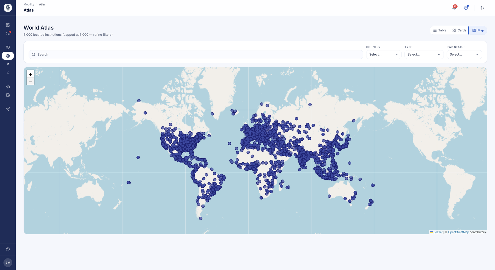
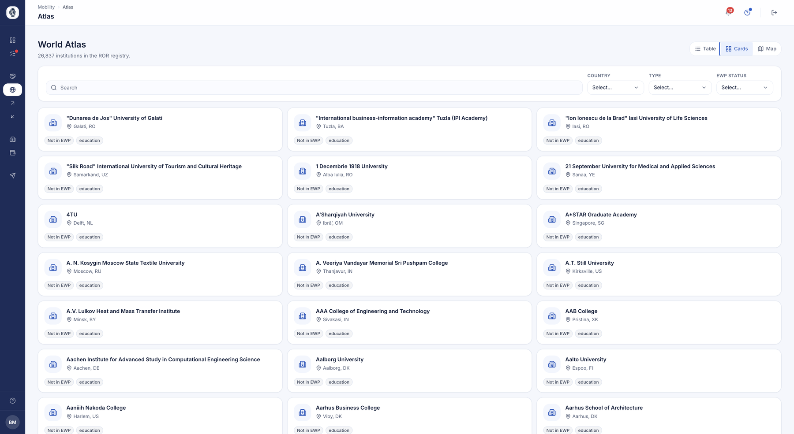

# Atlas — World directory

Atlas is a worldwide directory of higher-education institutions: a single place to
search for any institution, locate it on a world map, and immediately see whether it
is already a partner or reachable through the Erasmus/EWP network. "Who else is out
there?" becomes a map you explore, rather than a spreadsheet.

## World directory (table / cards / map)

**What it's for.** The Atlas brings together the higher-education institutions of the ROR
world registry in a searchable directory. You look up an institution, place it on a map,
and see whether it is already your partner and whether it is connected to the EWP network.

**Who it's for.** coordinator / IRO manager

**How it works.** **Mobility ▸ Atlas**, when the Atlas is turned on for your institution.
One page, three views: **Table**, **Cards** and the world map. The filters — search,
country, type, **EWP status** (synced, declared, not in EWP) — apply to the table and the
cards; the map follows the search, country and type, and loads the area on screen, up to
5,000 points.

In the table and cards, each institution carries its EWP status and, where relevant, the
**Partner** badge. The page is read-only: you look things up, you create nothing.

*The Atlas in map view: each point is an institution from the world registry. The Table and Cards views offer the same search.*

**Use case.**
> A coordinator searches "Antalya", filters on Turkey and switches to Cards: they see which
> universities are connected to EWP, and that one of them is already their partner.

*The same search in cards view: each institution with its country, type and EWP connection.*

## Live factsheet on demand

**What it's for.** Read an institution's EWP factsheet live — application calendar,
deadlines, contacts — without waiting for a synchronisation.

**Who it's for.** coordinator / IRO manager

**How it works.** An institution's record shows its identifiers (ROR, SCHAC), founding date
and links. In the **EWP factsheet** block, **Load** queries the partner over the network,
right now; **Reload** reads it again. It then shows: application dates (autumn / spring),
decision and transcript deadlines in weeks, housing, visa and insurance contacts, and links
to the course catalogue, the institution's site and the application site.

Nothing is kept: each opening queries the partner again. It requires your own institution
to have an EWP identifier.

**Use case.**
> Before nominating students, a coordinator opens a partner's record, clicks **Load** and
> confirms the spring application deadline.
