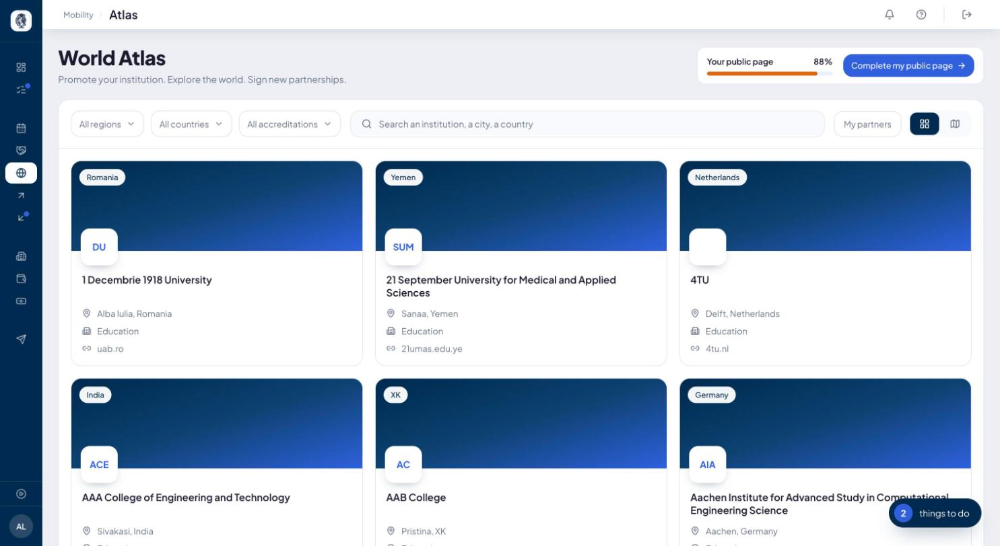
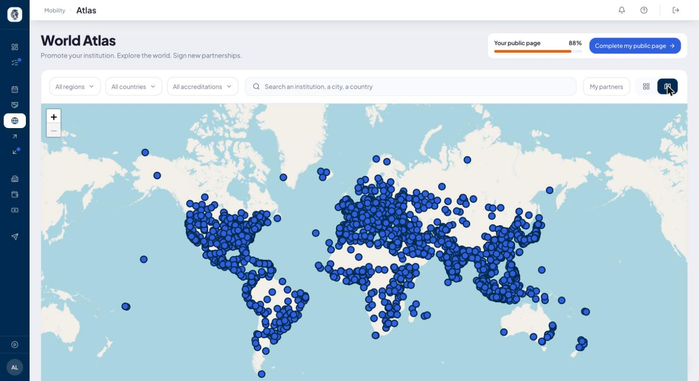
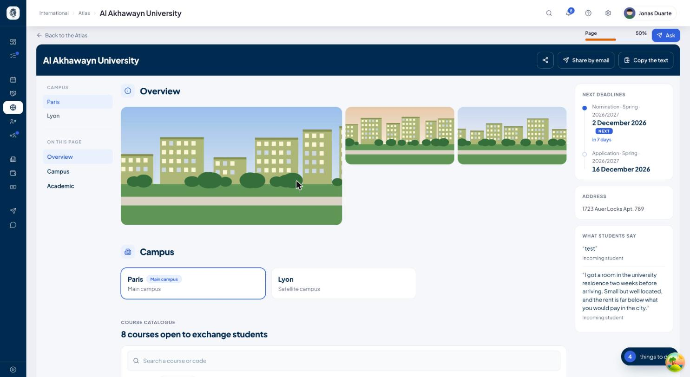

# Atlas — World directory

The Atlas gathers higher-education institutions from all over the world: one place to find
one, locate it on a map, see whether it is already your partner, and open its page. "Who else
is out there?" becomes a map you explore, rather than a spreadsheet.

## Finding an institution

**What it's for.** Finding an institution anywhere in the world, and spotting the ones worth
reaching out to.

**Who it's for.** coordinator / RI manager

**How it works.** **International ▸ Atlas**. Two views: **Cards** and **Map**.

A bar, stuck to the top of the page, holds the filters:

- **Region**, **country** and **accreditation**, each multi-select. Several accreditations
  ticked keep the institutions that hold **all** of them;
- a **search** on name, city or country;
- **My partners**, to keep only your partners.

Each card shows the institution's cover photo — the one from its public page when it has
published one —, its logo, name, country, and the **Partner** badge if it is already yours.
On the world map, hovering a point shows the same card, smaller.

*The Cards view: region, country and accreditation filters, the search, "My partners", and at the top right the gauge of your own public page.*

*The Atlas in map view: each point is an institution; hovering it shows its card.*

**Use case.**
> A coordinator looks for AACSB-accredited partners in Latin America: she ticks the region
> and the accreditation, and browses the cards.

## An institution's page

**What it's for.** Discovering an institution as it presents itself.

**How it works.** Clicking a card opens the institution's page:

- **if it has published its [public page](../etablissement/fiche-publique.md)**, that page
  shows, as it composed it;
- **otherwise**, the same layout fills with what public registries say — the world registry of
  institutions and Wikidata — with a banner saying where the information comes from, so it is
  not mistaken for the institution's own words.

Nothing you know about your partners appears here: the page only reads what the institution
publishes itself and the public registries. **Back to the Atlas** returns to your search.

*The page of a partner that published its own: its photos, campuses, catalogue, and on the right its next deadlines and student reviews.*

**Asking it to complete its page.** At the top of an institution's page, a **Page** gauge
shows where it stands, on four items: contact details, semester dates, language levels,
social links. While it is not full, **Ask** opens *Ask to complete the page*: you pick one of
your contacts there, or someone else, and **Send**. They receive an email in your name saying
what is missing, with a link to complete it — or to create their access if they have none.
Afterwards, the button says who asked and when; **Remind** appears after seven days. When
their page reaches 100%, a notification tells you.

If the institution was not in your list yet, it joins it, **inactive**: your students do not
see it until an agreement binds you.

**Your own page.** At the top of the Atlas, a gauge shows where **your** public page stands,
with a button leading to the composition screen. It counts your page's items — contact details, semester dates, language levels, social
links — and disappears once your page is complete and published. The list of
[what you still have to fill in](../etablissement/mon-etablissement.md#what-you-still-have-to-fill-in)
goes further: photos, catalogue, FAQ.

**Use case.**
> Before writing to a Brazilian university, a coordinator opens its page in the Atlas:
> photos, periods, language requirements — enough to prepare a first message.

