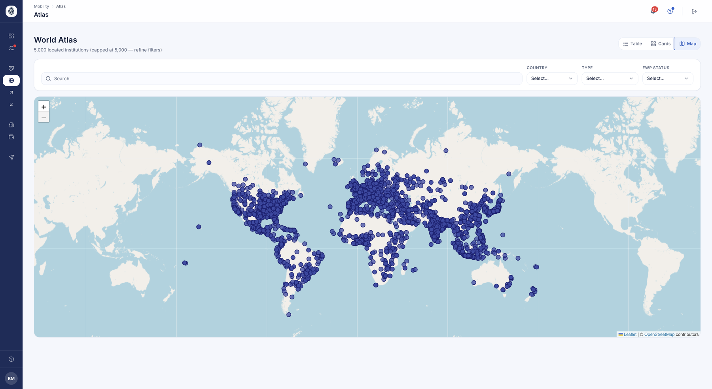
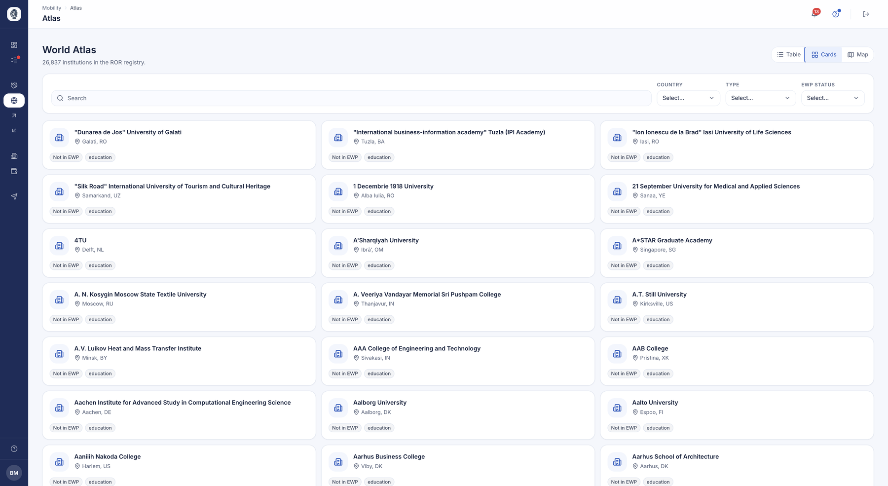

# Atlas — Annuaire mondial

Atlas est un annuaire mondial des établissements d'enseignement supérieur : un seul
endroit pour rechercher n'importe quel établissement, le situer sur une carte du
monde, et voir s'il est déjà partenaire ou joignable via le réseau Erasmus/EWP. « Qui d'autre existe ? » devient une carte que l'on explore, plutôt
qu'un tableur.

## Annuaire mondial (tableau / cartes / carte)

**À quoi ça sert.** L'Atlas rassemble les établissements d'enseignement supérieur du
registre mondial ROR dans un annuaire consultable. Vous y cherchez un établissement, le
situez sur une carte, et voyez s'il est déjà votre partenaire et s'il est raccordé au
réseau EWP.

**Pour qui.** coordinateur / gestionnaire RI

**Comment ça marche.** **Mobility ▸ Atlas**, quand l'Atlas est activé pour votre
établissement. Une page, trois vues : **Table**, **Cards** et la carte du monde. Les filtres
— recherche, pays, type, **EWP status** (synchronisé, déclaré, absent d'EWP) — s'appliquent
au tableau et aux cartes ; la carte suit la recherche, le pays et le type, et charge la zone
affichée, jusqu'à 5 000 points.

Dans le tableau et les cartes, chaque établissement porte son statut EWP et, s'il y a lieu,
le badge **Partner**. La page est en lecture seule : on y consulte, on n'y crée rien.

*L'Atlas en vue carte : chaque point est un établissement du registre mondial. Les vues Tableau et Cartes offrent la même recherche.*

**Cas d'usage.**
> Un coordinateur cherche « Antalya », filtre sur la Turquie et passe en vue Cards : il voit
> quelles universités sont raccordées à EWP, et que l'une d'elles est déjà son partenaire.

*La même recherche en vue cartes : chaque établissement avec son pays, son type et son raccordement au réseau EWP.*

## Factsheet en direct à la demande

**À quoi ça sert.** Lire la factsheet EWP d'un établissement en direct — calendrier de
candidature, délais, contacts — sans attendre une synchronisation.

**Pour qui.** coordinateur / gestionnaire RI

**Comment ça marche.** La fiche d'un établissement affiche ses identifiants (ROR, SCHAC),
sa date de fondation et ses liens. Dans le bloc **EWP factsheet**, **Load** interroge le
partenaire sur le réseau, à l'instant ; **Reload** relance la lecture. S'affichent alors :
les dates de candidature (automne / printemps), les délais de décision et de relevé de
notes en semaines, les contacts logement, visa et assurance, et les liens vers le catalogue
de cours, le site de l'établissement et le site de candidature.

La lecture ne garde rien : chaque ouverture interroge de nouveau le partenaire. Elle
suppose que votre établissement dispose lui-même d'un identifiant EWP.

**Cas d'usage.**
> Avant de nominer ses étudiants, un coordinateur ouvre la fiche d'un partenaire, clique sur
> **Load** et confirme la date limite de candidature du printemps.
