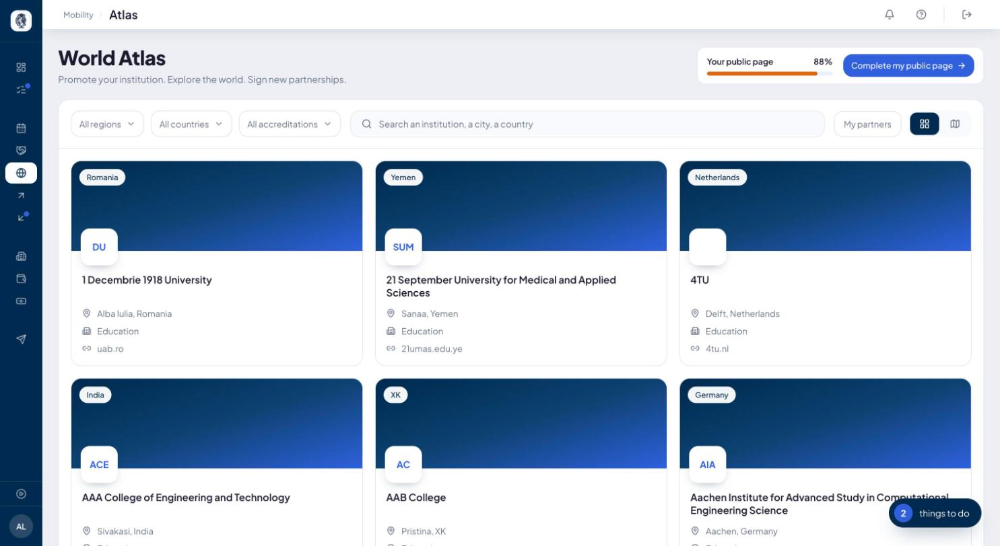
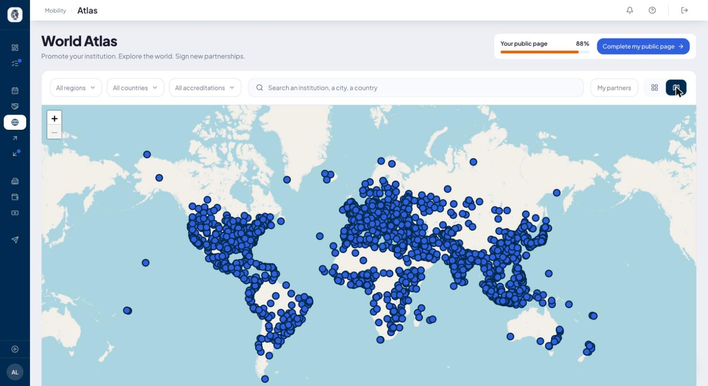
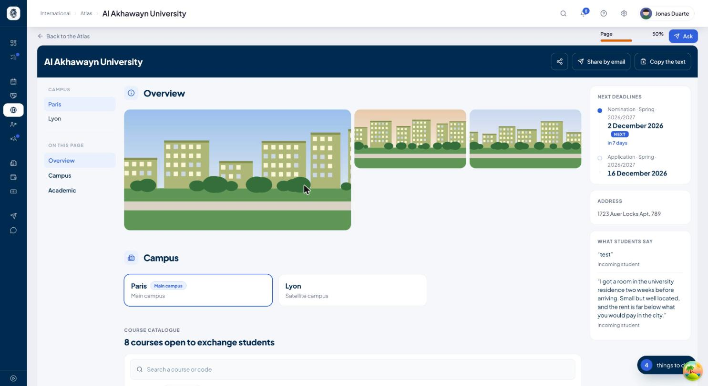

# Atlas — Annuaire mondial

L'Atlas rassemble les établissements d'enseignement supérieur du monde entier : un seul
endroit pour en trouver un, le situer sur une carte, voir s'il est déjà votre partenaire, et
ouvrir sa page. « Qui d'autre existe ? » devient une carte que l'on explore, plutôt qu'un
tableur.

## Trouver un établissement

**À quoi ça sert.** Chercher un établissement n'importe où dans le monde, et repérer ceux qui
valent une prise de contact.

**Pour qui.** coordinateur / gestionnaire RI

**Comment ça marche.** **International ▸ Atlas**. Deux vues : **Cards** et **Map**.

Une barre, collée en haut de la page, porte les filtres :

- **Région**, **pays** et **accréditation**, chacun en sélection multiple. Plusieurs
  accréditations cochées gardent les établissements qui les ont **toutes** ;
- une **recherche** sur le nom, la ville ou le pays ;
- **My partners**, pour ne garder que vos partenaires.

Chaque carte montre la photo de couverture de l'établissement — celle de sa page publique
quand il en a publié une —, son logo, son nom, son pays, et le badge **Partner** s'il est
déjà le vôtre. Sur la carte du monde, survoler un point affiche la même carte en réduit.

*La vue Cards : les filtres région, pays et accréditation, la recherche, « My partners », et en haut à droite la jauge de votre propre page publique.*

*L'Atlas en vue carte : chaque point est un établissement ; le survoler montre sa carte.*

**Cas d'usage.**
> Une coordinatrice cherche des partenaires en Amérique latine accrédités AACSB : elle coche
> la région et l'accréditation, et parcourt les cartes.

## La page d'un établissement

**À quoi ça sert.** Découvrir un établissement comme il se présente lui-même.

**Comment ça marche.** Un clic sur une carte ouvre la page de l'établissement :

- **s'il a publié sa [page publique](../etablissement/fiche-publique.md)**, c'est elle qui
  s'affiche, telle qu'il l'a composée ;
- **sinon**, la même mise en page se remplit de ce que disent les registres publics — le
  registre mondial des établissements et Wikidata — avec un bandeau qui dit d'où vient
  l'information, pour qu'on ne la prenne pas pour la parole de l'établissement.

Rien de ce que vous savez de vos partenaires n'apparaît ici : la page ne lit que ce que
l'établissement publie lui-même et les registres publics. **Back to the Atlas** ramène à
votre recherche.

*La page d'un partenaire qui a publié la sienne : ses photos, ses campus, son catalogue, et à droite ses prochaines échéances et les avis d'étudiants.*

**Lui demander de compléter sa page.** En haut de la page d'un établissement, une jauge
**Page** dit où il en est, sur quatre éléments : coordonnées, dates de semestre, niveaux de
langue, réseaux sociaux. Tant qu'elle n'est pas pleine, **Ask** ouvre *Ask to complete the
page* : vous choisissez l'un de vos contacts chez lui, ou quelqu'un d'autre, et **Send**. Il
reçoit un e-mail à votre nom qui dit ce qui manque, avec un lien pour compléter — ou pour
créer son accès s'il n'en a pas. Ensuite, le bouton dit qui a demandé et quand ; **Remind**
apparaît au bout de sept jours. Quand sa page atteint 100 %, une notification vous prévient.

Si l'établissement n'était pas encore dans votre liste, il y entre, **inactif** : vos
étudiants ne le voient pas tant qu'aucun accord ne vous lie.

**Votre propre page.** En tête de l'Atlas, une jauge dit où en est **votre** page
publique, avec un bouton qui mène à l'écran de composition. Elle compte les éléments de votre page — coordonnées, dates de semestre, niveaux de
langue, réseaux sociaux — et disparaît quand votre page est complète et publiée. La liste
[de ce qu'il vous reste à remplir](../etablissement/mon-etablissement.md#ce-quil-vous-reste-a-remplir)
va plus loin : photos, catalogue, FAQ.

**Cas d'usage.**
> Avant d'écrire à une université brésilienne, un coordinateur ouvre sa page dans l'Atlas :
> photos, périodes, exigences de langue — de quoi préparer son premier message.

