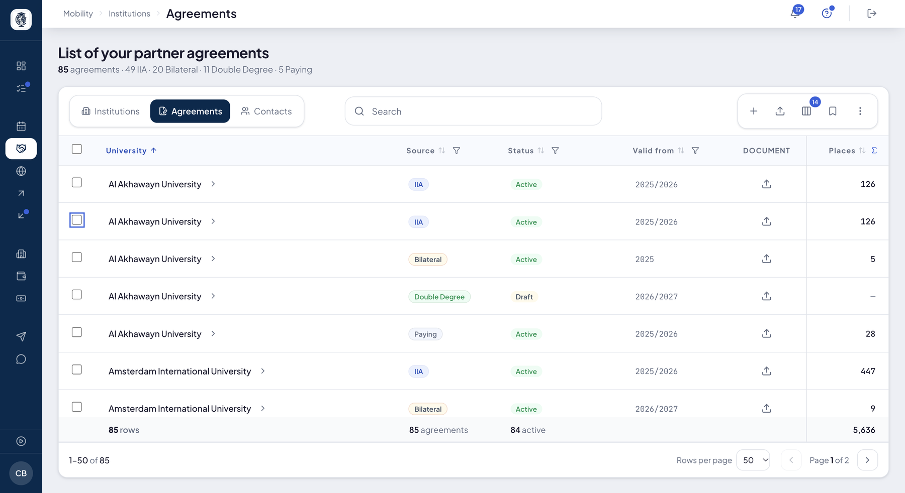
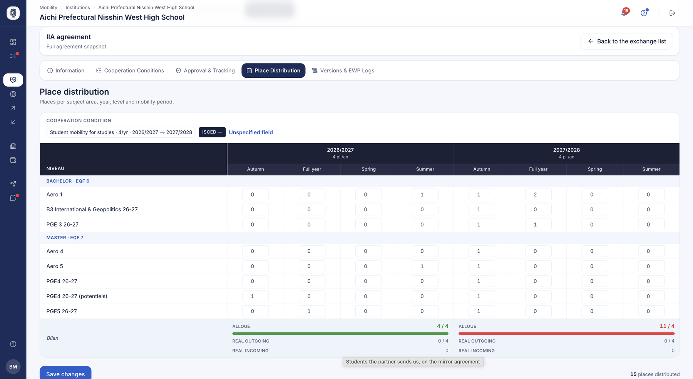

# Agreements & place distribution

**Mobility ▸ Institutions ▸ Agreements**: everything your institution can offer its students,
in four families of agreement — **IIA** (Erasmus+), **Bilateral**, **Double Degree** and
**Paying** (paying mobility). Each agreement carries its places, distributed by year, level,
period and field: they are what your students see and request.

## Your agreement list

**What it's for.** All your agreements, across partners, in one table.

**Who it's for.** RI manager / coordinator

**How it works.** Under the title, the count: how many agreements, and how many per family. One
row per agreement: partner, family (**Source**), status, start of validity, signed document, and
**Places** — the row's total places, pinned on the right, summed at the bottom of the table.
About twenty more columns show on demand: end of validity, signed or not, country, region,
level, required language, accepted tests, student / teaching / staff places, and the four
dimensions of the distribution — specialisation, level label, period, year. Every column sorts
and filters, and the table's footer counts what you see.

- **Opening a row** unfolds the agreement's cooperation conditions, with a link to the
  agreement itself.
- The **Document** column uploads the signed agreement.
- A distribution value — a period, a level label — leads to that agreement's place
  distribution.

*Your 85 agreements, with the count per family under the title and the total places at the bottom.*

**Acting on several agreements.** Tick rows: **Change status** deactivates them — they stop
offering places and leave the students' search, nothing is deleted — or reactivates them.
**Delete** sends them to the trash, with their files and conditions; an agreement whose places
are still distributed is refused, and the screen says which. The trash opens from the "…" menu.

An **IIA** cannot be changed from here: it is negotiated in the EWP network. Nor can an
agreement your partner wrote: only they can change it. The screen tells you before you confirm.

**Use case.**
> At the end of the year, the office filters the end of validity on 2026, ticks the bilateral
> agreements that will not be renewed and deactivates them in one go.

## Creating an agreement

**How it works.** The toolbar's **+** first asks which partner, then which family — **IIA**,
**Bilateral**, **Double Degree** or **Paying mobility** — and opens the matching form. The same
button sits on a partner's file, which already knows the institution.

## Erasmus+ agreements (IIA)

**What it's for.** The Erasmus+ inter-institutional agreement, exchanged with your partner
through the [EWP](../ewp/ewp.md) network.

**Who it's for.** RI manager / coordinator

**How it works.** An IIA is created or imported, then carries one or more mobility blocks —
studies, traineeship, staff — each with its expected languages, fields, prerequisites and
quota of places. Its screens show its conditions, its approval state at both institutions,
the history of its exchanges with the network, and its places.

**Use case.**
> The office records an Erasmus+ exchange with TU Munich: 3 Master's places in engineering,
> English B2 required, exchanged with the partner through EWP.

## Place distribution (allocation matrix)

**What it's for.** Rather than a single overall number, the institution spreads its
negotiated places across a precise grid: academic year, academic level, mobility period
and subject area (ISCED). This distribution feeds the places table shown to students and
enforces each agreement's annual cap.

**Who it's for.** IRO manager / coordinator

**How it works.** On an exchange's place-distribution page, the coordinator fills in a
matrix (year × field × level × period). The system checks each mobility block's annual
cap before saving, updates the affected cells and groups levels by EQF framework so
related programmes stay together. The result is immediately visible to students.

*The allocation grid: academic years split by period across the columns, your study levels grouped by European framework down the rows. The summary at the bottom flags an overrun of the negotiated annual cap in red.*

**Use case.**
> A partner grants 4 places: the office assigns 2 to Master / Semester 1 and 2 to
> Master / Semester 2 for 2026/2027; the student sees exactly that breakdown on the
> partner's page.

### Staff places are not distributed

**Why.** The matrix is a **study level × period** grid. A teacher belongs to no
intake: no cell can hold them. The grid was therefore filled in by default, for want
of saying it served no purpose.

**How it works.** An agreement carrying **only** staff mobility no longer shows a
matrix, and the screen explains why. An agreement with no conditions at all keeps
its own: the boundary is "there are conditions, but none for students".

**The negotiated envelope stays readable.** It is genuine agreement data, negotiated
per audience, and the **Agreements** and **Institutions** grids now show it in
**three columns** where a single one used to add them up:

| Column | What it counts |
|---|---|
| **students** | studies and traineeship together — one audience from the coordinator's point of view |
| **teachers** | teaching mobility |
| **staff** | staff training |

A dash, not a zero, when there is no agreement for that audience: a zero would read
as an envelope negotiated down to zero.

!!! warning "Two neighbouring figures, two meanings"
    These three columns say what was **signed**. The **Places / year** column next to
    them counts what was **distributed** in the matrices. An agreement could show 28
    places, 24 of them staff training, with nothing saying so.

### A place carries the location it is meant for

**How it works.** A place belongs to its agreement and names **the location** where the
student is expected. When a partner has several
[cities](partenaires.md#a-partners-cities), those cities' matrices **stack up in the
same page**, each announcing what it already carries — the institution itself counts
among the locations, labelled **Main**.

Three campuses therefore do not add three agreements, and a terminated agreement stops
distributing its places, whatever its family.

## Bilateral agreements

**What it's for.** Manages non-Erasmus partnerships built on a genuine negotiation
between two institutions, with their own place distribution. Covers cooperation outside the EWP/Erasmus network.

**Who it's for.** IRO manager / partner

**How it works.** You draft the agreement, then you **publish** it: it is active at once.
It does not wait for the partner's approval — an agreement stuck because the other side does
not sign in would be an agreement that does not exist. A place-distribution matrix is filled
in for student mobilities. An import with preview is available.

An agreement is **deactivated** when it should no longer be used, and can be reactivated: it
is reversible.

**Use case.**
> A French school signs a bilateral exchange with a Brazilian partner outside Erasmus;
> the French side publishes it, then distributes 2 Master
> places in Semester 1.

## Double degrees

**What it's for.** Manages double-degree partnerships, where a student earns a degree at
both institutions over several years: yearly phases, joint curriculum, graduation
conditions and common jury. A different framework from a simple exchange.

**Who it's for.** IRO manager / partner

**How it works.** Like a bilateral agreement, it is **active as soon as it is published**,
with an invitation sent to the partner signatory.
The agreement carries curriculum, graduation, jury, EQF level and duration information,
plus yearly phases (Year 1 / Year 2). Places are distributed via a dedicated matrix. An
import with preview is available.

**Use case.**
> A Master double degree with Georgia Tech over 2 years: the student goes abroad in year
> 2; the office tracks each phase and distributes the yearly places.

## Paying mobility (study abroad)

**What it's for.** Manages fee-based "study abroad" placements, where the student pays
tuition to the host institution and the home institution owns the agreement end to end.
Distinguishes fee-generating mobility from free Erasmus exchange.

**Who it's for.** IRO manager (creation) · student (viewing the price)

**How it works.** The coordinator drafts then publishes the agreement (a single owner,
with no two-sided negotiation phase): fee amount, currency, subtype (individual placement
or high volume), duration and mobility type. They then distribute places via the
distribution matrix. When an institution offers paying mobility, these offers are visible
to students (in "Find Exchange") with their indicative price, so the student knows the cost
before applying. An import with preview is available.

**Use case.**
> A partner in the US where the student pays $12,000 in tuition: the office records it as
> a "study abroad" paying agreement and publishes 5 places for the year.

## Proof of an agreement's conditions

**What it's for.** Keep, on the agreement itself, the documents evidencing its
conditions: the signed convention, an amendment, an exchange of letters, a fee
schedule.

**Who it's for.** RI manager / coordinator

**How it works.** Each agreement — bilateral, double degree or paying mobility —
has an upload area on its conditions screen. Documents stay attached to the
agreement, separate from student files, and remain readable even once the
agreement expires.

**Use case.**
> The coordinator uploads the signed convention to the double-degree agreement;
> two years later their successor finds it without digging through the office
> archives.

## Agreement CSV imports

**What it's for.** Load agreements in bulk from a spreadsheet rather than one by one, with a
preview before anything is written.

**Who it's for.** RI manager

**How it works.** **Settings ▸ Integrations** offers one import per family: IIA, bilateral,
double degree and paying mobility, each with its file template. The file is checked row by row
in a preview, where each row can be fixed, before the validation that saves it all.

**Use case.**
> An office loads 80 bilateral agreements from an old spreadsheet, fixes 3 rows flagged in the
> preview, then validates.

## Agreement update review (IIA)

**What it does.** When a partner institution pushes changes to an inter-institutional
agreement (IIA) over the EWP network, this review shows a field-by-field comparison and
lets you selectively accept or reject the changes before they touch local data.

**Who it's for.** RI manager / coordinator

**How it works.** The coordinator opens the pending update and sees the comparison
between their version and the partner's. They tick the fields to accept and apply — a
count of applied/skipped fields is shown — or reject the update, in which case their data
stays unchanged.

**Use case.**
> The partner changes the agreement's ECTS and languages; the coordinator accepts the
> language change but rejects the ECTS one — only the accepted field is written locally.
