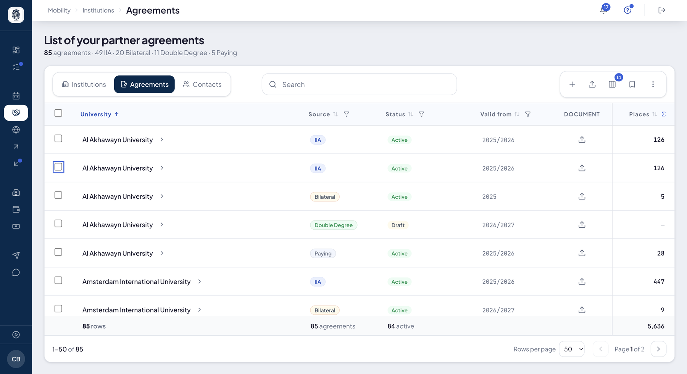
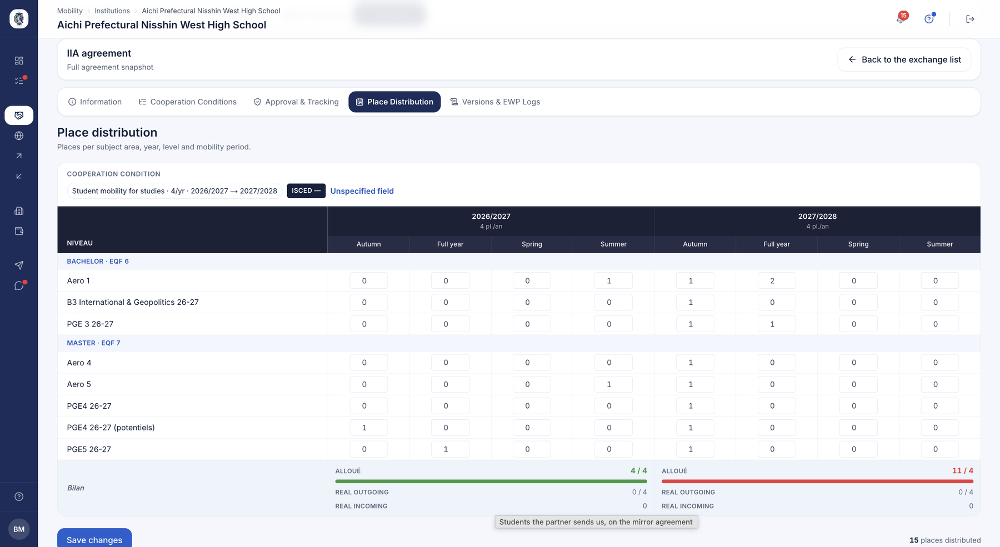

# Accords & distribution des places

**Mobility ▸ Institutions ▸ Agreements** : tout ce que votre établissement peut proposer à ses
étudiants, en quatre familles d'accords — **IIA** (Erasmus+), **Bilateral**, **Double Degree**
et **Paying** (mobilité payante). Chaque accord porte ses places, réparties par année, niveau,
période et domaine : ce sont elles que vos étudiants voient et demandent.

## La liste de vos accords

**À quoi ça sert.** Tous vos accords, tous partenaires confondus, dans un seul tableau.

**Pour qui.** gestionnaire RI / coordinateur

**Comment ça marche.** Sous le titre, le compte : combien d'accords, et combien par famille.
Une ligne par accord : partenaire, famille (**Source**), statut, début de validité, document
signé, et **Places** — la somme des places de la ligne, épinglée à droite, totalisée en bas
du tableau. Une vingtaine de colonnes s'ajoutent à la demande : fin de validité, signé ou non,
pays, région, niveau, langue exigée, tests acceptés, places étudiants / enseignants /
personnel, et les quatre dimensions de la répartition — spécialité, libellé de niveau, période,
année. Chaque colonne se trie et se filtre, et le bas du tableau compte ce que vous voyez.

- **Ouvrir une ligne** déroule les conditions de coopération de l'accord, avec un lien vers
  l'accord lui-même.
- La colonne **Document** dépose la convention signée.
- Une valeur de répartition — une période, un libellé de niveau — mène à la répartition des
  places de cet accord.

*Vos 85 accords, avec le compte par famille sous le titre et le total des places en bas.*

**Agir sur plusieurs accords.** Cochez des lignes : **Change status** les désactive — ils
n'offrent plus de places et quittent la recherche des étudiants, rien n'est supprimé — ou les
réactive. **Delete** les envoie à la corbeille, avec leurs fichiers et leurs conditions ; un
accord dont les places sont encore réparties est refusé, et l'écran dit lequel. La corbeille
s'ouvre depuis le menu « … ».

Un **IIA** ne se modifie pas d'ici : il se négocie dans le réseau EWP. Un accord rédigé par
votre partenaire non plus : lui seul peut le changer. L'écran vous le dit avant de confirmer.

**Cas d'usage.**
> En fin d'année, le bureau filtre la fin de validité sur 2026, coche les accords bilatéraux
> qui ne seront pas renouvelés et les désactive en une fois.

## Créer un accord

**Comment ça marche.** Le **+** de la barre d'outils demande d'abord avec quel partenaire, puis
la famille d'accord — **IIA**, **Bilateral**, **Double Degree** ou **Paying mobility** — et
ouvre le formulaire qui lui correspond. Le même bouton existe sur la fiche d'un partenaire,
qui connaît déjà l'établissement.

## Accords Erasmus+ (IIA)

**À quoi ça sert.** L'accord inter-institutionnel Erasmus+, échangé avec votre partenaire par
le réseau [EWP](../ewp/ewp.md).

**Pour qui.** gestionnaire RI / coordinateur

**Comment ça marche.** Un IIA se crée ou s'importe, puis porte un ou plusieurs blocs de
mobilité — études, stage, personnel — chacun avec ses langues attendues, ses domaines, ses
prérequis et son contingent de places. Ses écrans montrent ses conditions, son état
d'approbation chez les deux établissements, l'historique de ses échanges avec le réseau, et
ses places.

**Cas d'usage.**
> Le bureau enregistre un échange Erasmus+ avec TU Munich : 3 places de Master en ingénierie,
> anglais B2 exigé, échangé avec le partenaire par EWP.

## Distribution des places (matrice de répartition)

**À quoi ça sert.** Plutôt qu'un chiffre global, l'établissement répartit les places
négociées sur une grille précise : année universitaire, niveau d'études, période de
mobilité et domaine (ISCED). C'est cette répartition qui alimente le tableau des
places affiché à l'étudiant et qui garantit le respect du plafond annuel de chaque
accord.

**Pour qui.** gestionnaire RI / coordinateur

**Comment ça marche.** Sur la page de distribution des places d'un échange, le
coordinateur remplit une matrice (année × domaine × niveau × période). Le système
contrôle le plafond annuel de chaque bloc de mobilité avant d'enregistrer, met à jour
les cellules concernées et regroupe les niveaux par cadre EQF pour que les programmes
apparentés restent ensemble. Le résultat est immédiatement visible côté étudiant.

*La grille de répartition : en colonnes les années découpées par période, en lignes vos niveaux d'études groupés par cadre européen. Le bilan du bas signale en rouge un dépassement du plafond annuel négocié.*

**Cas d'usage.**
> Un partenaire accorde 4 places : le bureau en affecte 2 en Master / Semestre 1 et
> 2 en Master / Semestre 2 pour 2026/2027 ; l'étudiant voit exactement cette
> répartition sur la fiche du partenaire.

### Les places du personnel ne se répartissent pas

**Pourquoi.** La matrice est une grille **niveau d'études × période**. Un enseignant
n'appartient à aucune promotion : aucune case ne peut l'accueillir. La grille était
donc remplie par défaut, faute de dire qu'elle ne servait à rien.

**Comment ça marche.** Un accord qui ne porte **que** de la mobilité de personnel
n'affiche plus de matrice, et l'écran l'explique. Un accord sans aucune condition
garde la sienne : la borne est « il y a des conditions, mais aucune pour les
étudiants ».

**L'enveloppe négociée reste lisible.** Elle est une vraie donnée d'accord, négociée
par public, et les grilles **Agreements** et **Institutions** la montrent désormais en
**trois colonnes** là où une seule les additionnait :

| Colonne | Ce qu'elle compte |
|---|---|
| **étudiants** | études et stage réunis — un seul public du point de vue du coordinateur |
| **enseignants** | mobilité d'enseignement |
| **personnel** | formation du personnel |

Un tiret, et non un zéro, quand il n'y a pas d'accord pour ce public : un zéro se
lirait comme une enveloppe négociée à zéro.

!!! warning "Deux chiffres voisins, deux sens"
    Ces trois colonnes disent ce qui a été **signé**. La colonne **Places / year**, juste
    à côté, compte ce qui a été **réparti** dans les matrices. Un accord pouvait afficher
    28 places dont 24 de formation du personnel sans que rien ne le dise.

### Une place porte le lieu auquel elle est destinée

**Comment ça marche.** Une place appartient à son accord et désigne **le lieu** où
l'étudiant est attendu. Quand un partenaire a plusieurs
[villes](partenaires.md#les-villes-dun-partenaire), les matrices de ces villes
**s'empilent dans la même page**, chacune annonçant ce qu'elle porte déjà —
l'établissement lui-même compte parmi les lieux, étiqueté **Main**.

Trois campus n'ajoutent donc pas trois accords, et un accord résilié cesse de
distribuer ses places, quelle que soit sa famille.

## Accords bilatéraux

**À quoi ça sert.** Gère les partenariats hors Erasmus reposant sur une véritable
négociation entre deux établissements, avec leur propre distribution des places. Couvre les coopérations
en dehors du réseau EWP/Erasmus.

**Pour qui.** gestionnaire RI / partenaire

**Comment ça marche.** Vous rédigez l'accord, puis vous le **publiez** : il est actif
aussitôt. Il n'attend pas l'approbation du partenaire — un accord bloqué parce que l'autre
côté ne se connecte pas serait un accord qui n'existe pas. Une matrice de distribution des
places est renseignée pour les mobilités étudiantes. Un import avec aperçu est disponible.

Un accord se **désactive** quand il ne doit plus servir, et se réactive : c'est réversible.

**Cas d'usage.**
> Une école française signe un échange bilatéral avec un partenaire brésilien hors
> Erasmus ; le côté français le publie, puis répartit 2 places de Master en Semestre 1.

## Doubles diplômes

**À quoi ça sert.** Gère les partenariats de double diplôme, où l'étudiant obtient un
diplôme dans les deux établissements sur plusieurs années : phases annuelles, cursus
commun, conditions de diplomation et jury commun. Un cadre différent d'un simple
échange.

**Pour qui.** gestionnaire RI / partenaire

**Comment ça marche.** Comme un accord bilatéral, il est **actif dès sa publication**,
avec une invitation adressée au signataire partenaire. L'accord porte les informations de cursus, de diplomation, de jury, de
niveau EQF et de durée, ainsi que des phases annuelles (Année 1 / Année 2). Les places
sont réparties via une matrice dédiée. Un import avec aperçu est disponible.

**Cas d'usage.**
> Un double diplôme de Master avec Georgia Tech sur 2 ans : l'étudiant part en 2ᵉ année ;
> le bureau suit chaque phase et distribue les places annuelles.

## Mobilité payante (study abroad)

**À quoi ça sert.** Gère les placements payants de type « study abroad », où l'étudiant
règle des frais de scolarité à l'établissement d'accueil et où l'établissement d'origine
maîtrise l'accord de bout en bout. Distingue la mobilité génératrice de frais de
l'échange Erasmus gratuit.

**Pour qui.** gestionnaire RI (création) · étudiant (consultation du prix)

**Comment ça marche.** Le coordinateur rédige puis publie l'accord (un seul propriétaire,
sans phase de négociation à deux) : montant des frais, devise, sous-type (placement
individuel ou gros flux), durée et type de mobilité. Il répartit ensuite les places via
la matrice de distribution. Lorsqu'un établissement propose de la mobilité payante, ces
offres sont visibles côté étudiant (dans « Find Exchange ») avec leur prix indicatif, pour
que l'étudiant connaisse le coût avant de candidater. Un import avec aperçu est disponible.

**Cas d'usage.**
> Un partenaire aux États-Unis où l'étudiant paie 12 000 $ de frais : le bureau
> l'enregistre comme accord payant « study abroad » et publie 5 places pour l'année.

## Justificatifs des conditions d'un accord

**À quoi ça sert.** Conserver, au niveau de l'accord lui-même, les pièces qui en
attestent les conditions : la convention signée, un avenant, un échange de
courriers, un barème de frais.

**Pour qui.** gestionnaire RI / coordinateur

**Comment ça marche.** Chaque accord — bilatéral, double diplôme ou mobilité
payante — dispose d'un espace de dépôt sur son écran de conditions. Les documents
y restent attachés à l'accord, indépendamment des dossiers étudiants, et restent
consultables même lorsque l'accord arrive à échéance.

**Cas d'usage.**
> Le coordinateur dépose la convention signée sur l'accord de double diplôme ;
> deux ans plus tard, son successeur retrouve la pièce sans avoir à fouiller dans
> les archives du service.

## Imports CSV des accords

**À quoi ça sert.** Charger des accords en masse depuis un tableur plutôt qu'un par un, avec un
aperçu avant écriture.

**Pour qui.** gestionnaire RI

**Comment ça marche.** **Paramètres ▸ Integrations** propose un import par famille : IIA,
bilatéral, double diplôme et mobilité payante, chacun avec son modèle de fichier. Le fichier
est contrôlé ligne par ligne dans un aperçu, où chaque ligne se corrige, avant la validation
qui enregistre l'ensemble.

**Cas d'usage.**
> Un bureau charge 80 accords bilatéraux depuis un ancien tableur, corrige 3 lignes signalées
> dans l'aperçu, puis valide.

## Revue des mises à jour d'accord (IIA)

**À quoi ça sert.** Lorsqu'un établissement partenaire pousse des modifications sur un
accord inter-établissements (IIA) via le réseau EWP, cette revue affiche un comparatif
champ par champ et permet d'accepter ou de rejeter sélectivement les changements avant
qu'ils ne modifient les données locales.

**Pour qui.** gestionnaire RI / coordinateur

**Comment ça marche.** Le coordinateur ouvre la mise à jour en attente et voit le
comparatif entre sa version et celle du partenaire. Il coche les champs à accepter et
applique — un décompte des champs appliqués/ignorés est affiché — ou rejette la mise à
jour, auquel cas ses données restent inchangées.

**Cas d'usage.**
> Le partenaire modifie les ECTS et les langues de l'accord ; le coordinateur accepte le
> changement de langue mais rejette celui des ECTS — seul le champ accepté est écrit
> localement.
