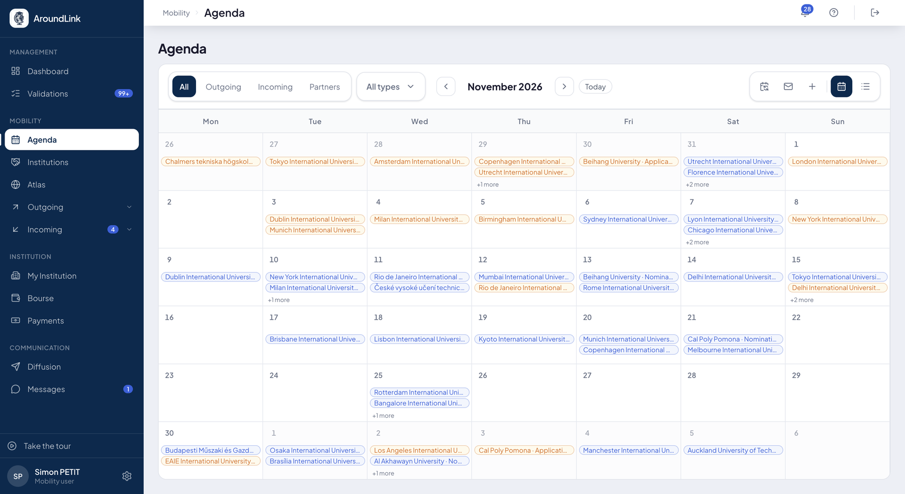
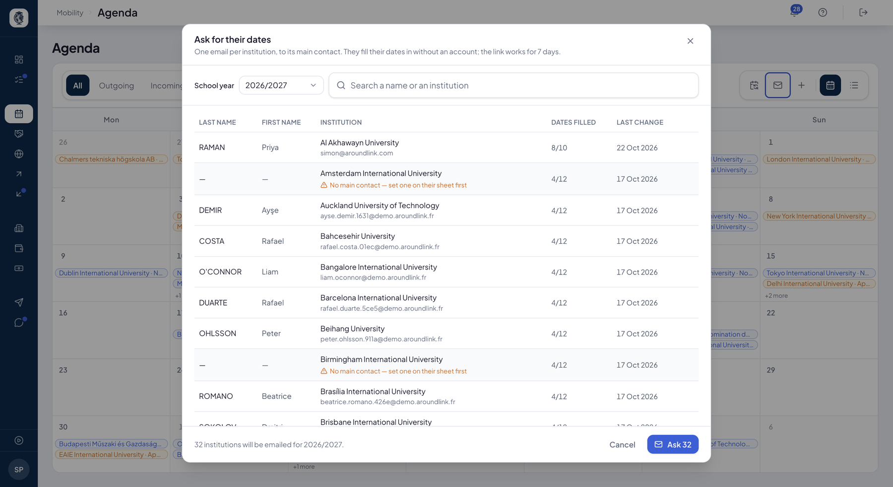

# Kalender

Der Kalender bringt **alle Termine Ihrer Hochschule an einen Ort**: Semester, Kampagnen,
Fristen Ihrer Partner, Onboarding-Schritte, Nominierungen und Veranstaltungen.

Bisher lagen diese Termine auf fünf verschiedenen Seiten, und niemand konnte einfach
beantworten: „Was steht nächsten Monat an?"

## Was Sie dort finden

**Wofür es da ist.** Kommendes sehen. Eine Nominierungsfrist, der Abschluss einer Kampagne und
der Semesterbeginn eines Partners sind nicht dasselbe, fallen aber in denselben Monat — und
genau das zählt, wenn man seine Arbeit plant.

**Für wen.** das gesamte Mobilitätsteam

**Wie es funktioniert.** Der Kalender **erfindet keinen Termin und ändert keinen**: er führt
zusammen, was anderswo bereits besteht. Jeder Eintrag verweist auf das Objekt, aus dem er
stammt, und dort wird der Termin geändert — sonst würden zwei Fassungen derselben Frist
einander widersprechen.

Der Kalender **öffnet sich in der Monatsraster-Ansicht**. In die **Listenansicht** wechseln
Sie, wenn Sie alles hintereinander lesen möchten, und Sie filtern nach:

- **der Familie** — Semester, Kampagnen, Partner, Nominierung, Onboarding, Anwendung,
  Sonstiges;
- **der Richtung** — ausgehend oder eingehend;
- **nur Ihrem Team**, um auszublenden, was Sie nicht betrifft.

Die Filter wirken zusammen, und die Filterleiste bleibt im Blick, während die Liste scrollt.

Sie können auch **einen Termin von Hand hinzufügen**, für das, was nirgends sonst besteht:
eine Kommissionssitzung, eine interne Frist.

**Auf Studierendenseite ist der Kalender der Zeitstrahl der Mobilität.** Die Termine der
Kampagne und die des [Verlaufs](parcours.md) treffen dort zusammen, geordnet in
**überfällig**, **bevorstehend** und **vergangen**. Der heutige Tag zählt nicht als
vergangen, und ein Kampagnentermin erscheint auch dann, wenn die Studentin oder der Student
keinen Wunsch eingereicht hat.

*Der laufende Monat, jeder Termin in der Farbe seiner Familie. Oben die Filter, die zusammenwirken, und die Schaltfläche zum Abonnieren in Ihrem Kalender.*

## Die Termine Ihrer Partner einsammeln

**Wozu es dient.** Sie können den Kalender von sechzig Hochschulen nicht aktuell halten.
Diese schon — jede ihren eigenen. Der Kalender erlaubt Ihnen, danach zu fragen.

**Für wen.** IO-Verantwortliche / Koordination

**Wie es funktioniert.** Sie fragen **einen Partner** nach seinen Fristen, oder **alle auf
einmal**. Er erhält einen Link, der **kein Konto** verlangt: er trägt seine Termine ein,
und diese erscheinen in Ihrem Kalender, ihm zugeordnet. Das Formular trägt **Ihr Logo**,
damit er weiß, wer fragt.

Sechs Terminarten werden so eingesammelt:

| Wonach Sie fragen | Für welchen Beginn |
|---|---|
| Nominierungsfrist | Herbst |
| Nominierungsfrist | Frühjahr |
| Bewerbungsfrist | Herbst |
| Bewerbungsfrist | Frühjahr |
| Beginn des Zeitraums | der betreffende Zeitraum |
| Ende des Zeitraums | der betreffende Zeitraum |

Sie haken an, wonach Sie fragen möchten: sechs Termine zu verlangen lohnt nicht, wenn Ihnen
zwei genügen.

!!! note "Angegeben oder erschlossen"
    Ein Semestertermin hängt an einem **Beginn**. Der Kalender sagt Ihnen, ob dieser Beginn
    vom Partner **angegeben** oder aus dem Termin selbst **erschlossen** wurde. Der
    Unterschied zählt, wenn Sie darauf eine Kampagne aufbauen.

!!! tip "Ihr Partner trägt nur einmal ein"
    Eine Antwort wird **veröffentlicht**, nicht nur an Sie gerichtet: die Hochschule spricht
    über ihren eigenen Kalender, und ihr Termin erreicht **alle ihre Partner**. Zeiträume
    werden beim Lesen zusammengeführt, über ihre europäischen Kenndaten — Wien antwortet
    einmal, und jede Schule mit einem Herbst sieht es.

*Eine E-Mail pro Hochschule, an ihren Hauptkontakt. Die Spalte „Dates filled" sagt, wie weit jede ist, und der orange Hinweis nennt diejenigen ohne Hauptkontakt — sie erhalten nichts.*

**Anwendungsfall.**
> Im April fragt die Koordinatorin ihre 62 Partner nach den Nominierungsfristen für beide
> Starttermine. Drei Wochen später haben 48 geantwortet; die übrigen vierzehn mahnt sie vom
> selben Bildschirm an, ohne eine Mail zu schreiben.

## Ihre Termine in Outlook wiederfinden

**Wofür es da ist.** Die Termine von AroundLink in dem Kalender lesen, den Sie ohnehin nutzen,
ohne das Werkzeug zu öffnen.

**Für wen.** das gesamte Mobilitätsteam und Ihre Studierenden

**Wie es funktioniert.** AroundLink veröffentlicht Ihren Kalender in dem Standardformat, das
alle Kalender seit zwanzig Jahren lesen können. Sie kopieren die Abonnementadresse, fügen sie
in Outlook ein, und Ihre Termine erscheinen — und aktualisieren sich danach von selbst.

Das ist keine Microsoft-Integration, sondern ein offenes Format. **Outlook, Google Kalender,
Apple Kalender und die übrigen werden gleich bedient**, und Ihre IT muss nichts freigeben und
nichts einrichten.

Die Abonnementadresse finden Sie unter **Einstellungen ▸ Connectors ▸ Calendar**, neben den
zwei anderen Anbindungen — siehe [E-Mails & Konnektoren](emails.md).

!!! info "Die Synchronisierung geht nur in eine Richtung"
    Ihr Kalender **liest** die Termine von AroundLink. Er ändert sie nicht: eine
    Nominierungsfrist soll sich nicht aus dem Outlook einer studierenden Person verschieben
    lassen. Um einen Termin zu ändern, gehen Sie über die Seite, aus der er stammt.

**Sie abonnieren, was Sie gerade sehen.** Die Adresse übernimmt die Filter, die beim Kopieren
angezeigt werden. So können Sie mehrere Abonnements anlegen — „meine Nominierungen" einerseits,
„die Termine des Teams" andererseits — und sie als zwei getrennte Kalender in Outlook ein- und
ausblenden.

**Was der Feed enthält.** Ausschließlich Termine und ihre Bezeichnung. Kein Name einer
studierenden Person, keine personenbezogenen Daten laufen über diesen Kanal.

**Anwendungsfall.**
> Die Koordinatorin abonniert den Kalender ihres Teams, gefiltert auf die Ausgehenden. Jeden
> Montag sieht sie in Outlook die Fristen der Woche, ohne AroundLink zu öffnen. Ändert sich ein
> Termin im Werkzeug, zieht ihr Kalender nach.

!!! warning "Die Abonnementadresse ist persönlich"
    Sie gibt Zugang zu Ihrem Kalender, und nur zu Ihrem. Geben Sie sie nicht weiter: wer sie
    erhielte, sähe Ihre Termine. Jede Person erstellt ihre eigene aus ihrem Konto.
