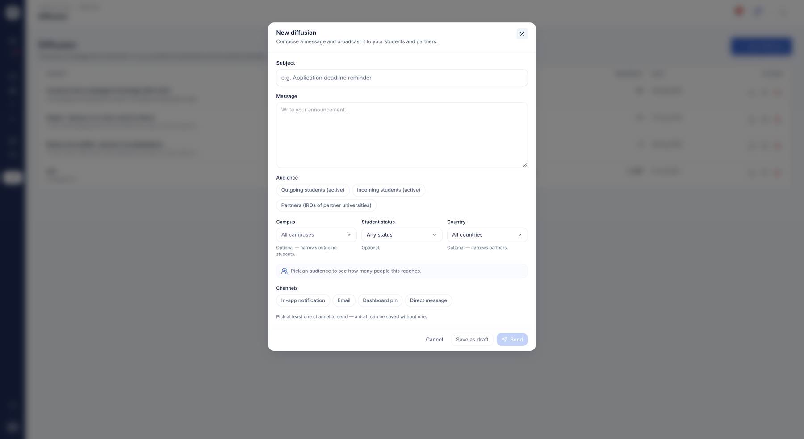

# Communications & notifications

This module brings together everything about the International Relations Office's
communication: broadcasting a message to a targeted audience, notifying,
chatting directly with a student or partner, and chasing missing documents. The goal: replace scattered manual emailing with integrated,
tracked tools.

## Broadcast messaging

**What it's for.** You write a message once and broadcast it over several channels to
targeted audiences. No more manual mail merges: you target, you send, and you keep a
record.

**Who it's for.** coordinator / IRO manager

**How it works.** **Communication ▸ Diffusion**. The composer lets you choose:

- the **audiences** — **Outgoing students (active)**, **Incoming students (active)**,
  **Partners (IROs of partner universities)** — and optional filters: **Campus**, **Student
  status**, **Country**, with a recipient counter before sending;
- the **channels** — **In-app notification**, **Email**, **Dashboard pin**, **Direct
  message**.

You can also start from an **explicit selection**: tick the students you want in your list,
or the contacts you want in your directory — for contacts, only email is offered. A
broadcast can also be started from a student's file or a partner's record.

A draft can be saved; **Send this diffusion now?** confirms the send, and a sent message is
locked. The list shows each broadcast's status, audiences, channels and recipients;
**Delivery history** gives opens, clicks and bounces. **Pin on the students' dashboard** pins
a message to, or removes it from, the students' dashboard.

*Composing a broadcast: the subject, the message, the target audience, optional filters and the sending channels.*

**Use case.**
> A coordinator sends "Nomination deadline moved to 15 March" to all outgoing students in
> Spain, pinned on their dashboard and sent by email.

## The identity of your emails

**What it's for.** Many messages leaving AroundLink reach people who are not your users: a
partner, a contact, a student who has not signed in yet. They recognise **the school they
work with**, not a tool they have never heard of.

**How it works.** Emails sent on your behalf — nominations and their reminders, a withdrawn
nomination, invitations, requests for dates and language requirements, document reminders —
carry **your logo and your name at the top**, the signature of the person sending it at the
bottom of the card, and a discreet *powered by AroundLink* mention.

A **broadcast** looks different: it is sent as "IRO *your institution* via AroundLink", opens
with "Message from *your institution*", and a reply goes straight to the person who sent it.

Automatic messages nobody writes — notifications, the daily digest — keep the AroundLink
brand.

## In-app notifications

**What it's for.** Every user has a notification feed, flagged by a bell in the top bar.
Coordinators, partners and students stay informed of new messages and events without relying
on email.

**Who it's for.** coordinator / partner / student

**How it works.** The bell shows the number of unread notifications; it refreshes when pages
load and after your own actions. Opening a notification marks it read and takes you to the
screen concerned; a long message unfolds inside the bell itself. A **Notifications** page
lists them all, with **Mark all as read**.

Coordinators also receive a daily email summing up their new alerts, with an **Open my
alerts** button.

**Use case.**
> A student sees a "3" on the bell, opens it and finds that their Learning Agreement has just
> been approved.

## Direct messaging

**What it's for.** Private, threaded messaging. Questions are settled inside the platform
rather than through scattered emails.

**Who it's for.** coordinator / student

**How it works.** Each profile has its inbox: list of conversations, one-to-one thread,
reply, and **New message** to start an exchange. You can only write to people your role
lets you reach:

| Who writes | To whom |
|---|---|
| A coordinator | their team, their partners, their own students, and the AroundLink team |
| A student | the staff of their own institution, and AroundLink support |

On the coordinator side, the number of unread messages shows on the **Messages** menu
entry. Your institution can turn messaging off.

**Use case.**
> An outgoing student writes to their coordinator with a question about their learning
> agreement; the coordinator answers in the thread.

## Document reminder campaigns

**What it's for.** Tracked email reminders that push students to upload what is missing —
with opens, clicks and deliverability. Chasing documents becomes a measurable operation.

**Who it's for.** coordinator / IRO manager

**How it works.** **Reminder** first asks what you are chasing: **Documents**, **Feedback**
or **Profile completion**. A document reminder targets students by document type, academic
level and campaign; a given student gets at most one every 48 hours, and emails go out in
the background.

The reminders list shows, for each one, the first and last send, sends out of the total,
opens, clicks and deliverability, and can be filtered on what is not sent yet, partly or
fully sent.

A reminder is started from the **Reminders** tab of the [validations](validations.md), from a
selection in the students list, or from a student's file.

**Use case.**
> A coordinator reminds every Master's student missing their Learning Agreement, then follows
> the opens in the reminders list.

## Feedback request reminders

**What it's for.** Asking students who have not yet left feedback on their host institution,
on the same principle as document reminders.

**Who it's for.** coordinator / IRO manager

**How it works.** You target your audience by academic level and campaign, or name the
students directly — naming students then takes precedence over the filters. You choose one
or more **themes** — each goes out as a separate request — and can add a message. A preview
tells you how many people will be reached before sending, and that number matches exactly
who will receive the message.

**Use case.**
> At the end of the semester, the coordinator asks the Master's students back from mobility
> for "Housing" and "Courses" feedback; the preview announces 12 recipients, and 12 students
> receive both requests.
