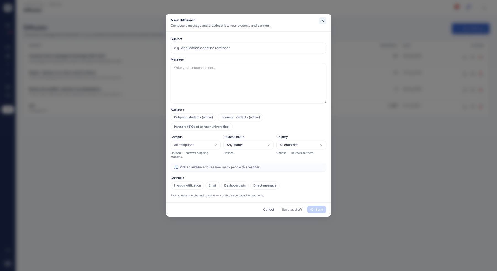

# Communications & notifications

Ce module regroupe tout ce qui touche à la communication du bureau des relations
internationales : diffuser un message à une audience ciblée, notifier,
échanger en direct avec un étudiant ou un partenaire, et relancer les documents
manquants. L'objectif : remplacer les envois manuels
dispersés par des outils intégrés et suivis.

## Diffusion de messages

**À quoi ça sert.** Vous rédigez un message une seule fois et le diffusez sur
plusieurs canaux vers des audiences ciblées. Fini le publipostage manuel : vous ciblez,
vous envoyez, et vous gardez une trace.

**Pour qui.** coordinateur / gestionnaire RI

**Comment ça marche.** **Communication ▸ Diffusion**. Le compositeur vous laisse choisir :

- les **audiences** — **Outgoing students (active)**, **Incoming students (active)**,
  **Partners (IROs of partner universities)** — et des filtres facultatifs : **Campus**,
  **Student status**, **Country**, avec un compteur de destinataires avant l'envoi ;
- les **canaux** — **In-app notification**, **Email**, **Dashboard pin**, **Direct
  message**.

Vous pouvez aussi partir d'une **sélection explicite** : cochez les étudiants voulus dans
votre liste, ou les contacts voulus dans votre annuaire — pour des contacts, seul l'e-mail
est proposé. Une diffusion se lance aussi depuis le dossier d'un étudiant ou la fiche d'un
partenaire.

Un brouillon s'enregistre ; **Send this diffusion now?** confirme l'envoi, et un message
envoyé est verrouillé. La liste montre pour chaque diffusion son statut, ses audiences, ses
canaux et ses destinataires ; **Delivery history** donne les ouvertures, clics et rejets.
**Pin on the students' dashboard** épingle ou retire un message du tableau de bord des
étudiants.

*La composition d'une diffusion : le sujet, le message, l'audience visée, les filtres facultatifs et les canaux d'envoi.*

**Cas d'usage.**
> Un coordinateur envoie « Date limite de nomination reportée au 15 mars » à tous
> les étudiants sortants en Espagne, épinglé sur leur tableau de bord et envoyé
> par e-mail.

## L'identité de vos e-mails

**À quoi ça sert.** Beaucoup des messages qui partent d'AroundLink arrivent chez des gens
qui ne sont pas vos utilisateurs : un partenaire, un contact, un étudiant qui ne s'est pas
encore connecté. Ils reconnaissent **l'école avec qui ils travaillent**, pas un outil dont
ils n'ont jamais entendu parler.

**Comment ça marche.** Les e-mails adressés en votre nom — nominations et leurs relances,
retrait d'une nomination, invitations, demandes de dates et d'exigences de langue, relances
de documents — portent **votre logo et votre nom en tête**, la signature de la personne qui
l'envoie au bas de la carte, et une mention discrète *powered by AroundLink*.

Une **diffusion** se présente autrement : elle part au nom de « IRO *votre établissement* via
AroundLink », s'ouvre sur « Message from *votre établissement* », et une réponse arrive
directement à la personne qui l'a envoyée.

Les messages automatiques que personne n'écrit — notifications, récapitulatif quotidien —
gardent la marque AroundLink.

## Notifications dans l'application

**À quoi ça sert.** Chaque utilisateur dispose d'un fil de notifications, signalé par une
cloche dans la barre supérieure. Coordinateurs, partenaires et étudiants restent informés
des nouveaux messages et événements sans dépendre de l'e-mail.

**Pour qui.** coordinateur / partenaire / étudiant

**Comment ça marche.** La cloche affiche le nombre de notifications non lues ; il se met à
jour au chargement des pages et après vos propres actions. Ouvrir une notification la marque
comme lue et mène à l'écran concerné ; un message long se déplie dans la cloche même. Une
page **Notifications** les reprend toutes, avec **Mark all as read**.

Les coordinateurs reçoivent aussi, chaque jour, un e-mail qui récapitule leurs nouvelles
alertes, avec un bouton **Open my alerts**.

**Cas d'usage.**
> Un étudiant voit un « 3 » sur la cloche, l'ouvre et découvre que son Learning
> Agreement vient d'être approuvé.

## Messagerie directe

**À quoi ça sert.** Une messagerie privée, en fil de discussion. Les questions se règlent
dans la plateforme plutôt que par e-mails éparpillés.

**Pour qui.** coordinateur / étudiant

**Comment ça marche.** Chaque profil a sa boîte de réception : liste des conversations, fil
un-à-un, réponse, et **New message** pour démarrer un échange. On n'écrit qu'aux personnes
que son rôle permet de joindre :

| Qui écrit | À qui |
|---|---|
| Un coordinateur | son équipe, ses partenaires, ses propres étudiants, et l'équipe AroundLink |
| Un étudiant | l'équipe de son propre établissement, et le support AroundLink |

Côté coordinateur, le nombre de messages non lus s'affiche sur l'entrée **Messages** du
menu. Votre établissement peut désactiver la messagerie.

**Cas d'usage.**
> Un étudiant sortant écrit à son coordinateur pour une question sur son contrat
> pédagogique ; le coordinateur répond dans le fil.

## Campagnes de relance de documents

**À quoi ça sert.** Des relances par e-mail, suivies, qui poussent les étudiants à déposer
ce qui manque — avec les ouvertures, les clics et la délivrabilité. La chasse aux documents
devient une opération mesurable.

**Pour qui.** coordinateur / gestionnaire RI

**Comment ça marche.** **Reminder** demande d'abord ce que vous relancez : **Documents**,
**Feedback** ou **Profile completion**. Une relance de documents cible les étudiants par
type de document, niveau d'études et campagne ; un même étudiant n'en reçoit qu'une toutes
les 48 heures, et les e-mails partent en tâche de fond.

La liste des relances montre, pour chacune, le premier et le dernier envoi, les envois sur
le total, les ouvertures, les clics et la délivrabilité, et se filtre sur ce qui n'est pas
encore envoyé, en partie ou entièrement.

On lance une relance depuis l'onglet **Reminders** des [validations](validations.md), depuis
une sélection dans la liste des étudiants, ou depuis le dossier d'un étudiant.

**Cas d'usage.**
> Un coordinateur relance tous les étudiants de Master à qui il manque le Learning
> Agreement, puis suit les ouvertures dans la liste des relances.

## Relances de demande d'avis

**À quoi ça sert.** Solliciter les étudiants qui n'ont pas encore déposé d'avis sur
leur établissement d'accueil, sur le même principe que les relances de documents.

**Pour qui.** coordinateur / gestionnaire RI

**Comment ça marche.** Vous ciblez votre audience par niveau d'études et par campagne, ou
vous désignez directement les étudiants concernés — nommer des étudiants prend alors le pas
sur les filtres. Vous choisissez un ou plusieurs **thèmes** — chacun part comme une demande
distincte — et pouvez ajouter un message. Un aperçu indique combien de personnes seront
touchées avant l'envoi, et ce nombre correspond exactement à qui recevra le message.

**Cas d'usage.**
> En fin de semestre, le coordinateur demande un avis « Logement » et « Cours » aux
> étudiants de Master rentrés de mobilité ; l'aperçu annonce 12 destinataires, et 12
> étudiants reçoivent les deux demandes.
