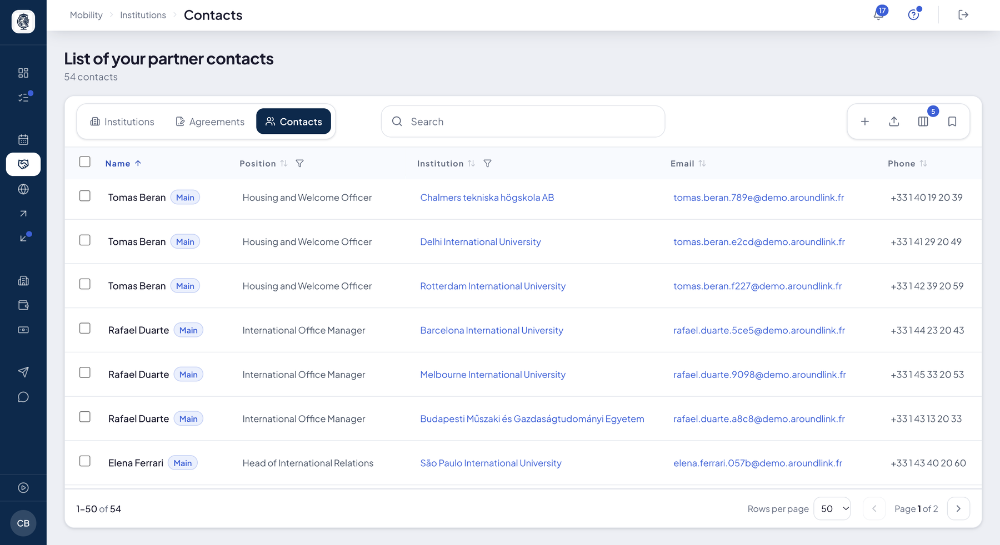

# Contacts

The people you work with at your partners: **Mobility ▸ Institutions ▸ Contacts**. They are
the ones who receive your nominations, your date requests and your emails.

## Your contact list

**What it's for.** One address book, across all your partners.

**Who it's for.** RI manager / coordinator

**How it works.** One row per person: name, position, institution, email, phone. More columns
show on demand, including the date of **last contact** — it leads straight to the emails you
sent them —, where the contact comes from, whether your students can see them, and their
**access** to AroundLink. Every column sorts and filters; the search also finds a phone number.

The same contact also shows on their partner's file, with the same columns.

*Your contacts at your partners. The "Main" badge marks each institution's main contact.*

**Use case.**
> A coordinator wonders who called her from an unknown number: she types it into the search,
> and the contact's row comes up.

## The main contact

**What it's for.** Naming, at each partner, the person your sendings go to.

**How it works.** The **Main** badge marks that contact.

- Your **date requests** only go to them: a partner with no main contact does not receive
  them, and the sending screen names it.
- Your **nominations** go to them first; failing that, to the agreement's signatory, then to the
  agreement's contact. See [Campaigns](campagnes.md#nominating-to-your-partners).

**Use case.**
> Before sending nominations, the coordinator checks that every partner has a "Main" contact.

## Opening access for a contact

**What it's for.** Giving a contact their own AroundLink access.

**How it works.** On a contact's row, **Open access** asks for confirmation, then creates an
access and emails them to choose a password. The email is sent for real and cannot be recalled.
If they already have an account, the screen says so. **Re-send** sends the invitation again.
The **Access** column shows where they stand.

**Use case.**
> The coordinator opens access for a partner's Erasmus officer; the **Access** column then
> shows whether she has logged in.

## Acting on several contacts

**How it works.** Tick rows: a bar offers **Send email** and **Delete**.

- **Send email** opens the [diffusion](communications.md) window with your contacts already as
  recipients. Nothing leaves from the list itself: you write, then you send. A contact is not a
  platform user, so email is the only channel.
- **Delete** is **final**: there is no trash for contacts, and any access they had closes with
  them. If some cannot be deleted, the screen names them. A contact attached to no partner
  cannot be deleted from here.

The toolbar's **+** adds a contact.

**Use case.**
> The office ticks the contacts at its Spanish partners and writes to them all at once to
> announce the welcome day.

## Importing contacts

**What it's for.** Bulk-load your partners' contacts from a file, with a preview before
anything is written.

**Who it's for.** RI manager / admin

**How it works.** **Settings ▸ Integrations ▸ Import Contacts**. Two columns are required:
**institution_domain** — the contact's institution SCHAC domain or EWP identifier — and
**email**. Optional: first name, last name, phone, position, main contact.

The preview flags every row whose institution cannot be found, without writing anything; you
then confirm. Re-importing the same email for the same partner updates the contact, and naming
a new main contact removes that role from the previous one. A notification confirms the end of
the import.

**Use case.**
> The office loads 60 contacts: the preview flags two mistyped domains, fixed before the
> import; each contact joins its partner.
