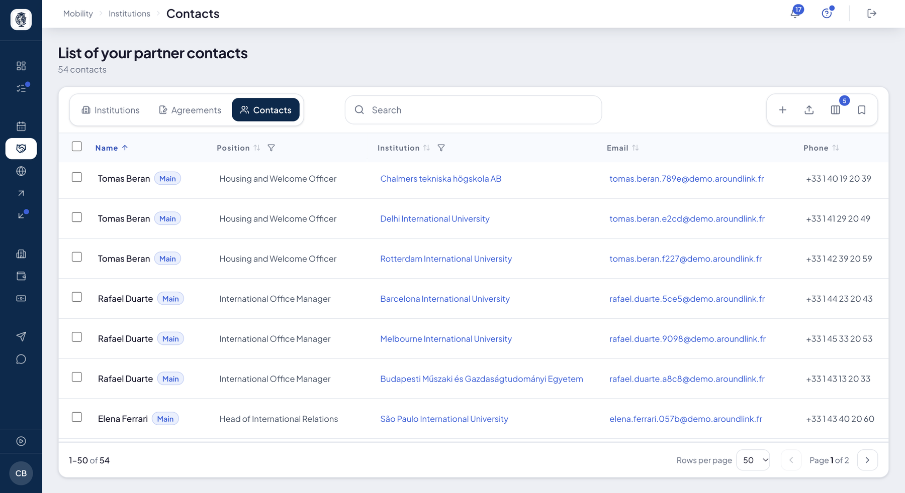

# Contacts

Les personnes avec qui vous travaillez chez vos partenaires : **Mobility ▸ Institutions ▸
Contacts**. Ce sont elles qui reçoivent vos nominations, vos demandes de dates et vos e-mails.

## La liste de vos contacts

**À quoi ça sert.** Un carnet d'adresses unique, tous partenaires confondus.

**Pour qui.** gestionnaire RI / coordinateur

**Comment ça marche.** Une ligne par personne : nom, fonction, établissement, e-mail,
téléphone. D'autres colonnes s'affichent à la demande, dont la date du **dernier contact** —
elle mène droit aux e-mails que vous lui avez envoyés —, la provenance du contact, sa
visibilité pour vos étudiants et son **accès** à AroundLink. Chaque colonne se trie et se
filtre ; la recherche trouve aussi un numéro de téléphone.

Le même contact se lit aussi sur la fiche de son partenaire, avec les mêmes colonnes.

*Vos interlocuteurs chez vos partenaires. L'étiquette « Main » marque le contact principal de chaque établissement.*

**Cas d'usage.**
> Une coordinatrice cherche à qui appartient un numéro qui l'a appelée : elle le tape dans la
> recherche, et la ligne du contact sort.

## Le contact principal

**À quoi ça sert.** Désigner, chez chaque partenaire, la personne à qui partent les envois.

**Comment ça marche.** L'étiquette **Main** marque ce contact.

- Vos **demandes de dates** ne partent qu'à lui : un partenaire sans contact principal ne les
  reçoit pas, et l'écran d'envoi le nomme.
- Vos **nominations** partent à lui d'abord ; à défaut, au signataire de l'accord, puis au
  contact de l'accord. Voir [Campagnes](campagnes.md#nominations-chez-vos-partenaires).

**Cas d'usage.**
> Avant d'envoyer ses nominations, le coordinateur vérifie que chaque partenaire a un contact
> « Main ».

## Ouvrir un accès à un contact

**À quoi ça sert.** Donner à un interlocuteur son propre accès à AroundLink.

**Comment ça marche.** Sur la ligne d'un contact, **Open access** demande confirmation, puis
lui crée un accès et lui envoie un e-mail pour choisir son mot de passe. L'envoi est réel et ne
se rattrape pas. S'il a déjà un compte, l'écran le dit. **Re-send** renvoie l'invitation. La
colonne **Access** dit où il en est.

**Cas d'usage.**
> La coordinatrice ouvre un accès à la responsable Erasmus d'un partenaire ; la colonne
> **Access** indique ensuite si elle s'est connectée.

## Agir sur plusieurs contacts

**Comment ça marche.** Cochez des lignes : une barre propose **Send email** et **Delete**.

- **Send email** ouvre la fenêtre de [diffusion](communications.md), vos contacts déjà en
  destinataires. Rien ne part de la liste elle-même : vous écrivez, puis vous envoyez. Un
  contact n'est pas un utilisateur de la plateforme, l'e-mail est donc le seul canal.
- **Delete** est **définitif** : il n'y a pas de corbeille pour les contacts, et l'accès
  qu'ils avaient se ferme avec eux. Si certains ne peuvent pas être supprimés, l'écran les
  nomme. Un contact rattaché à aucun partenaire ne se supprime pas d'ici.

Le **+** de la barre d'outils ajoute un contact.

**Cas d'usage.**
> Le bureau coche les contacts de ses partenaires espagnols et leur écrit, en une fois, pour
> annoncer la date de la journée d'accueil.

## Importer des contacts

**À quoi ça sert.** Charger en masse les contacts de vos partenaires depuis un fichier,
avec un aperçu avant écriture.

**Pour qui.** gestionnaire RI / admin

**Comment ça marche.** **Paramètres ▸ Integrations ▸ Import Contacts**. Deux colonnes sont
obligatoires : **institution_domain** — le domaine SCHAC ou l'identifiant EWP de
l'établissement du contact — et **email**. Facultatives : prénom, nom, téléphone, fonction,
contact principal.

L'aperçu signale chaque ligne dont l'établissement est introuvable, sans rien écrire ; vous
confirmez ensuite. Réimporter le même e-mail pour le même partenaire met le contact à jour,
et désigner un nouveau contact principal retire ce rôle au précédent. Une notification
confirme la fin de l'import.

**Cas d'usage.**
> Le bureau charge 60 contacts : l'aperçu signale deux domaines mal saisis, corrigés avant
> l'import ; chaque contact rejoint son partenaire.
