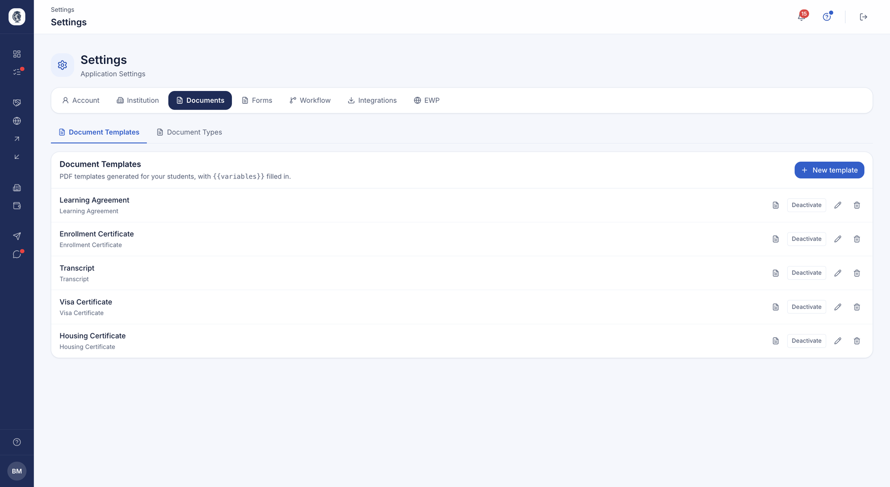
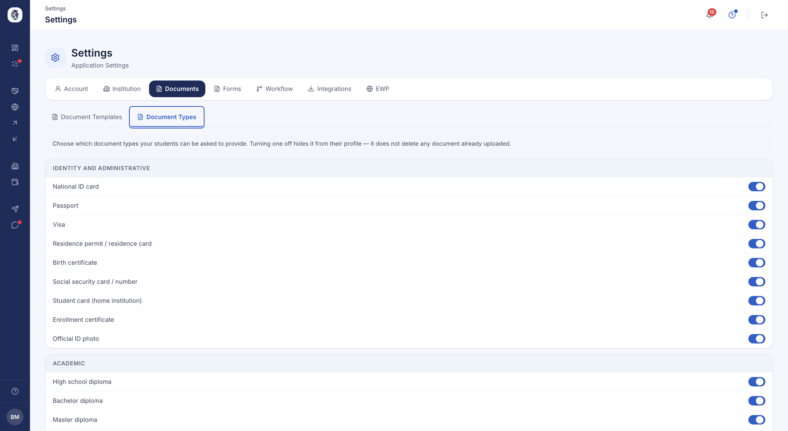

# Documents & templates

What your institution **asks for** and what it **produces**: the document types required from
your students, and the templates of the official documents the platform generates in their
name. It is a setting — done once, then it applies to every file.

## Document templates

**What it does.** Lets each institution design its own reusable document templates
(nomination letter, learning agreement, acceptance letter, enrolment certificate,
transcript of records, visa certificate, housing certificate) with `{{…}}` fields that
fill automatically with a student's real data.

**Who it's for.** RI manager / coordinator

**How it works.** The coordinator lists, creates and edits their templates, composes the
document body using the available variables, previews the layout as a PDF (tokens still
visible) to check spacing and pagination, then generates a filled PDF for a given
student. They can activate/deactivate a template or delete it. Institutional templates
made available are visible read-only.

*Your generated document templates — acceptance letter, enrolment certificate, learning agreement, transcript — where the student's details replace the variables.*

**Use case.**
> The coordinator creates an "Acceptance Letter" template with the institution's logo,
> checks the preview, then generates it filled for an incoming student in one click.

## Enable / disable document types

**What it does.** Lets each institution enable or disable certain document types, so an
unwanted type stops appearing on the students' upload page and in dropdown lists. By
default, all types are active.

**Who it's for.** RI manager / coordinator

**How it works.** In Settings → Documents, each document type has an ON/OFF switch saved
per institution.

*The documents your institution asks for, by family. Turning a type off removes it from the student's profile without deleting anything already uploaded.*

**Use case.**
> An institution that never issues housing certificates disables that type: it
> disappears from every student's checklist.
