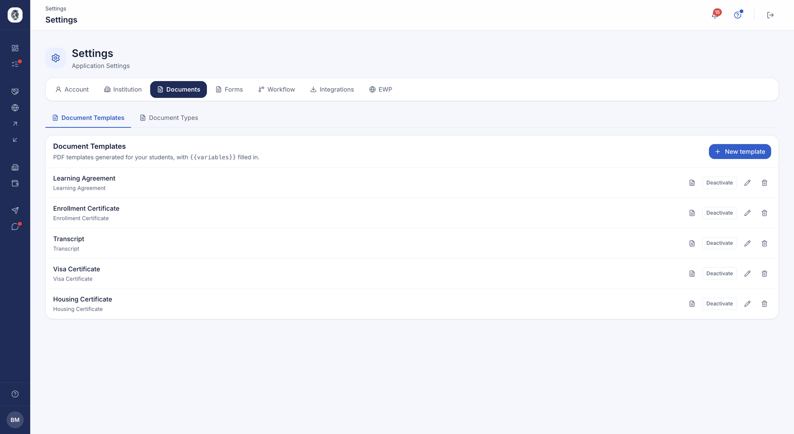
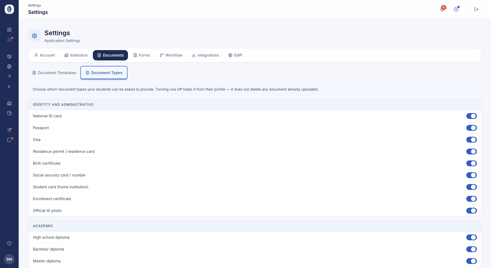

# Documents & modèles

Ce que votre établissement **demande** et ce qu'il **produit** : les types de pièces exigées
de vos étudiants, et les modèles des documents officiels que la plateforme génère à leur nom.
C'est un réglage — on le fait une fois, puis il s'applique à tous les dossiers.

## Modèles de documents

**À quoi ça sert.** Permet à chaque établissement de concevoir ses propres modèles de
documents réutilisables (lettre de nomination, contrat pédagogique, lettre
d'acceptation, certificat de scolarité, relevé de notes, certificat de visa, attestation
de logement) avec des champs `{{…}}` qui se remplissent automatiquement avec les données
réelles d'un étudiant.

**Pour qui.** gestionnaire RI / coordinateur

**Comment ça marche.** Le coordinateur liste, crée et modifie ses modèles, compose le
corps du document à l'aide des variables proposées, prévisualise la mise en page en PDF
(jetons encore visibles) pour vérifier l'espacement et la pagination, puis génère un PDF
rempli pour un étudiant donné. Il peut activer/désactiver un modèle ou le supprimer. Les
modèles institutionnels mis à disposition sont visibles en lecture seule.

*Vos modèles de documents générés — lettre d'acceptation, attestation de scolarité, contrat pédagogique, relevé — dans lesquels les informations de l'étudiant viennent se substituer aux variables.*

**Cas d'usage.**
> Le coordinateur crée un modèle « Lettre d'acceptation » avec le logo de
> l'établissement, vérifie l'aperçu, puis le génère rempli pour un étudiant entrant en
> un clic.

## Activer / désactiver des types de documents

**À quoi ça sert.** Permet à chaque établissement d'activer ou de désactiver certains
types de documents, pour qu'un type inutile cesse d'apparaître sur la page de dépôt des
étudiants et dans les listes déroulantes. Par défaut, tous les types sont actifs.

**Pour qui.** gestionnaire RI / coordinateur

**Comment ça marche.** Dans Paramètres → Documents, chaque type de document dispose d'un
interrupteur ON/OFF enregistré par établissement.

*Les pièces que votre établissement demande, par famille. Désactiver un type le retire du profil de l'étudiant sans supprimer ce qui a déjà été déposé.*

**Cas d'usage.**
> Un établissement qui n'émet jamais d'attestation de logement désactive ce type : il
> disparaît de la checklist de tous ses étudiants.
