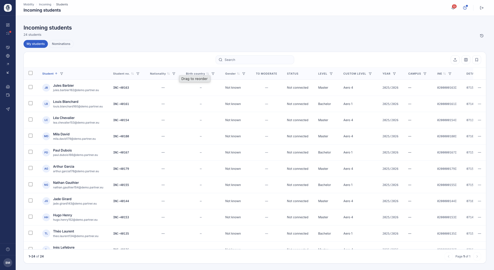

# Incoming students

The students you host, including those your partners nominate to you. The ones you send have
[their own list](etudiants.md), and each of them has [their file](fiche-etudiant.md).

## Incoming students

**What it's for.** Following the students your partners send you, from nomination
through to the end of their stay.

**Who it's for.** IRO manager / coordinator

**How it works.** Two tabs separate what is offered to you from what you have
accepted: *Nominations* for proposals awaiting your decision, *My students* for
those you are actually hosting. An incoming student appears from the moment they
are nominated, before they even have an account.

Once you accept the nomination, you open their access: they receive their
credentials and can complete their file. The list sorts, filters and tags exactly
like the outgoing one.

*Your incoming students, with their level, their year and the state of their connection to the platform.*

**Use case.**
> A partner university nominates twelve students; the coordinator accepts eleven,
> refuses one, then opens access for the eleven retained.
