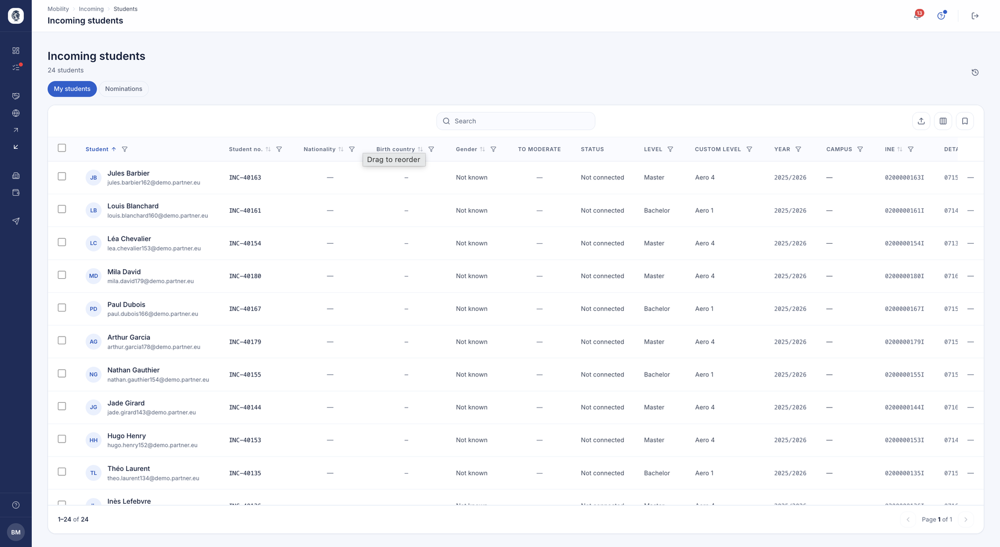

# Étudiants entrants

Les étudiants que vous accueillez, y compris ceux que vos partenaires vous nomment. Ceux que
vous envoyez ont [leur propre liste](etudiants.md), et chacun a [son dossier](fiche-etudiant.md).

## Étudiants entrants

**À quoi ça sert.** Suivre les étudiants que vos partenaires vous envoient, depuis
la nomination jusqu'à la fin de leur séjour.

**Pour qui.** gestionnaire RI / coordinateur

**Comment ça marche.** Deux onglets séparent ce qui vous est proposé de ce que vous
avez accepté : *Nominations* pour les propositions en attente de votre décision,
*Mes étudiants* pour ceux que vous accueillez effectivement. Un étudiant entrant
apparaît dès la nomination, avant même d'avoir un compte.

Une fois la nomination acceptée, vous lui ouvrez son accès : il reçoit ses
identifiants et peut compléter son dossier. La liste se trie, se filtre et se
tague exactement comme celle des sortants.

*Vos étudiants entrants, avec leur niveau, leur année et l'état de leur connexion à la plateforme.*

**Cas d'usage.**
> Une université partenaire nomine douze étudiants ; le coordinateur en accepte
> onze, en refuse un, puis ouvre les accès aux onze retenus.
