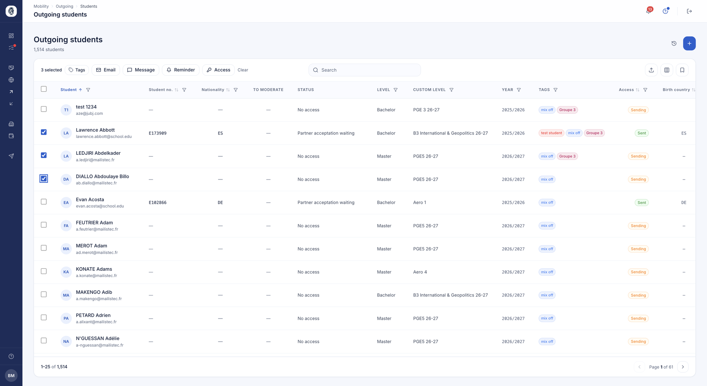

# Outgoing students

The students you send on mobility. The ones you host have [their own list](etudiants-entrants.md),
and each of them has [their file](fiche-etudiant.md).

## Outgoing students

**What it's for.** Finding all of your institution's students going on mobility,
following where each one stands, and acting on several of them at once.

**Who it's for.** IRO manager / coordinator

**How it works.** Each row is a student. The list sorts and filters on every column
— level, campus, year, campaigns, tags, access status. The *Access* column shows
where their account stands: never sent, sending, or connected.

Select several students and you can open their access, apply or remove tags, send
an email, an internal message or a reminder — all in one operation. The list can be
imported from and exported to a spreadsheet.

*Your outgoing students. The top bar appears as soon as you make a selection and gathers the actions that apply to the whole batch. Click the image to enlarge it.*

**Use case.**
> The coordinator filters on the Master cohort, selects the 40 students concerned
> and opens their platform access in one go.

!!! note "Nominating a student"
    Nominating to a partner does not start from this list: it happens from the
    [campaign](campagnes.md), once the student has been assigned to a destination.
