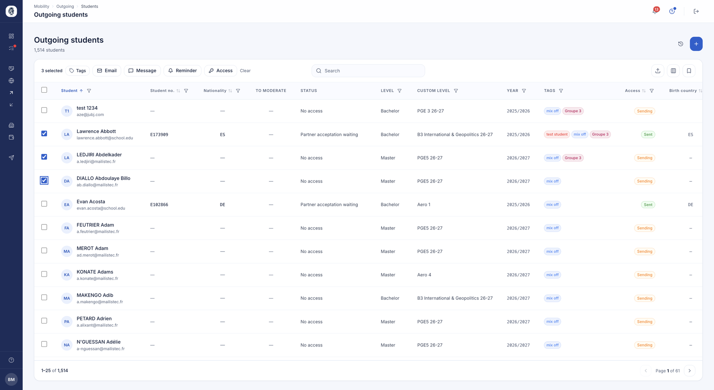

# Étudiants sortants

Les étudiants que vous envoyez en mobilité. Ceux que vous accueillez ont
[leur propre liste](etudiants-entrants.md), et chacun a [son dossier](fiche-etudiant.md).

## Étudiants sortants

**À quoi ça sert.** Retrouver la totalité des étudiants de votre établissement qui
partent en mobilité, suivre où en est chacun, et agir sur plusieurs d'entre eux à
la fois.

**Pour qui.** gestionnaire RI / coordinateur

**Comment ça marche.** Chaque ligne est un étudiant. La liste se trie et se filtre
sur toutes ses colonnes — niveau, campus, année, campagnes, tags, statut d'accès.
La colonne *Accès* indique où en est l'ouverture de son compte : jamais envoyé, en
cours d'envoi, ou connecté.

En sélectionnant plusieurs étudiants, vous leur ouvrez les accès, posez ou retirez
des tags, envoyez un e-mail, un message interne ou une relance — en une seule
opération. La liste s'importe et s'exporte depuis un tableur.

*Vos étudiants sortants. La barre du haut apparaît dès qu'une sélection est faite et regroupe les actions applicables à tout le lot. Cliquez sur l'image pour l'agrandir.*

**Cas d'usage.**
> Le coordinateur filtre sur la promotion Master, sélectionne les 40 étudiants
> concernés et leur ouvre l'accès à la plateforme en une fois.

!!! note "Nommer un étudiant"
    La nomination chez un partenaire ne part pas de cette liste : elle intervient
    depuis la [campagne](campagnes.md), une fois l'étudiant affecté à une
    destination.
