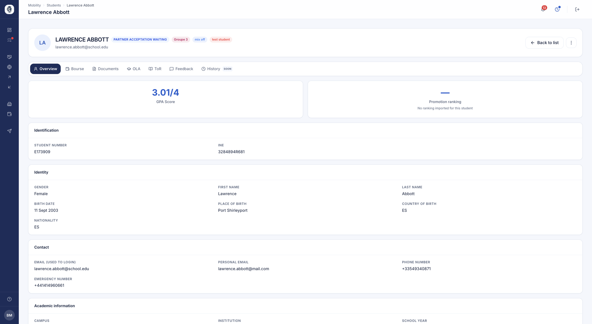
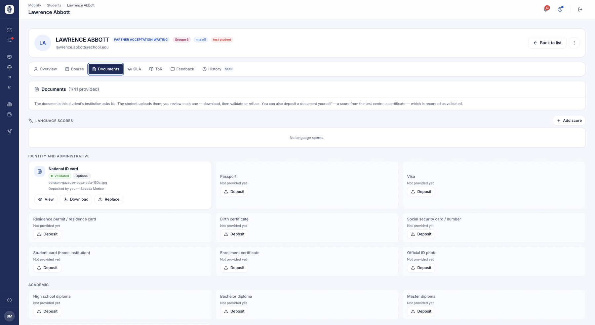

# A student's record

Outgoing or incoming, every student has a fiche gathering their whole file: identity,
documents, learning agreement, transcript, mobility tracking. You reach it from the list of
[outgoing](etudiants.md) or [incoming](etudiants-entrants.md) students.

## A student's file

**What it's for.** Bringing together everything about one student: their identity,
their documents, their learning agreement, their transcript, their grant and their
reviews.

**Who it's for.** IRO manager / coordinator

**How it works.** Click a row to open the file. Tabs separate the main parts of the
record. The *Overview* tab gathers their identity, contact details, academic
information, their GPA and their cohort ranking where those have been imported.

*A student's overview: identification, identity, contacts and academic information.*

**Use case.**
> Before confirming a nomination, the coordinator opens the file to check the
> student's language level and GPA.

### The Mobility tab

**What it's for.** Answering, when you open a file, the question you actually ask:
**where does this student stand, and do I have anything to do?**

**How it works.** The Mobility tab carries **one block per mobility** — a student who
left twice has two files, each with its dates and its progress. You read the phase, the
tasks sorted by phase, and the dated timeline of the stay. It is the same screen as
[mobility tracking](suivi-mobilites.md), seen at the scale of one student.

### Email exchanges

**What it's for.** Reading, on the fiche, what has been written to the student, without
leaving their file.

**How it works.** An **Emails** tab matches filed messages to the student's addresses —
the school one and the personal one. The list is **read-only**: a message is managed from
the fiche of the contact that carries it. See [Emails & connectors](emails.md).

In the grids, a **Last contact** column gives the date of the latest exchange, and a
student's name always leads to their fiche.

### Removing a language test

**How it works.** A **cross** lets the coordinator remove a language test from a student's
fiche — a document uploaded by mistake, an expired certificate. It is one of the actions
the coordinator can take **on the student's behalf** when they cannot manage.

## Student profile completion

**What it's for.** Seeing at a glance which students have not finished filling in their
profile, and reminding them without keeping a list.

**Who it's for.** IRO manager / coordinator

**How it works.** Completion is measured on the **nine pieces of information only the
student can give about themselves**: date, place and country of birth, nationality, gender,
personal email, phone number, emergency number and profile photo.

What you fill in yourself — first name, last name, student number, institutional email,
level — does not count: a student should not be measured on someone else's work.

You find this measure in the **Profile** column of your student list, which sorts and
filters like the others. The student sees a gauge on their profile and a window offering to
complete what is missing, field by field.

Once the list is filtered on incomplete profiles, the reminder goes out from the selection
bar, like any other reminder.

**Use case.**
> Three weeks before departures, the coordinator sorts their list on the Profile column,
> selects the twenty-two students below 100%, and sends a reminder. Each one receives the
> list of their own missing fields.

!!! note "Gender left unanswered"
    "Not answered" is the record's default value, not an answer: the gauge does not count
    it. A student who would rather not answer picks "Prefer not to say", which does count as
    an answer — otherwise they would stay below 100% forever.

## A student's documents

**What it's for.** Seeing at a glance what the student has provided, what is still
missing, and acting on each item.

**Who it's for.** IRO manager / coordinator

**How it works.** The *Documents* tab lists every item your institution asks for,
grouped by family — identity and administrative, academic, financial. Each card
shows whether the item is provided, validated or still expected, and whether it is
required or optional.

Students upload their own documents; you view them, download them, then approve or
refuse them. You can also upload an item on their behalf — a score received
directly from the test centre, for instance — in which case it is recorded as
validated, and the file keeps track of who uploaded it.

*A student's documents, by family, with their status and the language scores recorded.*

**Use case.**
> The coordinator receives a student's language certificate by post, uploads it to
> her file themselves, and the item immediately shows as validated.

!!! note "Approving in batches"
    To handle everything your students have submitted in one place, go through
    [validations](validations.md) rather than file by file.

## Learning Agreement (OLA)

**What it does.** The Learning Agreement describes the programme of courses a student
will follow abroad. This view lets the office track every agreement, see at a glance
which ones are pending, validated or need corrections, and enforce the signature of both
institutions before an agreement becomes final.

**Who it's for.** RI manager / coordinator

**How it works.** The coordinator opens the OLA list, filters by status and reviews each
agreement in a window that shows its history. They can request modifications — the
agreement then returns to draft with a comment for the student — or approve it. For a
standard agreement, each institution signs on its own side, in any order, and the
agreement is validated only once both signatures are in place; for an EWP agreement,
approval hands the agreement to the host institution following the network's sequential
flow.

**Use case.**
> The coordinator reviews Marie's pre-departure OLA (3 courses, 18 ECTS), asks her to
> swap one course, then signs on behalf of the sending institution; as soon as the
> partner signs in turn, the OLA becomes "Validated".

### The coordinator corrects, instead of only judging

**What it does.** A contract refused over a comma meant a full round trip: comment, wait,
new submission, new review. When the correction is obvious, it may as well be made.

**Who it's for.** RI manager / coordinator

**How it works.** A **pencil** on the OLA tab opens the correction. The coordinator can:

- correct the contract's **period** and **language**;
- **correct the course list**, drawing from the partner's catalogue;
- **add a free course**, when the course is not in the catalogue.

The OLA tab now opens the contract directly, instead of asking for one more click.

!!! warning "A student who had signed is told"
    If the contract already carried their signature, they are told they must
    **resubmit**: a signature only covers the text signed. The contract does not become
    validated behind their back.

!!! info "On an EWP agreement, the amendment stays closed"
    For a contract travelling on the European network, correction by the coordinator is not
    open: the network imposes its own amendment circuit, and two paths for the same change
    would produce two versions of the contract.

### The documents of an incoming student hosted on a campus

**How it works.** When you host a student on one of your campuses, their documents —
learning agreement and transcript — carry **"School — Campus"** rather than the
institution's name alone. The student and their home school therefore know where the stay
actually took place.

## PDF generation: OLA & transcript of records

**What it does.** Produces the official PDF of the learning agreement or the transcript
of records from the institution's document template (letterhead, layout), with the
student's course table inserted automatically. The office gets a document ready to file,
in the institution's colours.

**Who it's for.** RI manager / coordinator

**How it works.** From the OLA list, the coordinator downloads the PDF of the learning
agreement or the transcript of records. The agreement can only be downloaded once fully
validated; the transcript once the transcript itself is validated. The system fills the
template with the courses (and the grades, for the transcript).

**Use case.**
> After both signatures, the coordinator downloads the Learning Agreement as a PDF, on
> the institution's letterhead, for the student's file.

## Transcript of Records (ToR)

**What it does.** Manages the incoming student's transcript that the host institution
must return to the home institution. The coordinator reviews the entered grades and the
uploaded official transcript, then validates or requests corrections.

**Who it's for.** RI manager / coordinator (validation) ; student (entry)

**How it works.** The student enters each grade according to the chosen grading system
and uploads the official transcript. The coordinator opens the transcript in a window
showing the history and the uploaded document, then validates — the transcript becomes
downloadable — or sends the file back to the student for correction.

**Use case.**
> An incoming student uploads their official transcript and enters their grades; the
> coordinator checks, validates, and the transcript of records is ready to be sent to
> the home university.
