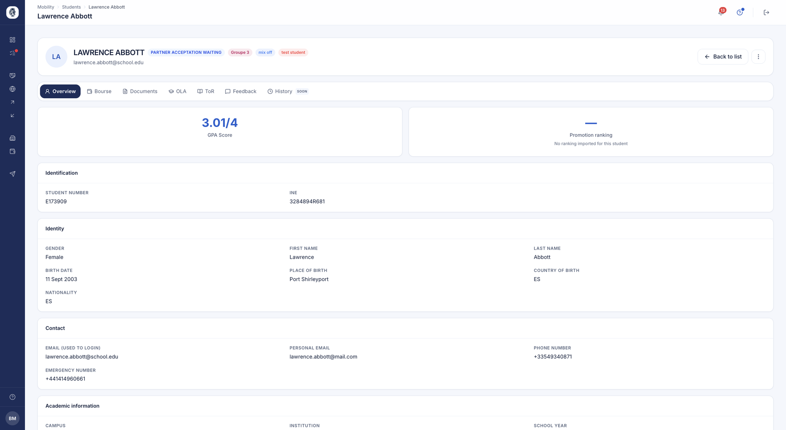
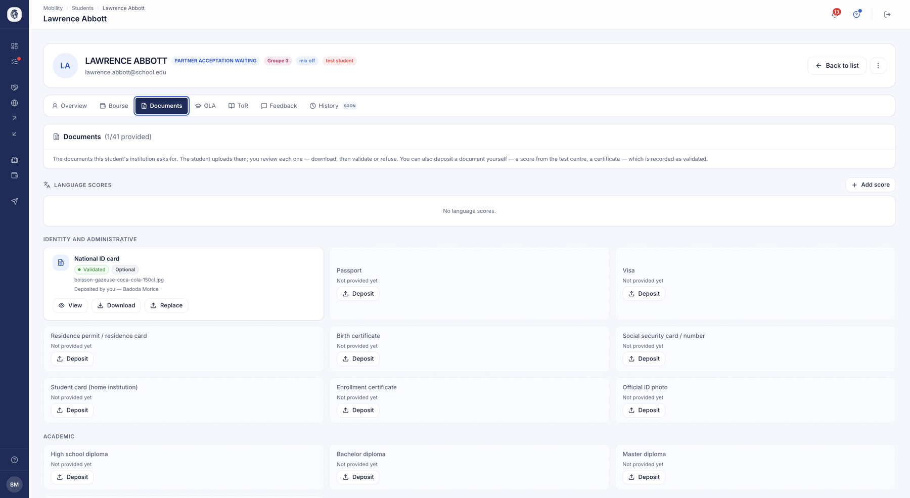

# Le dossier d'un étudiant

Qu'il parte ou qu'il arrive, chaque étudiant a une fiche qui rassemble tout son dossier : son
identité, ses pièces, son contrat d'études, son relevé de notes, son suivi de mobilité. On y
arrive depuis la liste des [sortants](etudiants.md) ou des [entrants](etudiants-entrants.md).

## La fiche d'un étudiant

**À quoi ça sert.** Réunir en un seul endroit tout ce qui concerne un étudiant :
son identité, son dossier documentaire, son contrat pédagogique, son relevé de
notes, sa bourse et ses avis.

**Pour qui.** gestionnaire RI / coordinateur

**Comment ça marche.** Cliquez sur une ligne pour ouvrir la fiche. Des onglets
séparent les grands volets du dossier. L'onglet *Vue d'ensemble* rassemble son
identité, ses coordonnées, ses informations académiques, sa moyenne et son
classement de promotion lorsqu'ils ont été importés.

*La vue d'ensemble d'un étudiant : identification, identité, contacts et informations académiques.*

**Cas d'usage.**
> Avant de valider une nomination, le coordinateur ouvre la fiche pour vérifier le
> niveau de langue et la moyenne de l'étudiant.

### L'onglet Mobility

**À quoi ça sert.** Répondre, en ouvrant un dossier, à la question qu'on se pose
vraiment : **où en est-il, et ai-je quelque chose à faire ?**

**Comment ça marche.** L'onglet Mobility porte **un bloc par mobilité** — un étudiant
parti deux fois a deux dossiers, chacun avec ses dates et son avancement. On y lit la
phase, les tâches rangées par phase, et la frise datée du séjour. C'est le même écran
que le [suivi des mobilités](suivi-mobilites.md), vu à l'échelle d'un étudiant.

### Les échanges par e-mail

**À quoi ça sert.** Lire sur la fiche ce qui a été écrit à l'étudiant, sans sortir de
son dossier.

**Comment ça marche.** Un onglet **Emails** rapproche les messages classés des adresses
de l'étudiant — celle de l'école et la personnelle. La liste est **en lecture seule** :
un message se gère depuis la fiche du contact qui le porte. Voir
[Emails & connecteurs](emails.md).

Dans les grilles, une colonne **Last contact** donne la date du dernier échange, et le
nom d'un étudiant mène toujours à sa fiche.

### Retirer un test de langue

**Comment ça marche.** Une **croix** permet au coordinateur de retirer un test de langue
d'une fiche étudiant — une pièce déposée par erreur, un certificat périmé. C'est l'une
des actions que le coordinateur peut faire **à la place de l'étudiant** quand celui-ci ne
s'en sort pas.

## Complétude du profil étudiant

**À quoi ça sert.** Savoir d'un coup d'œil quels étudiants n'ont pas fini de renseigner
leur profil, et les relancer sans tenir de liste.

**Pour qui.** gestionnaire RI / coordinateur

**Comment ça marche.** La complétude se mesure sur les **neuf informations que l'étudiant
est seul à pouvoir donner sur lui-même** : date, lieu et pays de naissance, nationalité,
genre, e-mail personnel, téléphone, numéro d'urgence et photo de profil.

Ce que vous renseignez vous-même — nom, prénom, numéro étudiant, e-mail institutionnel,
niveau — n'entre pas dans le calcul : l'étudiant ne doit pas être mesuré sur le travail de
quelqu'un d'autre.

Vous retrouvez cette mesure dans la colonne **Profile** de votre liste d'étudiants, qui se
trie et se filtre comme les autres. L'étudiant, lui, voit une jauge sur son profil et une
fenêtre qui lui propose de compléter ce qui manque, champ par champ.

Une fois la liste filtrée sur les profils incomplets, la relance part depuis la barre de
sélection, comme n'importe quel autre rappel.

**Cas d'usage.**
> Trois semaines avant les départs, la coordinatrice trie sa liste sur la colonne Profile,
> sélectionne les vingt-deux étudiants sous 100 %, et lance une relance. Chacun reçoit la
> liste de ses propres champs manquants.

!!! note "Le genre non renseigné"
    « Non renseigné » est la valeur par défaut de la fiche, pas une réponse : la jauge ne le
    compte donc pas. Un étudiant qui préfère ne pas répondre choisit « Ne souhaite pas
    répondre », qui compte, lui, comme une réponse — sans quoi il resterait indéfiniment
    sous les 100 %.

## Les documents d'un étudiant

**À quoi ça sert.** Voir d'un coup d'œil ce que l'étudiant a fourni, ce qu'il lui
reste à déposer, et agir sur chaque pièce.

**Pour qui.** gestionnaire RI / coordinateur

**Comment ça marche.** L'onglet *Documents* liste toutes les pièces que votre
établissement demande, regroupées par famille — identité et administratif,
académique, financier. Chaque carte indique si la pièce est fournie, validée ou
encore attendue, et si elle est obligatoire ou facultative.

L'étudiant dépose lui-même ses documents ; vous les consultez, les téléchargez,
puis les validez ou les refusez. Vous pouvez aussi déposer une pièce à sa place —
un score reçu directement du centre d'examen, par exemple — auquel cas elle est
enregistrée comme validée, et la fiche garde la trace de qui l'a déposée.

*Les documents d'un étudiant, par famille, avec leur état et les scores de langue enregistrés.*

**Cas d'usage.**
> Le coordinateur reçoit par courrier le certificat de langue d'une étudiante, le
> dépose lui-même sur sa fiche, et la pièce apparaît aussitôt comme validée.

!!! note "Valider en série"
    Pour traiter d'un coup tout ce que vos étudiants ont soumis, passez par les
    [validations](validations.md) plutôt que fiche par fiche.

## Contrat pédagogique (Learning Agreement / OLA)

**À quoi ça sert.** Le Learning Agreement décrit le programme de cours qu'un étudiant
suivra à l'étranger. Cette vue permet au bureau de suivre chaque contrat, de voir en un
coup d'œil ceux qui sont en attente, validés ou à corriger, et de faire respecter la
signature des deux établissements avant qu'un contrat ne devienne définitif.

**Pour qui.** gestionnaire RI / coordinateur

**Comment ça marche.** Le coordinateur ouvre la liste des OLA, filtre par statut et
consulte chaque contrat dans une fenêtre qui affiche son historique. Il peut demander
des modifications — le contrat repart alors en brouillon avec un commentaire pour
l'étudiant — ou l'approuver. Pour un accord classique, chaque établissement signe de
son côté, dans n'importe quel ordre, et le contrat n'est validé qu'une fois les deux
signatures posées ; pour un accord EWP, l'approbation transmet le contrat à
l'établissement d'accueil selon le flux séquentiel du réseau.

**Cas d'usage.**
> Le coordinateur relit l'OLA de départ de Marie (3 cours, 18 ECTS), lui demande de
> remplacer un cours, puis signe au nom de l'établissement d'envoi ; dès que le
> partenaire signe à son tour, l'OLA passe « Validé ».

### Le coordinateur corrige, il ne fait plus que juger

**À quoi ça sert.** Un contrat refusé pour une virgule faisait un aller-retour complet :
commentaire, attente, nouvelle soumission, nouvelle relecture. Quand la correction est
évidente, autant la faire.

**Pour qui.** gestionnaire RI / coordinateur

**Comment ça marche.** Un **crayon** sur l'onglet OLA ouvre la correction. Le
coordinateur peut :

- corriger la **période** et la **langue** du contrat ;
- **corriger la liste des cours**, en puisant dans le catalogue du partenaire ;
- **ajouter un cours libre**, quand le cours n'est pas au catalogue.

L'onglet OLA ouvre désormais le contrat directement, au lieu de demander un clic de
plus.

!!! warning "L'étudiant qui avait signé est prévenu"
    Si le contrat portait déjà sa signature, il apprend qu'il doit **resoumettre** : une
    signature ne vaut que pour le texte signé. Le contrat ne passe pas validé dans son dos.

!!! info "Sur un accord EWP, l'avenant reste fermé"
    Pour un contrat qui circule sur le réseau européen, la correction par le coordinateur
    n'est pas ouverte : le réseau impose son propre circuit d'avenants, et deux chemins
    pour une même modification donneraient deux versions du contrat.

### Les documents d'un entrant accueilli sur un campus

**Comment ça marche.** Quand vous accueillez un étudiant sur l'un de vos campus, ses
documents — contrat d'études et relevé de notes — portent **« École — Campus »** et non
le seul nom de l'établissement. L'étudiant et son école d'origine savent ainsi où le
séjour a réellement eu lieu.

## Génération PDF : OLA & relevé de notes

**À quoi ça sert.** Produit le PDF officiel du contrat pédagogique ou du relevé de
notes à partir du modèle de document de l'établissement (en-tête, mise en page), avec
le tableau de cours de l'étudiant inséré automatiquement. Le bureau obtient un document
prêt à archiver, aux couleurs de l'établissement.

**Pour qui.** gestionnaire RI / coordinateur

**Comment ça marche.** Depuis la liste des OLA, le coordinateur télécharge le PDF du
contrat pédagogique ou du relevé de notes. Le contrat n'est téléchargeable qu'une fois
pleinement validé ; le relevé de notes une fois le relevé lui-même validé. Le système
remplit le modèle avec les cours (et les notes, pour le relevé).

**Cas d'usage.**
> Après la double signature, le coordinateur télécharge le Learning Agreement en PDF,
> à l'en-tête de l'établissement, pour le dossier de l'étudiant.

## Relevé de notes (Transcript of Records)

**À quoi ça sert.** Gère le relevé de notes de l'étudiant entrant que l'établissement
d'accueil doit renvoyer à l'établissement d'origine. Le coordinateur relit les notes
saisies et le relevé officiel déposé, puis valide ou demande des corrections.

**Pour qui.** gestionnaire RI / coordinateur (validation) ; étudiant (saisie)

**Comment ça marche.** L'étudiant saisit chaque note selon le système de notation choisi
et dépose le relevé officiel. Le coordinateur ouvre le relevé dans une fenêtre qui
affiche l'historique et le document déposé, puis valide — le relevé devient
téléchargeable — ou renvoie le dossier à l'étudiant pour correction.

**Cas d'usage.**
> Un étudiant entrant dépose son relevé officiel et saisit ses notes ; le coordinateur
> vérifie, valide, et le relevé de notes est prêt à être transmis à l'université
> d'origine.
