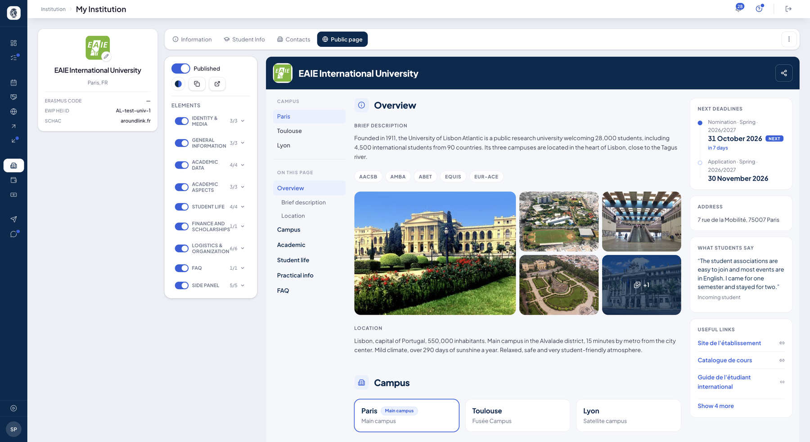
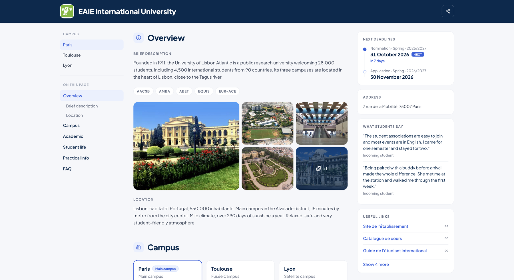

# Your public page

Your public page is **a web page in your name**, reachable without an account, that you
compose from AroundLink and hand to whoever you like: a partner discovering you, a student
hesitating, a colleague preparing a committee.

It reuses what you already maintain in the tool — your photos, your mobility periods, your
language requirements, your course catalogue, your FAQ. Nothing to retype.

!!! info "Where it happens"
    **My institution ▸ Public page.** The page's address is
    `app.aroundlink.com/aroundlink/<your-school>`.

## Composing, not filling in a form

**What it is for.** Deciding what the world sees of you, while seeing it.

**Who it is for.** IO officer / coordinator

**How it works.** The composer **shows the page itself**, exactly as the public will see
it. Each block can be grabbed and moved, or removed with a cross; a side panel offers what
is not yet placed, sorted by category and collapsible.

The preview **is** the page: there is no "edit mode" that would render differently from
reality.

*On the left, your sections each with a switch and a counter; in the middle, the page as the public will see it; at the top left of the page, the campus selector.*

!!! note "The order of sections cannot be changed"
    That is deliberate: every institution's page reads in the same order, which makes it
    comparable from one partner to the next. You decide **what gets published**, not the
    order.

## What you can put on it

**How it works.** Your **logo** is served automatically, at the top and in the footer: it
is not a block to tick. The rest is your choice.

| Group | Available blocks |
|---|---|
| **Identity & media** | Photos · Key facts (website, Erasmus code, accreditations) · Campus cards |
| **Academic data** | Mobility periods · Language requirements · Course catalogue · Catalogue filter by promotion |
| **Your sections** | every section of your student content, in the order of your categories — general information, academic aspects, student life, scholarships, logistics |
| **FAQ** | your frequently asked questions, which close the page |
| **Side panel** | Nomination and application deadlines · Team contacts (role and email only) · Postal address · Student reviews (no names) · Useful links |

!!! warning "What never goes out"
    Team contacts only expose **the role and the email address** — never a personal number.
    Student reviews are published **without their author's name**. And no content belonging
    to another institution appears on your page.

*The same page, seen without an account: your colours and logo in the banner, the table of contents on the left, and the panel carrying your next deadlines, your address, your students' reviews and your links.*

!!! tip "A full example, to scroll through"
    [Open a sample public page](../assets/exemples/fiche-publique-exemple.html){ target=_blank } —
    the whole page of a demonstration institution, from the introduction to the FAQ.
    It is a frozen copy: the links in it lead nowhere.

## Your colours

**How it works.** You set **two colours** — an accent colour and a dark one — and the page
follows: the banner, the buttons, the footer. With your logo opening and closing the page,
it looks like your institution, not like AroundLink.

A discreet **Powered by AroundLink** signature sits at the bottom.

## One page per campus

**What it is for.** An institution with several sites has more than one reality: courses,
periods and contacts may differ from one city to the next.

**How it works.** Each declared campus can have **its own page**, composed separately, and
a selector moves from one to another in the composer. Content is broken down by campus: a
course declares which campuses it is taught on, and a campus page only shows its own.

On the public side, a menu links the pages together. A campus address is shared as you are
looking at it.

## Publishing, sharing, switching off

**How it works.** One switch publishes the page. The address copies with a button.

!!! warning "The address never regenerates"
    That is deliberate: you must be able to leave this link everywhere — in your emails, on
    your website, in a printed PDF — without it breaking one day. If you no longer want to
    be visible, **switch the page off**: that is the fallback, and the link works again
    when you switch it back on.

**Use case.**
> The office composes its page in twenty minutes: photos, periods, language requirements,
> course catalogue, FAQ, and in the side panel the two nomination deadlines. It sets the
> school's colours, publishes, and pastes the address into its email signature. A partner
> asking "your dates and prerequisites?" now gets a link instead of a PDF.
