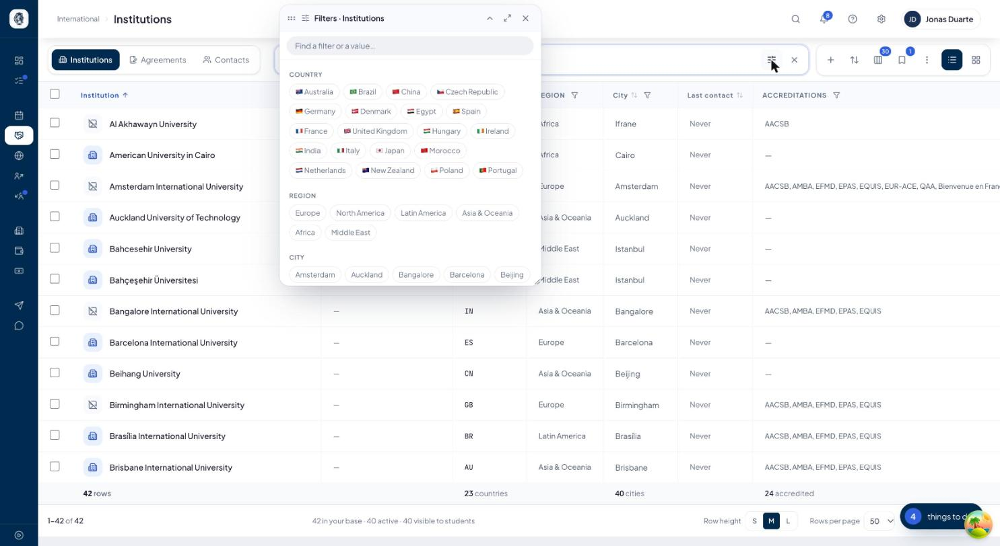
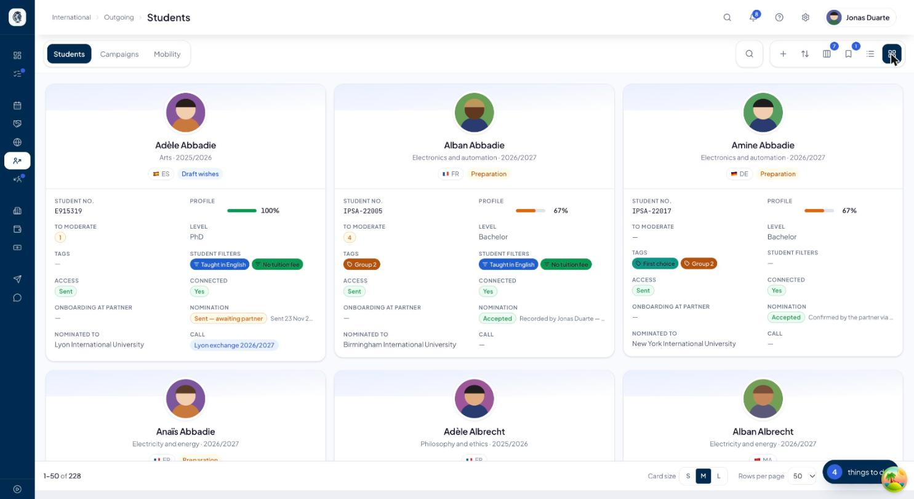
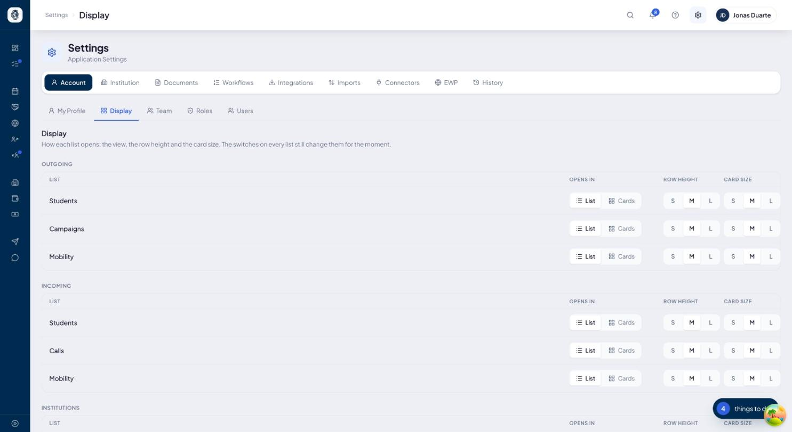

# Your lists: search, filter, display

Students, campaigns, partners, agreements, contacts: your lists all work the same way. What
you learn on one holds for the others.

## Searching

**Across the tool.** The magnifier in the top bar — or the **⇧ /** shortcut — searches
everywhere at once: students, institutions, contacts.

**In a list.** The magnifier in the table bar unfolds a search field. As you type, it
suggests filter values — "Country : France" — on top of the free-text search, which always
comes first. Folding the search keeps what you typed; active filters stay shown as chips
beside it.

## Filtering

The **Filters** button, in the search, opens a floating window, **Filters · <list>**. It does
not hide the table, which updates while you tick. You move it, enlarge it, fold it; a field
finds a filter or a value, and **Clear all** resets everything. Closing it **keeps the
filters on**.

*The "Filters · Institutions" window, over the list: tick a country, the table updates behind it.*

## Saving a view

The bookmark icon saves what you see — columns, filters and sort — under a name: **Save
current view**. Views are **shared with your team**.

While the screen matches a view, the bookmark is filled and the view ticked. If you change a
column, a filter or the sort, the bookmark empties and the menu offers **Save as a new
view…**; going back exactly to the view lights the bookmark again.

## List or cards

The lists of students (outgoing and incoming), campaigns, mobilities, received nomination
calls, partners and contacts show **as a list** or **as cards** — two icons in the table bar.
A student card shows their photo, name, institution or cohort, nationality and status, then
the columns you chose.

Bottom right, next to the pagination, you set the **row height** in list view and the **card
size** in card view: S, M or L.

*Outgoing students as cards: photo, name, cohort, nationality and status, then the chosen columns.*

**Settings ▸ Account ▸ Display** sets, for each list, how it opens: as a list or as cards, the
row height, the card size. This setting is personal and stays in your browser.

*Settings ▸ Account ▸ Display: for each list, the opening view, the row height and the card size.*

## Filling an empty cell

An empty cell shows "—". On hover it becomes **+ Set up** and leads to the screen where the
value is entered: a student's cohort or campus, a contact's phone, a partner's accepted tests,
a cell of an agreement's place distribution… Without the right to edit, the cell stays a
plain dash.

**Use case.**
> A coordinator filters her outgoing students on Spain, switches to cards to put faces to
> names before a meeting, saves the view "Spain 2027" for her team, and on the way fills in a
> student's missing campus with one click on **+ Set up**.
