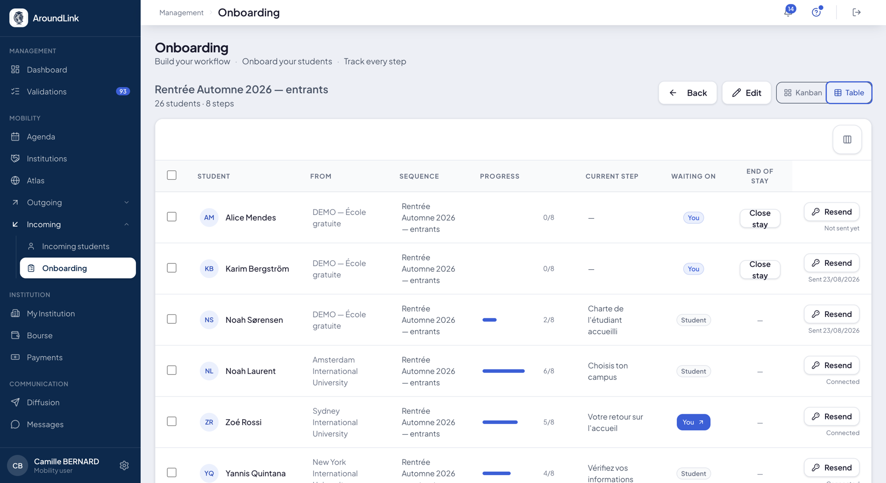

# Onboarding incoming students

Onboarding is the **stay of a student you host**, from their first access to their
transcript. It is steered with two objects:

- a welcome **[path](parcours.md)**, which describes what the student has to do — built once
  under **Settings ▸ Workflows**;
- a **welcome session**, which groups an intake of incoming students and names the path it
  applies.

!!! info "The counterpart of a campaign, on the incoming side"
    What a campaign is to outgoing students, the welcome session is to incoming ones: it
    gathers a group, applies a path to it, and carries its tracking. Both screens read and
    work the same way.

## Opening a welcome session

**What it is for.** Keeping your intakes apart. Autumn and spring have neither the same dates
nor necessarily the same requirements.

**Who it is for.** IO officer / coordinator

**How it works.** Under **Onboarding**, **New session**: you name the session — "Autumn 2026
intake" — and pick the path it applies. Only **incoming** paths are offered.

A session can be renamed, duplicated, and **closed** when the intake ends. Two sessions
cannot carry the same name.

!!! warning "A session without a path asks for nothing"
    The path is what gives the student work to do. A session opened without one takes in files
    that have no step to clear. The screen says so and offers to plug one in.

## Accepting a nomination into a session

**What it is for.** Attaching every incoming student to their intake at the moment of
acceptance, rather than later and forgetting.

**How it works.** When you accept a nomination, the screen **always asks for the welcome
session** the student joins. The student then receives that session's path, and their
onboarding file knows which session it was opened in.

A file already under way **keeps its place**: changing a session's path does not restart the
steps already cleared.

!!! tip "Opening access"
    Access is opened from the session. It asks you to pick the session — without that choice,
    nothing is saved. The state of each access is read on the tracking: not sent yet, sent on
    such a date, or already signed in.

## Following where everyone stands

**What it is for.** Knowing at a glance who is waiting for what.

**How it works.** The session carries the same [tracking](suivi-mobilites.md) as a campaign,
with the same views and the same tools: table or kanban, search that suggests filters,
sorting, card-line picker, saved views and **Export what is on screen**.

A session's table adds what only makes sense for an incoming student: their **home
institution**, **country**, **level**, **field of study** and **home city**, alongside
progress, current step and the state of their access.

*The intake as a table: progress, current step, who is expected, and the state of each access.*

## What the hosted student sees

**How it works.** The student finds their path on **My onboarding**: a single task list, in
order, with what is asked of them at each step. Steps that mirror an act done elsewhere tick
without them doing anything.

Documents in their file **only open once validated**: a transcript or a certificate still
being produced is not shown half-made.

!!! note "One document, one validation"
    A document uploaded by an incoming student is validated **by their home institution**, not
    twice. The host institution can open it and read it; it does not redo the validation work.

**Use case.**
> The school hosts twenty-six incoming students in the autumn. It builds an eight-step path —
> proof of funds, language test, charter to accept, hosting certificate, campus choice, then
> courses — and opens the "Autumn 2026 intake" session. Every accepted nomination joins that
> session and receives the path. The coordinator filters the kanban on what is waiting for
> her: three files, and the rest moves on without her.
