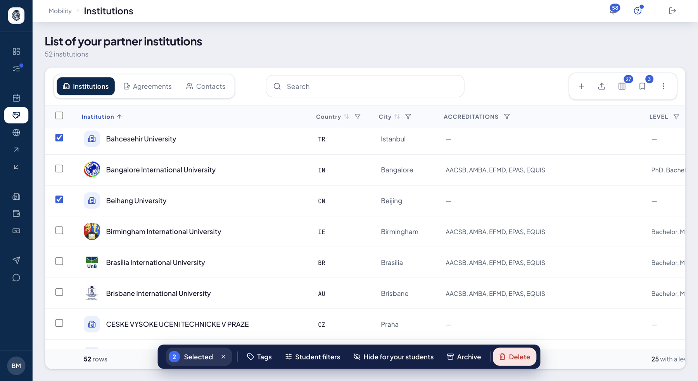
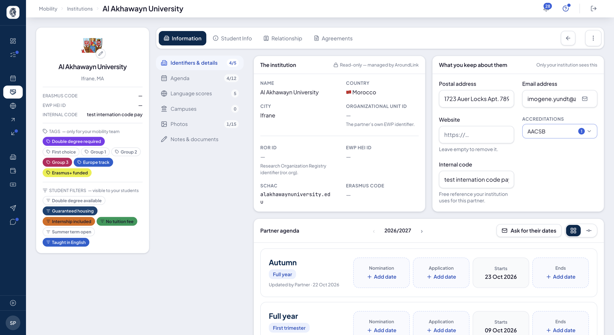
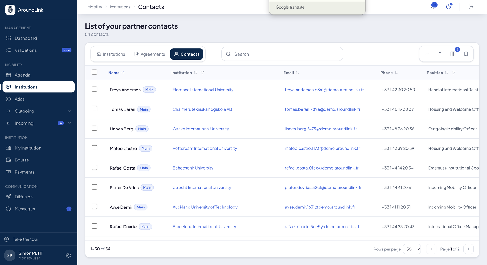
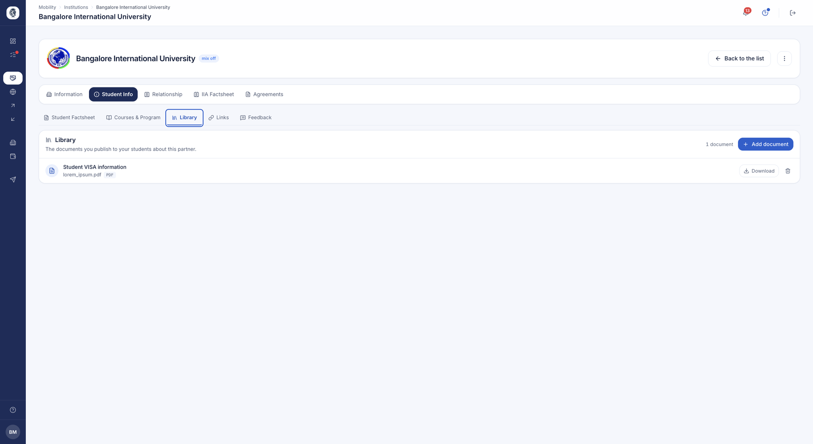
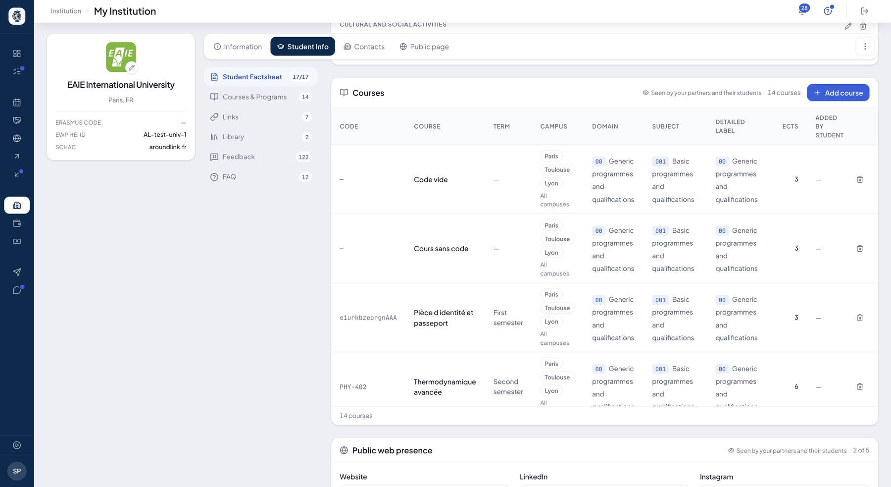

# Partners & institution files

The **Partners** module brings together, in one place, every institution your
international relations office works with: where they are, what agreements bind
you, how many places remain open, and the state of their official data. Each
partner has a complete file that your students and your team consult throughout
the year.

## Partner directory

**What it's for.** A single, filterable table of all your partner institutions.
It gives an immediate overview — country, city, accreditations, tags, languages,
levels, remaining places, number and type of agreements — and acts as the entry
point into each partner file.

**Who it's for.** RI manager / coordinator

**How it works.** The directory lists the partners your institution tracks (those
you have an agreement with or that you created). You filter the list straight from
the search bar, then click a row to open the file. A toggle switches the same
table to the consolidated agreements view.

*Your partners, with their internal code, accreditations, your tags and the levels open. Click the image to enlarge it.*

**Use case.**
> A coordinator filters on "Spain + active agreements", then opens a university's
> file to check its contacts.

## Create a partner institution

**What it's for.** Register a new partner not yet on the platform, capturing its
identity, location, official identifiers and at least one main contact. The
partner immediately becomes visible in the directory and available for agreements.

**Who it's for.** RI manager / coordinator

**How it works.** **The form starts with the institution's domain** — the one its
professional email addresses use. That is what identifies an institution reliably,
where two similar names often mean the same school.

Before creating anything, the platform checks that domain and shows you the
records it already knows. Three outcomes:

- **That's the one** — you attach the existing record to your directory. No
  duplicate is created, and you inherit what is already filled in.
- **None of these is my partner** — your request goes to our team, who complete
  the shared reference.
- **It is unknown** — you create it, with at least one main contact.

On save, the partner is attached to your institution and its contacts are linked
to any matching existing accounts. You are then redirected to the full file to
keep editing.

Beyond the domain, only the **name** is required: the rest is filled in as you
learn it.

**Use case.**
> The office signs a new partner in Portugal; the coordinator adds it with its
> Erasmus code and the receiving coordinator as main contact.

## Institution file (Information)

**What it's for.** The editable identity card of a partner: description,
accreditations, links, private tags, internal code, logo and photo. Everything the
office wants to remember about a partner is centralised here.

**Who it's for.** RI manager / coordinator

**How it works.** One page combines the information form, logo and photo uploads,
and the expected language-scores block. Descriptive fields are editable; the
official technical identifiers stay read-only. Saving only affects your own tags
and your internal code for that partner; other institutions' data on a shared
partner is never modified.

*A partner's fiche: on the left their identity card, which stays on screen — including your tags and student filters; in the middle the index of sections with what is left to fill in; on the right what you keep to yourself. At the bottom, their agenda and the button that asks them for their dates.*

**Use case.**
> The coordinator tags Bologna as "Priority" and records the office's internal
> reference for that institution.

### Partner tags

**What it's for.** Define your own colour-coded labels (for example "Priority",
"Double degree", "Watch") and apply them to partners for grouping and filtering.
Tags are private to the institution that creates them.

**Who it's for.** RI manager / admin

**How it works.** A management screen (Settings ▸ Institution) lets you create,
edit and delete tags, each with a name and a colour. Tags are applied from the
partner file and appear as badges and filters in the directory.

**Use case.**
> The office creates a red "Suspended" tag and applies it to two partners whose
> agreements have expired.

### Partner internal code

**What it's for.** Record your own internal identifier for each partner, distinct
from the official code, to map partners onto your existing spreadsheets or
management tools.

**Who it's for.** RI manager / coordinator

**How it works.** It's not a separate screen: just a field on the partner file.
Left blank, it clears the code; filled in, it creates or updates a reference
private to your institution. It appears as a column in the directory.

**Use case.**
> The coordinator records the internal reference "IT-BOL-01" for Bologna.

### Expected language scores

**What it's for.** Record the language-test thresholds a partner expects from
incoming students (for example IELTS 6.5, TOEFL 90, B2), on the same scale
students declare — so the two can be compared directly during selection.

**Who it's for.** RI manager / coordinator

**How it works.** A management block (add, edit, delete via a dialog) on the
partner file. Each entry reuses the student-score structure: test type, overall
score, the four sub-scores and an optional CEFR level. The test reference now
states **which language each test measures**, so a requirement and a certificate
can be matched without interpretation.

**Requiring two languages: AND between blocks, OR inside.** A requirement is no
longer a flat list of alternatives. Each expectation belongs to a **block**, and a
block is **one proof to provide**:

- inside a block, expectations are **alternatives** — "IELTS 6.5 **or** TOEFL 84";
- between two blocks, they **add up** — "English **and** Portuguese".

A single failed block is enough to refuse the wish. This is what finally expresses what
a university really asks when it requires a second language on top of English: before,
the student stayed eligible as soon as English was satisfied.

The **grade point average** holds its own requirement apart: it belongs to no language
block.

**Where a requirement comes from.** The same fiche can carry two origins, and the
difference matters — one applies to everyone, the other to you alone. A note at the
top of the block says which:

| Note | What it means |
|---|---|
| **Published by this partner** | the partner publishes its own requirement from its own fiche; it applies to all its clients |
| **Provided by this partner** | the fiche is kept by the partner: you view, you do not change |
| **Only your institution sees this** | this is **your** record for this partner — ring-fenced, nobody else sees it |

When the partner publishes its requirement, that one decides: your line stays
visible but no longer applies, and the counter only counts what acts. You can
**take it back at home** — your value applies again, for your institution only.

A **source** column gives the same information row by row, and the fiche says who
filled it in.

!!! info "What your institution publishes"
    The counterpart, seen from your side: the scores **you** require of your incoming
    students are entered under [My institution](mon-etablissement.md), and your partners
    read them on your fiche. An institution on a free plan publishes its language
    requirements — and nothing else.

**Use case.**
> The coordinator records "Lund: IELTS 6.5 / B2"; a student at IELTS 6.0 is then
> flagged below the threshold. Six months later Lund publishes its own requirement at
> 7.0: it takes over, and the coordinator's line stays visible but marked as no longer
> applying.

### A partner's cities

**What it's for.** Many partners have several sites — Berlin, Düsseldorf, Frankfurt.
Those cities only lived in a free-text field: you could not send a student there, nor
put places on them.

**Who it's for.** RI manager / coordinator

**How it works.** You **declare a partner's cities yourself** from its fiche: a name, a
country. They appear under its name, collapsible, and the **institution itself counts
among its places** — at the top, labelled **Main**.

A switch on each city **turns it on as a destination**: it then becomes a full campaign
destination that a student can wish for, and the student sees it like any other
destination.

!!! warning "These cities are ring-fenced"
    The cities you declare for a partner **belong to you alone**. Another institution
    working with the same partner does not see them. The padlock on the list says so.

!!! note "A partner who keeps its own fiche keeps control"
    If the partner manages its own campuses, those are the ones that count: you view
    them, you do not add on top. Two sets of cities for a single institution would make
    no sense. And a city does not contain cities — the screen does not offer it.

**Places follow the place.** A place belongs to its agreement and carries **the location
it is meant for**: the cities' matrices stack up in the places page, each announcing what
it already carries. Three campuses therefore do not add three agreements.

!!! warning "Switch off before deleting"
    A city turned on as a destination cannot be deleted: students may already have chosen
    it, and its places would go with it. Switch it off first — the screen says so and
    refuses clearly. The deletion is then confirmed, and it is definitive.

## Partner contacts

**What it's for.** A directory of the people the office deals with at each partner,
one designated as main. These contacts feed the agreement and signatory dropdowns.

**Who it's for.** RI manager / coordinator

**How it works.** Two entry points: a global list of your contacts and a
"Relationship" tab per partner. Each contact has name, email, phone, position and
a "main" flag. On save, a contact is automatically linked to a matching existing
account.

*Your contacts at partner institutions, the "Main" badge marking the one who receives requests and nominations. This is where you open their access.*

**Use case.**
> The coordinator adds a partner's Erasmus officer and marks them as the main
> contact.

### Open portal access (invitations)

**What it's for.** Open partner-side access for a contact so they collaborate
directly (for example to approve an agreement). In one click, the system invites
the contact, links them to an existing account, or reports a conflict.

**Who it's for.** RI manager / coordinator

**How it works.** From a partner contact, "Open access" sends an email invitation;
a "Resend" action re-issues it. Both are rate-limited to avoid repeated sends.

**Use case.**
> The coordinator invites the partner's Erasmus officer so she can review an
> agreement in her own portal.

## Consolidated agreements view

**What it's for.** A unified view merging Erasmus (IIA) and bilateral agreements
across all your partners, to see and filter in one place each agreement's status,
validity years, signing date and approval state.

**Who it's for.** RI manager / coordinator

**How it works.** A toggle switches the directory to this normalised view, one row
per agreement. Each row shows the partner, the source (IIA or bilateral), the
type, the status (active / inactive / terminated), local and partner approval, and
the validity years.

**Use case.**
> The office filters "All agreements" on "Expired" to plan renewals.

## Institution lookup (autocomplete)

**What it's for.** Speed up data entry by suggesting known institutions as you
type, to attach partners and agreements to the right, correctly-named institution.

**Who it's for.** RI manager / coordinator

**How it works.** A field suggests the institutions matching your input;
autocomplete is built into the relevant forms.

**Use case.**
> Typing "sorbon" suggests "Sorbonne Université" with its identifiers.

## Partner student content

**What it's for.** Compose the practical information students see about a partner
(description and content blocks grouped by category), to give consistent guidance
approved by the office.

**Who it's for.** RI manager / coordinator

**How it works.** An editor with a description field and the add, edit or delete of
content blocks grouped by sub-category. A bulk import can also load this content
from a file.

**Use case.**
> The office fills in the "Housing" and "Visa" blocks of a partner so they appear
> on its student page.

## Partner document library

**What it's for.** Keep the files attached to a partner (signed agreements,
brochures…), to gather all partner documents in one place.

**Who it's for.** RI manager / coordinator

**How it works.** You upload named documents to a partner (duplicate names are
rejected), list them, and delete them individually.

*The documents you publish to your students about this partner.*

**Use case.**
> The coordinator uploads the signed cooperation-agreement PDF to the partner
> file.

## Partner course catalogue

**What it's for.** Maintain the list of courses available at a partner for the
exchange, so students and the office know what can be studied there.

**Who it's for.** RI manager / coordinator

**How it works.** You add courses via a form and delete them per partner; they are
listed by code.

Each course now declares **where and when it is taught**, and **to whom**:

- the **campuses** it is taught on — a campus page only shows its own;
- the **incoming periods** it is open to;
- the **incoming promotions** that can take it.

Two columns summarise this in the list: **Open to** — the promotions — and
**Available in** — the periods. The catalogue can then be filtered by period.

!!! warning "A label is incoming OR outgoing, never both"
    Your mobility periods and your custom academic levels now carry a **direction**.
    Everything that existed was switched to **outgoing**. A consequence worth knowing:
    **levels and periods only appear on your pages once your incoming labels are
    declared**. If a page looks empty on that side, that is where to look.

*The course catalogue — here your own institution's. Each course says which campuses it is taught on and in which term. The "Open to" and "Available in" columns appear as well once you have declared your incoming labels.*

**Use case.**
> The office records the 12 English-taught master's courses a partner offers to
> incoming students.

## Partner FAQ

**What it's for.** Gathering the questions your students always ask about a destination,
and their answers.

**Who it's for.** RI manager / coordinator

**How it works.** What you see depends on the nature of the partner, on the same principle
as its factsheet, course catalogue and library:

- **The partner is itself an AroundLink client** — it publishes its own FAQ, which you read
  as written, marked "Provided by this partner". It updates when they change it; you have
  nothing to maintain.
- **The partner is not a client** — it broadcasts nothing, so the FAQ is yours. You write it
  about them, for your students, and **your institution alone sees it**.

Each question carries its category and the audience it addresses.

**Use case.**
> The same three questions came up every year about housing in Lisbon. The coordinator
> writes them once in the record's FAQ; their students now find them before writing in.

## Partner web & social links

**What it's for.** Record a partner's website and social networks, so students and
staff can reach its official channels.

**Who it's for.** RI manager / coordinator

**How it works.** A form edits the website, Instagram, LinkedIn, Twitter and
Facebook, with a save confirmation and a clear flag when something is wrong.

**Use case.**
> The coordinator adds a partner's Instagram so it appears on the student page.

## Student-feedback moderation

**What it's for.** Review, accept (and publish) or refuse the feedback your students
leave about their host institution, controlling what future students see while
keeping a record of each decision.

**Who it's for.** RI manager / coordinator

**How it works.** A view by status (pending / accepted / refused) with counters.
Accepting can publish the review (visible to students) or keep it hidden; refusing
hides it and records a reason. Each decision writes a history entry with the author.
Reviews appear in two places: on the partner's page, and in a dedicated tab on the
profile of the student who wrote them.

**What you see.** Only the reviews written by **your** students. A review written by
another institution's student — even about a partner you also track — is never shown
to you, whatever its status.

**Use case.**
> A coordinator reads a pending review, publishes the positive ones and refuses an
> inappropriate one with a reason.

!!! info "Paid plan only"
    Reading and moderating reviews are part of the paid plan. An institution on free
    access does not have this screen.

## Preview as student

**What it's for.** Show the office exactly what a student sees on a partner's page
— places by category, level and field, requirements, published reviews — to verify
the file before students rely on it.

**Who it's for.** RI manager / coordinator

**How it works.** The preview displays the partner's student page, with place
distributions gathered across all agreement types, filterable by year, level and
field. With no student profile, filters start on "All".

**Use case.**
> Before a campaign opens, the coordinator previews a partner to confirm the
> display of places and requirements.

## Hide, archive or merge a partner

**What it's for.** Take a partner you no longer work with out of circulation, or
bring together two records pointing at the same institution, without ever losing
the history of past mobilities.

**Who it's for.** RI manager / coordinator

**How it works.** Three moves, from the lightest to the most final. **Hiding**
removes the partner from your students' view while keeping it in your internal
lists. **Archiving** also takes it out of your campaigns and destination counts.
**Merging** brings two records into one: the agreements, contacts and mobilities
of the absorbed record are attached to the one you keep.

In all three cases, nothing is deleted. Mobilities already completed with that
partner remain visible in the files of the students concerned.

**Use case.**
> After a university merger, the coordinator brings the two records into one; the
> agreements from both end up in the same place, with no re-entry.

!!! warning "Contact access"
    Archiving a partner revokes the access you had opened for its contacts. They
    can no longer sign in until the partner is reactivated.

## Import partner institutions

**What it's for.** Bulk-load or refresh many partners from an Excel file, with
strict header checking so a badly-filled template doesn't silently import zero
rows.

**Who it's for.** RI manager / admin

**How it works.** You upload the file; headers are checked up front (missing or
unknown columns flagged); rows are imported and a failing row is skipped without
blocking the others. Re-importing an existing institution refreshes its filled-in
fields. A summary reports creations, updates and skipped rows.

**Use case.**
> The office uploads 300 partners: 280 created, 20 updated, a header typo caught
> before any save.

## Import partner contacts

**What it's for.** Bulk-load partner contacts from a CSV or Excel file, matching
them to partners by email domain, with a preview before writing.

**Who it's for.** RI manager / admin

**How it works.** You upload the file, a preview is shown without writing anything,
then you confirm. A failing row is skipped, the others continue. The summary
reports creations, updates, skipped rows and email domains matching no known
partner.

**Use case.**
> The office uploads a contact list: each one joins the right partner, and 3
> unknown domains are flagged.

