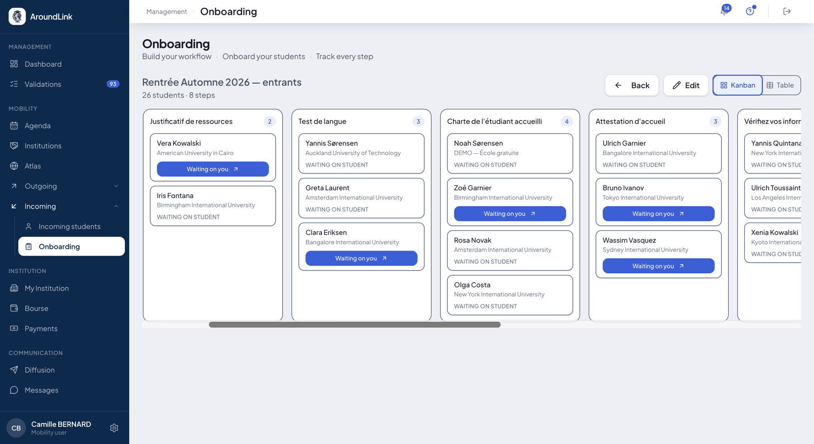

# Mobility tracking

Once the [path](parcours.md) is plugged in, tracking answers the only question you ask when
you open a file: **where does this student stand, and do I have anything to do?**

The same tracking serves both directions — the students you send and the ones you host —
with the same words, the same views and the same filters.

## The three phases of a mobility

**What it is for.** Sorting files in the order of time rather than in the order of steps. You
do not steer someone who has not left the way you steer someone who is back.

**Who it is for.** the whole mobility team

**How it works.** Each step of a path declares its phase, and a file's phase is **the first
one that is not finished**. It is therefore not declarative: it follows from the work
actually done.

| Phase | Read on a file | What it covers |
|---|---|---|
| **Before the mobility** | *Not departed* | everything before departure: documents, learning agreement, insurance |
| **During the mobility** | *On site* | the stay: arrival confirmed, courses, on-site follow-up |
| **After the mobility** | *Returned* | the return: departure certificate, transcript, feedback |
| **Closed** | *Closed* | the file is closed |

!!! info "A phase follows, it is not typed in"
    You do not move a student from one phase to another by hand. Move the steps on — or let
    the mirrors tick — and the phase follows. A finished file says so even without a closing
    date.

## Two views of the same tracking

**What it is for.** The table to work through, the kanban to see what is coming.

**How it works.** Both views share the same toolbar: search, sorting, filters, column
picker, saved views and export.

The **table** lines the files up in rows, with progress in figures, the current step and who
is expected. Eight optional columns can be added and sorted: **Destination**, **City**,
**Country**, **Region**, **Period**, **Level**, **Field of study**, **Agreement**,
**Workflow**.

The **kanban** gives one column per phase and one card per student. Each column scrolls
inside itself, its title stays visible, and the gauge at the top says how many files have
**passed** the step — mirrors included. You pick up to thirteen facts to show on the cards,
and the whole card leads to the file.

The kanban's search **suggests filters as you type**: Destination, City, Country, Region,
Period, Level, Field of study, Agreement, Phase.

!!! tip "The export takes what you have in front of you"
    The **Export what is on screen** button takes your filters, your visible columns and your
    sorting. It is available on both views and in both directions.

## Where to find it

**How it works.** Tracking appears in four places, and it is always the same screen:

- **a campaign's Mobility tab** — every outgoing student of that campaign. If no path is
  plugged in, the tab says what is missing and offers to plug it in on the spot;
- **a welcome session** — every incoming student of that session;
- **a student's Mobility tab** — one block per mobility: a student who left twice has two
  files, each with its dates and its progress;
- **the dashboard**, which gives the summary by phase.

A mobility header always reads the same way: **where**, **what**, **when** — the partner with
its logo, the agreement family, the period. And the breadcrumb goes all the way down to the
open session.

*One column per phase, one card per student. The gauge at the top of a column counts those who have passed the step.*

## The mobility timeline

**What it is for.** Reading a mobility in time rather than as a list: from the first wish to
the closing.

**How it works.** The timeline carries real dates and distinguishes its two sources — what
comes from the campaign and what comes from the path. It does not go back in time, and the
current day does not count as past. Campaign dates appear even if the student has submitted
no wish.

It is also what a student's [agenda](agenda.md) shows: the dated timeline of their mobility,
sorted into **overdue**, **upcoming** and **past**.

## Who is expected

**How it works.** On every row and every card, **Waiting on** says who holds the ball: the
student, you, or nobody when the step is a mirror. A step that nothing blocks is **due**, not
pending — the distinction saves you looking for a blockage that does not exist.

Shortcuts lead straight to the object named: a student's name opens their fiche, a path's
name opens its workshop, a transcript's badge opens the entry screen.

**Use case.**
> At the end of September, the coordinator opens the campaign's Mobility tab. The kanban shows
> four files still *Not departed* although classes have started. She filters on **Waiting on:
> you**, finds three learning agreements waiting for her signature, handles them, and the
> three cards move to *On site* on their own.
