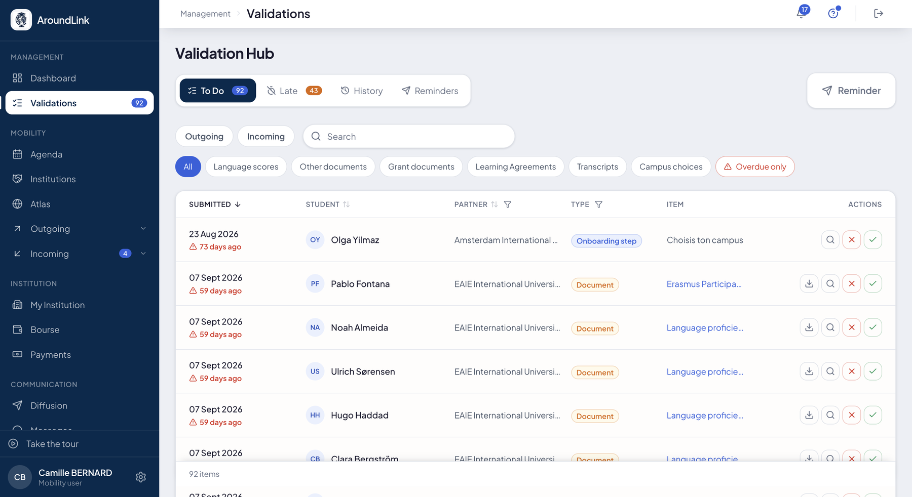
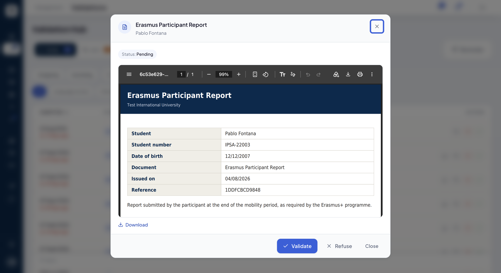
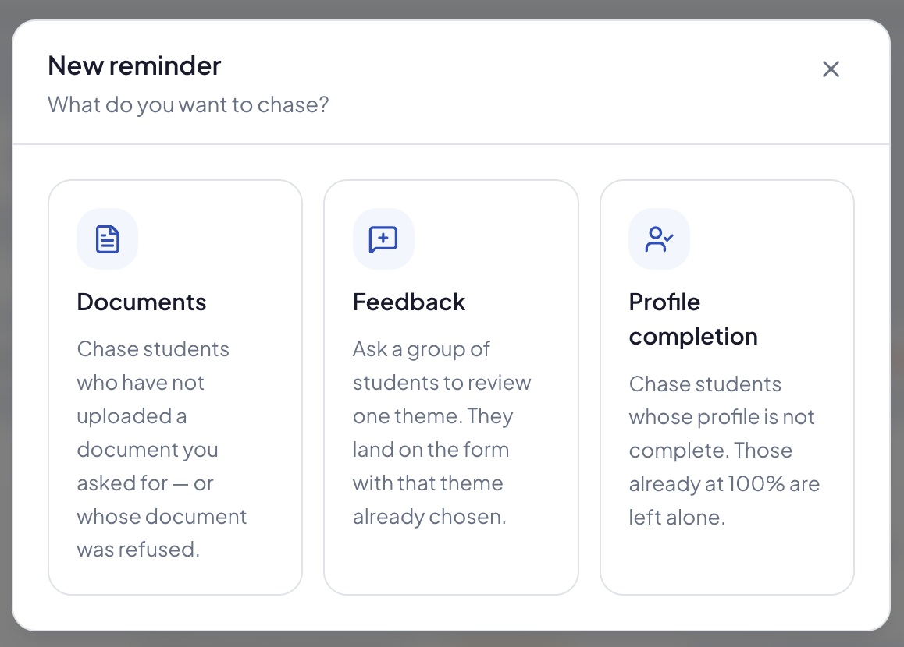

# Validations

Everything waiting for a decision from you, in one place: documents uploaded by your students,
learning agreements to sign, transcripts to issue. It is the screen you open in the morning to
see what is blocked.

## The validation queue

**What it's for.** One queue for everything your students submit, instead of one screen per
kind of document. What has waited too long is flagged, and every decision is kept with its
author, outcome and reason.

**Who it's for.** RI manager / coordinator

**How it works.** Four tabs:

| Tab | What it holds |
|---|---|
| **To Do** | everything waiting for your decision |
| **Late** | grant payments and grant documents past the delays your institution has set |
| **History** | what was validated or refused, by whom and when |
| **Reminders** | the reminders already sent — see below |

In **To Do**, you pick the direction — **Outgoing**, **Incoming**, or both — and chips filter by
kind of document. They follow the direction, because the work is not the same:

| Direction | Chips |
|---|---|
| both | **Language scores**, **Other documents**, **Feedback** |
| **Outgoing** | **Grant documents**, **Learning Agreements**, **Transcripts** |
| **Incoming** | **Course choices**, **Campus choices**, **Other steps** — the steps of your onboarding |

**Overdue only** isolates what has waited more than seven days; it combines with the other
chips. A search finds a student or a partner.

*The queue: the four tabs, the direction, chips by kind of document, and each item's age in red once it has passed seven days.*

**Deciding.** Each row is decided on the spot — ✓ to validate, ✗ to refuse — or opened: the
document then shows in a window, with its status, so you can read it before deciding. A refusal
always asks for a **reason**: it goes to the student, who knows what to fix.

*A document opened from the queue: read it, download it, then validate or refuse.*

**Use case.**
> On Monday morning, the coordinator clicks **Overdue only**: 3 items. They open a language
> score, validate it, and refuse an unreadable certificate saying why — without leaving the
> queue.

## Chasing from the queue

**What it's for.** What was never sent to you cannot be validated. The **Reminder** button, on
the same line as the tabs, chases students right where you notice what is missing.

**How it works.** You pick what to chase:

- **Documents** — students who have not uploaded a document you asked for, or whose document
  was refused;
- **Feedback** — a group of students asked to review one theme; they land on the form with that
  theme already chosen;
- **Profile completion** — students whose profile is not complete; those already at 100% are
  left alone.

*Three kinds of reminder, each with its own target.*

The **Reminders** tab keeps each reminder's history: how many messages went out of how many,
when the first and the last were sent. Each kind of reminder is detailed in
[Diffusion & messages](communications.md).

