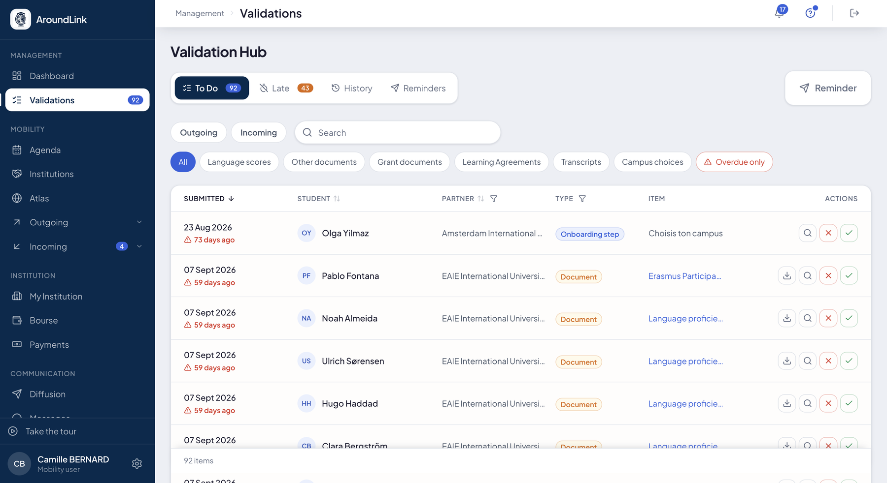
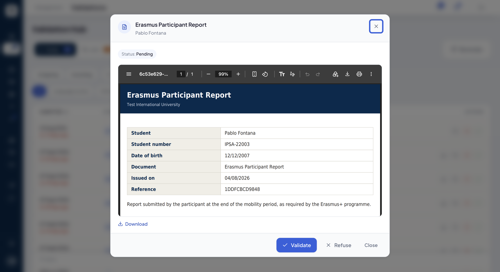
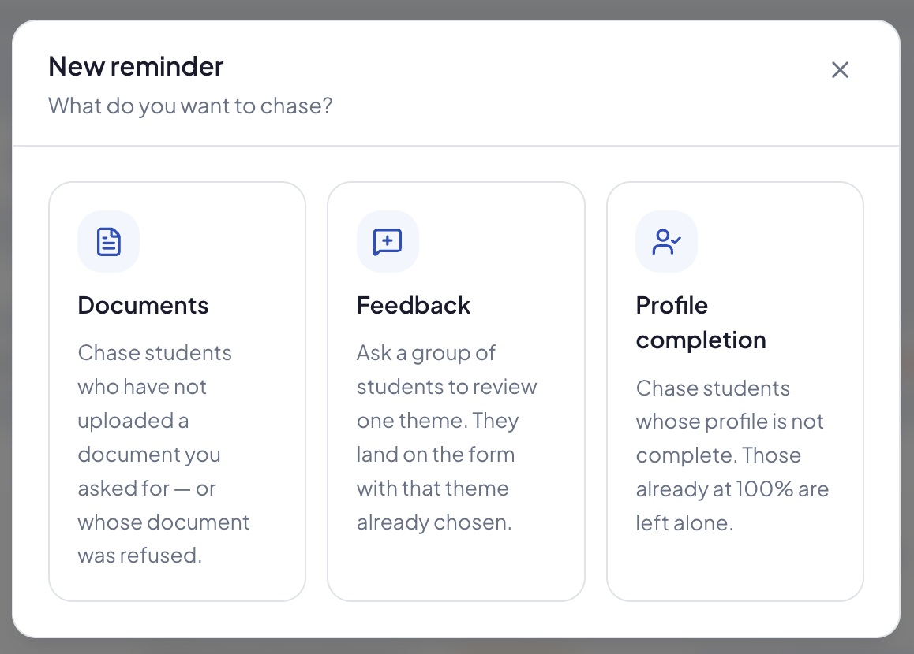

# Validations

Tout ce qui attend une décision de votre part, au même endroit : les pièces déposées par vos
étudiants, les contrats pédagogiques à signer, les relevés à émettre. C'est l'écran qu'on ouvre le
matin pour savoir ce qui bloque.

## La file de validation

**À quoi ça sert.** Une file unique pour tout ce que vos étudiants soumettent, au lieu d'un
écran par nature de pièce. Ce qui attend depuis trop longtemps est signalé, et chaque décision
est archivée avec son auteur, son issue et son motif.

**Pour qui.** gestionnaire RI / coordinateur

**Comment ça marche.** Quatre onglets :

| Onglet | Ce qu'il contient |
|---|---|
| **To Do** | tout ce qui attend votre décision |
| **Late** | les versements de bourse et les pièces de bourse qui ont dépassé les délais fixés par votre établissement |
| **History** | ce qui a été validé ou refusé, par qui et quand |
| **Reminders** | les relances déjà parties — voir plus bas |

Dans **To Do**, vous choisissez le sens — **Outgoing**, **Incoming**, ou les deux — et des
pastilles filtrent par nature de pièce. Elles suivent le sens, parce que le travail n'est pas le
même :

| Sens | Pastilles |
|---|---|
| les deux | **Language scores**, **Other documents**, **Feedback** |
| **Outgoing** | **Grant documents**, **Learning Agreements**, **Transcripts** |
| **Incoming** | **Course choices**, **Campus choices**, **Other steps** — les étapes de votre onboarding |

**Overdue only** isole ce qui attend depuis plus de sept jours ; elle se combine aux autres
pastilles. Une recherche retrouve un étudiant ou un partenaire.

*La file : les quatre onglets, le sens, les pastilles par nature de pièce, et l'ancienneté de chaque élément en rouge quand il a passé sept jours.*

**Décider.** Chaque ligne se décide sur place — ✓ pour valider, ✗ pour refuser — ou s'ouvre :
la pièce s'affiche alors dans une fenêtre, avec son statut, pour la lire avant de trancher.
Un refus demande toujours un **motif** : il part chez l'étudiant, qui sait ce qu'il doit
corriger.

*Une pièce ouverte depuis la file : on la lit, on la télécharge, puis on valide ou on refuse.*

**Cas d'usage.**
> Lundi matin, le coordinateur clique sur **Overdue only** : 3 éléments. Il ouvre un relevé
> de score de langue, le valide, et refuse une attestation illisible en indiquant pourquoi —
> sans quitter la file.

## Relancer depuis la file

**À quoi ça sert.** Ce qui ne vous a pas été envoyé ne peut pas être validé. Le bouton
**Reminder**, sur la même ligne que les onglets, relance les étudiants à l'endroit même où vous
constatez ce qui manque.

**Comment ça marche.** Vous choisissez ce que vous voulez relancer :

- **Documents** — les étudiants qui n'ont pas déposé une pièce demandée, ou dont la pièce a été
  refusée ;
- **Feedback** — un groupe d'étudiants à qui demander un avis sur un thème ; ils arrivent sur le
  formulaire, le thème déjà choisi ;
- **Profile completion** — ceux dont le profil n'est pas complet ; ceux déjà à 100 % sont laissés
  tranquilles.

*Trois sortes de relance, chacune avec sa cible.*

L'onglet **Reminders** garde l'historique de chaque relance : combien de messages sont partis
sur combien, quand est parti le premier et le dernier. Le détail de chaque type de relance est
dans [Diffusion & messages](communications.md).

