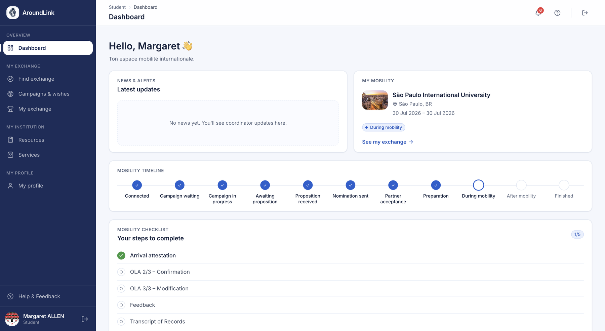
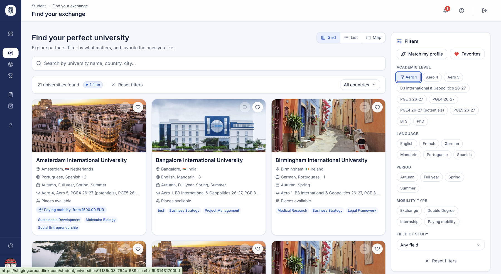
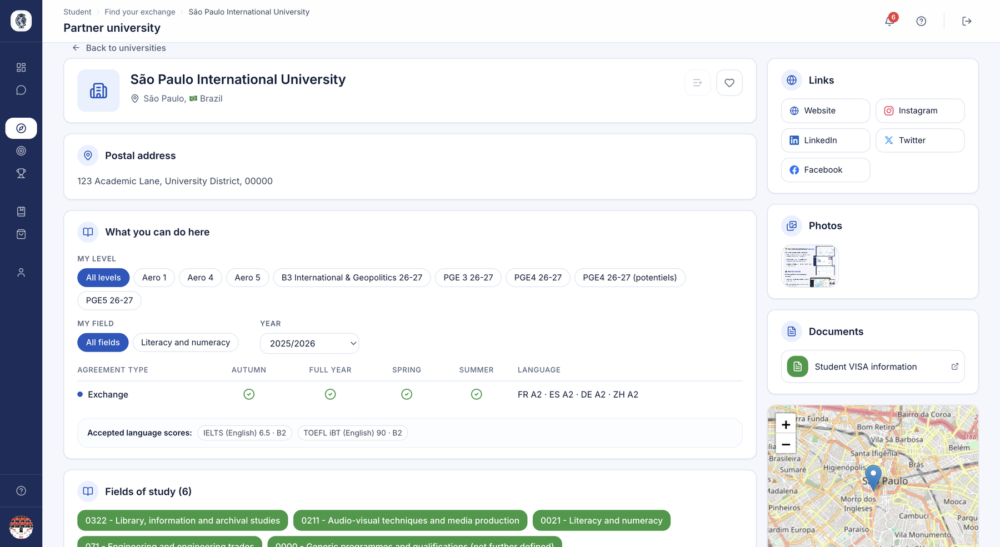
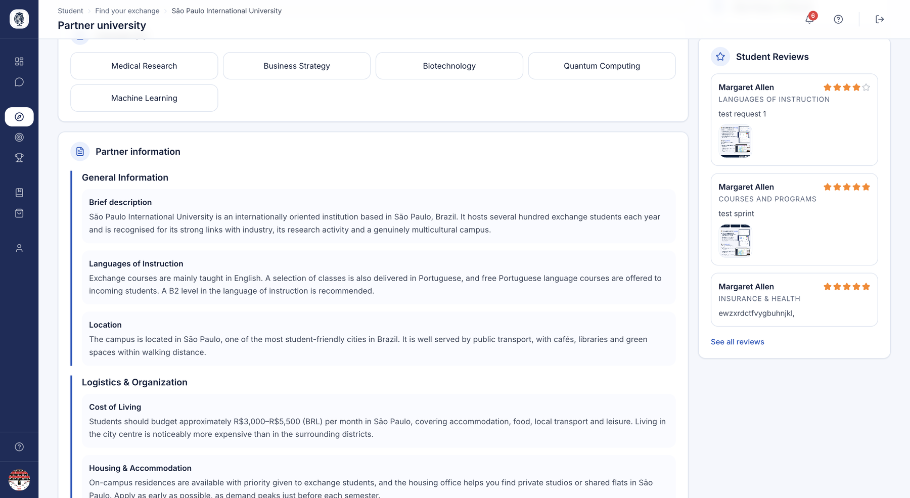
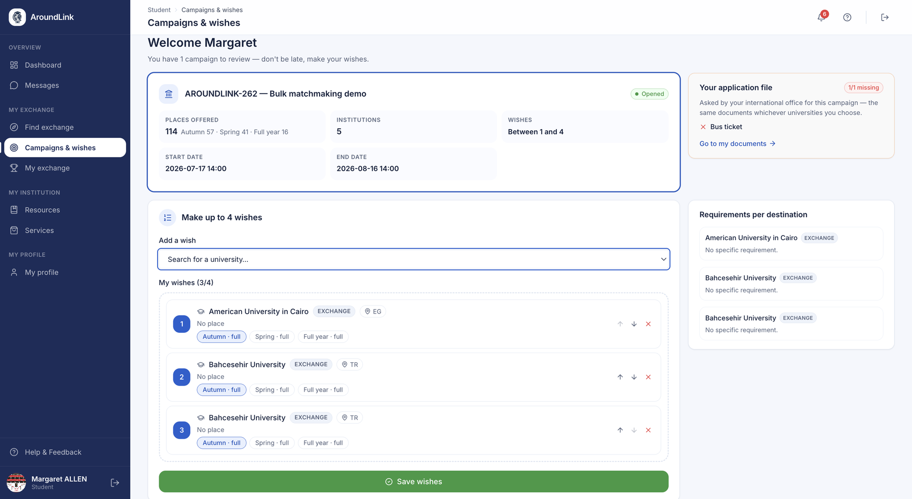

# Student portal — Discover & apply

The student portal supports every student from their first login through to their
application. Its menu has four headings:

| Heading | What is there |
|---|---|
| **Overview** | the dashboard, and messages if your institution has turned them on |
| **My exchange** | **Find exchange** and **Campaigns & wishes** for an outgoing student; **My exchange** as soon as they have a destination |
| **My institution** | the resources you publish, and services if the marketplace is on |
| **My profile** | their file: identity, documents, grant, learning agreement, transcript, reviews |

The menu promises nothing it cannot keep: **My exchange** only appears once a destination is
in sight, and an **incoming** student sees neither the search nor the campaigns — their
destination is you.

## Mobility dashboard

**What it's for.** The student's home page. At a glance it says which mobility we are
talking about, where they stand and what is left to do.

**Who it's for.** student

**How it works.** Two thirds of the screen are for **their mobility**, the last third for
your institution's **announcements**.

- **Before any destination**, the card presents partners to explore, with the same
  information as the search — languages, periods, places — and a link to it.
- **Once placed**, the header names the mobility: city, country, agreement framework, period
  and actual dates. On the right, two figures: how many tasks are done, and where they are
  in their stay ("Returned · D+1" says they are back, and since when).
- Under the header, **three phase panels** — before, during, after — carry their tasks.
- Further down, their **agenda**: the dates of their mobility.

*The dashboard: their mobility and tasks by phase on the left, the institution's announcements on the right.*

**Use case.**
> A student placed in Bologna logs in: the header shows "Bologna, Italy", her dates and
> "4 / 9 tasks done", and the "Before departure" panel shows what is left.

## Profile — Personal information

**What it's for.** Students manage their identity and academic details here,
reused throughout the mobility process: name, contacts, emergency number,
nationality, birth information, student number, academic level, campus and field
of study. They also manage their profile photo here.

**Who it's for.** student

**How it works.** The student fills in a profile form and can upload a photo
(PNG or JPG). The academic-level field adapts to the institution: if it has
configured its own programmes (for example "Aéro 4"), those are shown;
otherwise a generic level is offered. The field of study is based on the ISCED
classification.

**Use case.**
> Before departure, a student updates their personal email and emergency number,
> then uploads an ID photo.

## Profile — Documents & language scores

**What it's for.** The student's document vault: what they upload, what you hand them, and
their language scores.

**Who it's for.** student

**How it works.** The profile has six tabs, in the same order as the file you read on your
side: **Overview**, **Bourse**, **Documents**, **OLA**, **ToR**, **Feedback**. On the left, a
rail always shows who they are and how complete their profile is.

The **Documents** tab reads in three views:

| View | What it holds |
|---|---|
| **What I upload** | the documents your institution and the campaign ask for, plus additional ones; a validated document is locked |
| **What I receive** | the documents you have issued to them — a document only appears once validated |
| **Language scores** | their language tests, each with its certificate |

When you hand them a document they have not opened yet, a **badge** on "My profile", in the
menu, tells them and takes them straight there.

**Use case.**
> A student sees a "1" badge on My profile: their assignment certificate has arrived in
> "What I receive". They open it, then record their English score under "Language scores".

## Profile — Mobility grant

**What it's for.** A read-only view of the mobility grants attached to the
student's exchange, so they can see the financial support awarded to them.

**Who it's for.** student

**How it works.** The tab lists the grants linked to the student's profile,
newest first. The student views the amount and status of their grant; there is
no data entry from this screen.

**Use case.**
> A student checks the amount and status of their Erasmus+ grant.

## Profile — Partner university reviews

**What it's for.** Once placed, the student can leave a review (topic, rating,
content, with optional photos) about their host university, to help future
students. They track their own reviews through moderation (Pending / Accepted /
Refused).

**Who it's for.** student

**How it works.** Students only review the institution of **their own** mobility:
the portal identifies it automatically from their placement, and without a
confirmed placement the form stays hidden behind an empty state. The topic is
picked from a detailed list — housing, courses, campus life, administrative
formalities… The review goes to moderation before any publication, and tabs
summarise the student's reviews by status.

**Use case.**
> A returning student writes a "Housing" review with two photos of the
> residence; it is sent to the coordinator for moderation.

## Find an exchange (partner search engine)

**What it's for.** This is the discovery hub: the student browses all of their
institution's partner universities, on a map and as cards, and narrows down by
period, level of study, ISCED field, mobility type, language and language level.
This is where they explore their possible destinations.

**Who it's for.** student

**How it works.** The page loads the partner universities and initialises a map.
The filters are dynamic and specific to each institution: only the periods,
fields, mobility types and languages actually present in the active agreements
are offered, covering Erasmus agreements (IIA) as well as bilateral, double-degree
and paying agreements. A "Match my profile" button pre-selects the student's
level and field. Filtering happens live, without a full page reload.

*Destination search: cards, list or world map, filters by level, language, period and mobility type, and favouriting.*

**Use case.**
> A 4th-year aerospace student clicks "Match my profile" and immediately sees
> only the partners offering their level and field for a winter semester.

## Partner university page

**What it's for.** The full page for one partner: description, documents, map,
language requirements, published reviews and — the centrepiece — a
"profile-first" table showing the available places by agreement type (Exchange /
Double degree / Paying agreement), split by period, filtered by default on the
student's level and field.

**Who it's for.** student

**How it works.** The page loads all agreements with this partner and
pre-selects the one matching the navigation context coming from the search
engine. It builds the language requirements, merges the place distributions of
the Erasmus, bilateral and double-degree agreements into a single matrix, and
displays one row per agreement type. The level, field and year remain
adjustable, and the student's profile pre-fills them. A sub-page lists all
published reviews.

*What a student sees of a destination: the places open by period and agreement type, filtered on their own level and field, the accepted language scores, the fields of study, the links and documents you published, and the location on a map.*

*Further down the same page: the practical information you wrote — description, languages of instruction, cost of living, housing — and the reviews left by students who have already been there.*

**Use case.**
> A student opens a partner's page, sees 3 study places for "Aéro 5" in the
> spring period under the exchange agreement, and reads 4 published reviews.

## Favourites

**What it's for.** The student can bookmark the partner universities that
interest them, so they can find them again quickly when building their wish list.

**Who it's for.** student

**How it works.** A toggle button adds or removes a university from favourites
and updates the list on the fly. The icon appears on the dashboard cards, the
search results and the partner pages.

**Use case.**
> A student bookmarks three institutions while browsing, then reviews their
> shortlist before building their wish list.

## Campaign wishes (application)

**What it's for.** The heart of the application. During an open campaign, the student ranks
destinations in order of preference — or says they do not wish to go.

**Who it's for.** student

**How it works.** The page lists the campaigns they are enrolled in. Opening one shows its
dates, how many wishes are allowed, their ranked wishes and what is missing from their file.

- **What they can ask for.** The list only offers destinations where a place is **planned
  for them** — their year, level, cohort, term. A full destination can still be requested; a
  destination never opened to their cohort does not appear.
- **Building the list.** They add destinations, rank them, and can pour in their
  **favourites** that are open in the campaign in one click.
- **Saving.** Each save checks the destinations' requirements — language level, documents —
  and says exactly what is blocking. While the campaign is open, they can change their wishes.
- **Not going.** If your campaign allows it, they can answer **"I don't wish to go"**. The
  answer is exclusive: their wishes are removed, and they can change their mind while the
  campaign is open. Your team can also record it for them — the screen tells them so. The
  setting is described in [Campaigns](../etablissement/campagnes.md).

*The campaign as the student sees it: dates, how many wishes are allowed, their ranked wishes, requirements per destination and what is still missing from their file.*

**Use case.**
> A student pours their three favourites into the campaign, adds two more, ranks them, then
> saves: a message points out the language score missing for their 2nd choice.

## Offer — Accept or decline

**What it's for.** When the institution proposes a place to the student (an
assigned wish), they see the offer and make the binding decision to accept or
decline it.

**Who it's for.** student

**How it works.** On the wishes page, the assigned offer is highlighted. Accept
and decline are two actions confirmed from a modal window. Each decision checks
that the wish belongs to the student and triggers a decision confirmation email.

**Use case.**
> A student receives an offer for their 2nd choice, clicks "Accept" in the modal,
> and receives a confirmation email.

