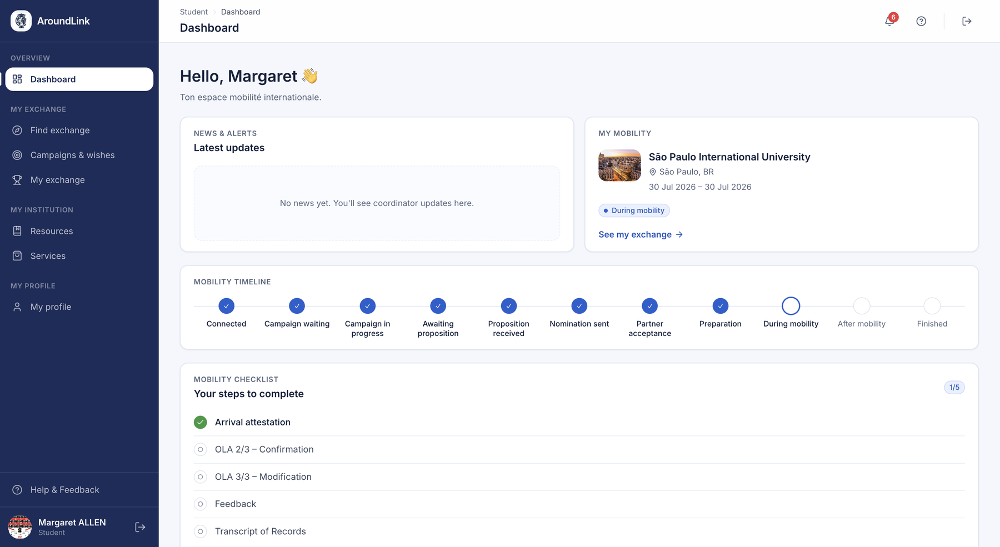
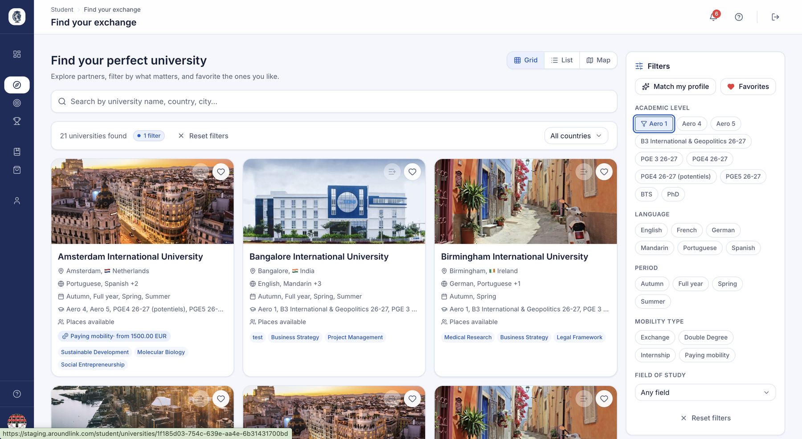
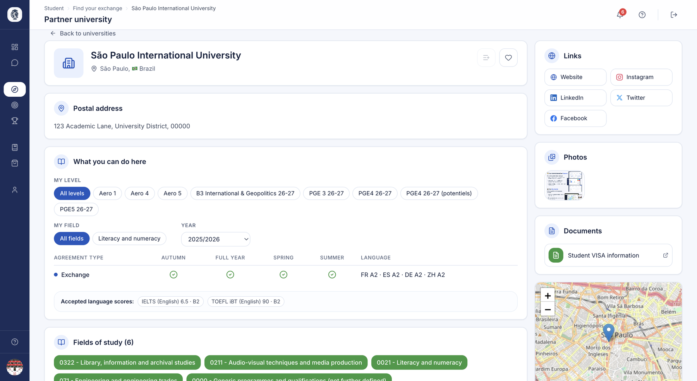
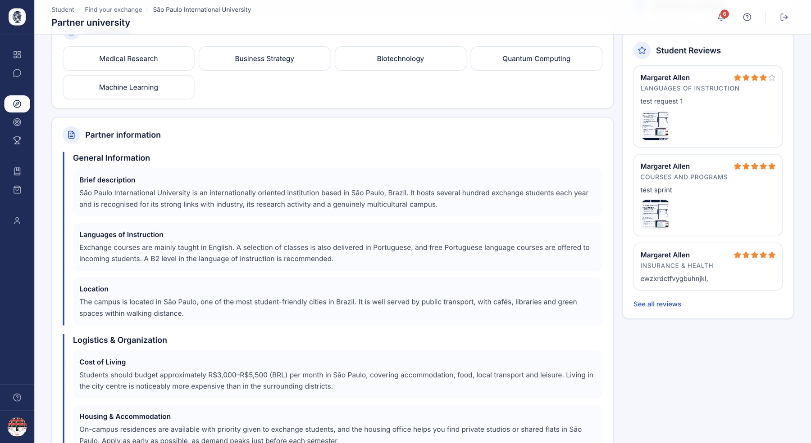
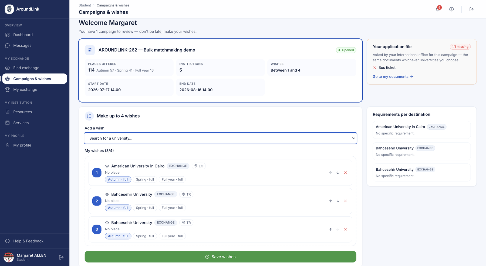

# Espace étudiant — Découverte & candidature

L'espace étudiant accompagne chaque étudiant de sa première connexion jusqu'à sa
candidature. Son menu tient en quatre rubriques :

| Rubrique | Ce qu'on y trouve |
|---|---|
| **Overview** | le tableau de bord, et la messagerie si votre établissement l'a ouverte |
| **My exchange** | **Find exchange** et **Campaigns & wishes** pour un sortant ; **My exchange** dès qu'il a une destination |
| **My institution** | les ressources que vous publiez, et les services si la marketplace est activée |
| **My profile** | son dossier : identité, documents, bourse, contrat pédagogique, relevé, avis |

Un menu ne promet rien qu'il ne tienne : **My exchange** n'apparaît qu'une fois une
destination en vue, et un étudiant **entrant** ne voit ni la recherche ni les campagnes —
sa destination, c'est vous.

## Tableau de bord de mobilité

**À quoi ça sert.** La page d'accueil de l'étudiant. Elle dit, d'un coup d'œil, de quelle
mobilité on parle, où il en est et ce qui lui reste à faire.

**Pour qui.** étudiant

**Comment ça marche.** Deux tiers de l'écran sont à **sa mobilité**, le dernier tiers aux
**annonces** de votre établissement.

- **Avant toute destination**, la carte présente les partenaires à explorer, avec les mêmes
  informations que la recherche — langues, périodes, places — et un lien vers celle-ci.
- **Une fois placé**, l'en-tête nomme la mobilité : ville, pays, cadre de l'accord, période
  et dates réelles. À droite, deux chiffres : combien de tâches sont faites, et où il en est
  de son séjour (« Returned · D+1 » dit qu'il est rentré, et depuis quand).
- Sous l'en-tête, **trois encarts de phase** — avant, pendant, après — portent ses tâches.
- Plus bas, son **agenda** : les dates de sa mobilité.

*Le tableau de bord : sa mobilité et ses tâches par phase à gauche, les annonces de l'établissement à droite.*

**Cas d'usage.**
> Une étudiante placée à Bologne se connecte : l'en-tête affiche « Bologna, Italy »,
> ses dates et « 4 / 9 tasks done », et l'encart « Avant le départ » lui montre ce qu'il reste.

## Profil — Informations personnelles

**À quoi ça sert.** L'étudiant y gère son identité et ses informations
académiques, réutilisées tout au long du processus de mobilité : nom, contacts,
numéro d'urgence, nationalité, informations de naissance, numéro étudiant,
niveau académique, campus et domaine d'études. Il y gère aussi sa photo de
profil.

**Pour qui.** étudiant

**Comment ça marche.** L'étudiant complète un formulaire de profil et peut
téléverser une photo (PNG ou JPG). Le champ de niveau académique s'adapte à
l'établissement : si celui-ci a configuré ses propres programmes (par exemple
« Aéro 4 »), ce sont eux qui s'affichent ; sinon, un niveau générique est
proposé. Le domaine d'études repose sur la nomenclature ISCED.

**Cas d'usage.**
> Avant son départ, un étudiant met à jour son email personnel et son numéro
> d'urgence, puis téléverse une photo d'identité.

## Profil — Documents & scores de langue

**À quoi ça sert.** Le coffre-fort documentaire de l'étudiant : ce qu'il dépose, ce que
vous lui remettez, et ses scores de langue.

**Pour qui.** étudiant

**Comment ça marche.** Le profil porte six onglets, dans le même ordre que le dossier que
vous lisez de votre côté : **Overview**, **Bourse**, **Documents**, **OLA**, **ToR**,
**Feedback**. À gauche, un rail rappelle en permanence qui il est et la complétude de son
profil.

L'onglet **Documents** se lit en trois vues :

| Vue | Ce qu'elle contient |
|---|---|
| **What I upload** | les pièces demandées par votre établissement et par la campagne, et les pièces complémentaires ; un document validé est verrouillé |
| **What I receive** | les documents que vous lui avez émis — un document n'y figure qu'une fois validé |
| **Language scores** | ses tests de langue, chacun avec son certificat |

Quand vous lui remettez un document qu'il n'a pas encore ouvert, une **pastille** sur
« My profile », dans le menu, le lui signale et l'y conduit directement.

**Cas d'usage.**
> Un étudiant voit une pastille « 1 » sur My profile : son attestation d'affectation est
> arrivée dans « What I receive ». Il l'ouvre, puis enregistre son score d'anglais dans
> « Language scores ».

## Profil — Bourse de mobilité

**À quoi ça sert.** Vue en lecture seule des bourses de mobilité rattachées à
l'exchange de l'étudiant, pour qu'il visualise le soutien financier qui lui a
été accordé.

**Pour qui.** étudiant

**Comment ça marche.** L'onglet liste les bourses associées au profil de
l'étudiant, de la plus récente à la plus ancienne. L'étudiant consulte le
montant et l'état de sa bourse ; il n'y a pas de saisie depuis cet écran.

**Cas d'usage.**
> Un étudiant consulte le montant et le statut de sa bourse Erasmus+.

## Profil — Avis sur l'établissement partenaire

**À quoi ça sert.** Une fois placé, l'étudiant peut déposer un avis (thème,
note, contenu, avec photos optionnelles) sur son établissement d'accueil, pour
aider les futurs étudiants. Il suit ses propres avis au fil de la modération
(En attente / Accepté / Refusé).

**Pour qui.** étudiant

**Comment ça marche.** L'étudiant ne note que l'établissement de **sa** mobilité :
l'espace l'identifie automatiquement à partir de son affectation, et sans
affectation validée le formulaire reste masqué derrière un état vide. Le thème se
choisit dans une liste détaillée — logement, cours, vie sur le campus, démarches
administratives… L'avis part en modération avant toute publication, et des onglets
récapitulent les avis de l'étudiant par statut.

**Cas d'usage.**
> Un étudiant de retour rédige un avis « Logement » avec deux photos de la
> résidence ; il est transmis au coordinateur pour modération.

## Rechercher un exchange (moteur de recherche partenaires)

**À quoi ça sert.** C'est le hub de découverte : l'étudiant parcourt tous les
établissements partenaires de son établissement, sur une carte et sous forme de
cartes, et affine par période, niveau d'études, domaine ISCED, type de mobilité,
langue et niveau de langue. C'est là qu'il explore ses destinations possibles.

**Pour qui.** étudiant

**Comment ça marche.** La page charge les établissements partenaires et initialise
une carte. Les filtres sont dynamiques et propres à chaque établissement : seules
les périodes, domaines, types de mobilité et langues réellement présents dans les
accords actifs sont proposés, en couvrant aussi bien les accords Erasmus (IIA)
que les accords bilatéraux, doubles diplômes et payants. Un bouton « Correspond à
mon profil » présélectionne le niveau et le domaine de l'étudiant. Le filtrage se
fait en direct, sans rechargement complet de la page.

*La recherche de destinations : cartes, liste ou carte du monde, filtres par niveau, langue, période et type de mobilité, et mise en favori.*

**Cas d'usage.**
> Un étudiant de 4e année en aéronautique clique sur « Correspond à mon profil »
> et voit aussitôt les seuls partenaires offrant son niveau et son domaine pour
> un semestre d'hiver.

## Fiche établissement partenaire

**À quoi ça sert.** La page complète d'un partenaire : description, documents,
carte, exigences linguistiques, avis publiés et — pièce maîtresse — un tableau
« profil d'abord » montrant les places disponibles par type d'accord (Échange /
Double diplôme / Accord payant), réparties par période, filtrées par défaut sur
le niveau et le domaine de l'étudiant.

**Pour qui.** étudiant

**Comment ça marche.** La page charge tous les accords avec ce partenaire et
présélectionne celui qui correspond au contexte de navigation venu du moteur de
recherche. Elle construit les exigences linguistiques, fusionne les
distributions de places des accords Erasmus, bilatéraux et doubles diplômes en
une seule matrice, et affiche une ligne par type d'accord. Le niveau, le domaine
et l'année restent ajustables, et le profil de l'étudiant les préremplit. Une
sous-page liste tous les avis publiés.

*Ce que l'étudiant voit d'une destination : ses places ouvertes par période et par type d'accord, filtrées sur son propre niveau et sa discipline, les scores de langue acceptés, les domaines d'études, les liens et documents que vous avez publiés, et la localisation sur une carte.*

*Plus bas sur la même fiche : les informations pratiques que vous avez rédigées — description, langues d'enseignement, coût de la vie, logement — et les avis laissés par les étudiants déjà partis là-bas.*

**Cas d'usage.**
> Un étudiant ouvre la fiche d'un partenaire, voit 3 places d'études pour
> « Aéro 5 » sur la période de printemps sous l'accord d'échange, et lit
> 4 avis publiés.

## Favoris

**À quoi ça sert.** L'étudiant peut mettre en favori les établissements
partenaires qui l'intéressent, pour les retrouver rapidement au moment de
construire ses vœux.

**Pour qui.** étudiant

**Comment ça marche.** Un bouton bascule ajoute ou retire un établissement des
favoris et met à jour la liste à la volée. L'icône apparaît sur les cartes du
tableau de bord, les résultats de recherche et les fiches partenaires.

**Cas d'usage.**
> Un étudiant met en favori trois établissements pendant sa navigation, puis
> revoit sa présélection avant de construire ses vœux.

## Vœux de campagne (candidature)

**À quoi ça sert.** Le cœur de la candidature. Pendant une campagne ouverte, l'étudiant
classe ses destinations par ordre de préférence — ou dit qu'il ne souhaite pas partir.

**Pour qui.** étudiant

**Comment ça marche.** La page liste les campagnes auxquelles il est inscrit. En ouvrir une
montre ses dates, le nombre de vœux autorisés, ses vœux classés et ce qui manque à son
dossier.

- **Ce qu'il peut demander.** La liste ne propose que les destinations où une place est
  **planifiée pour lui** — son année, son niveau, sa promotion, le semestre. Une destination
  pleine reste demandable ; une destination jamais ouverte à sa promotion n'apparaît pas.
- **Composer.** Il ajoute des destinations, les range, et peut verser d'un clic ses
  **favoris** ouverts dans la campagne.
- **Enregistrer.** Chaque enregistrement vérifie les exigences des destinations — niveau de
  langue, documents — et dit précisément ce qui bloque. Tant que la campagne est ouverte, il
  peut revenir sur ses vœux.
- **Ne pas partir.** Si votre campagne le permet, il peut répondre **« I don't wish to
  go »**. La réponse est exclusive : ses vœux sont retirés, et il peut changer d'avis tant
  que la campagne est ouverte. Votre équipe peut aussi l'enregistrer pour lui — l'écran le
  lui dit. Le réglage est décrit dans [Campagnes](../etablissement/campagnes.md).

*La campagne vue par l'étudiant : les dates, le nombre de vœux autorisés, ses vœux classés par ordre de préférence, les exigences par destination et ce qui manque encore à son dossier.*

**Cas d'usage.**
> Un étudiant verse ses trois favoris dans la campagne, en ajoute deux, les classe, puis
> enregistre : un message lui signale le score de langue qui manque pour son 2e choix.

## Proposition — Accepter ou refuser

**À quoi ça sert.** Lorsque l'établissement propose une place à l'étudiant
(un vœu affecté), celui-ci voit la proposition et prend la décision engageante
de l'accepter ou de la refuser.

**Pour qui.** étudiant

**Comment ça marche.** Sur la page des vœux, la proposition affectée est mise en
avant. Accepter et refuser sont deux actions confirmées depuis une fenêtre
modale. Chaque décision vérifie que le vœu appartient bien à l'étudiant et
déclenche un email de confirmation de décision.

**Cas d'usage.**
> Un étudiant reçoit une proposition pour son 2e choix, clique sur « Accepter »
> dans la modale, et reçoit un email de confirmation.

