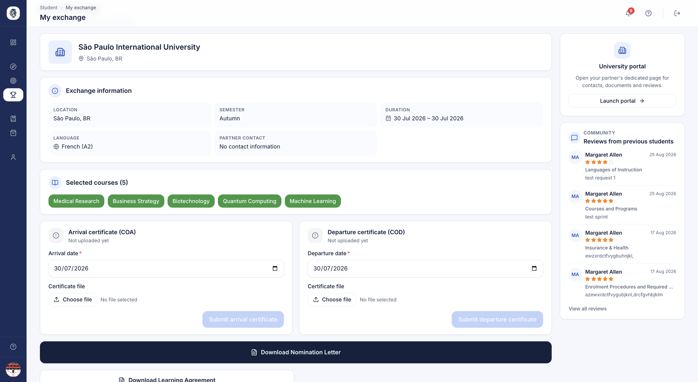
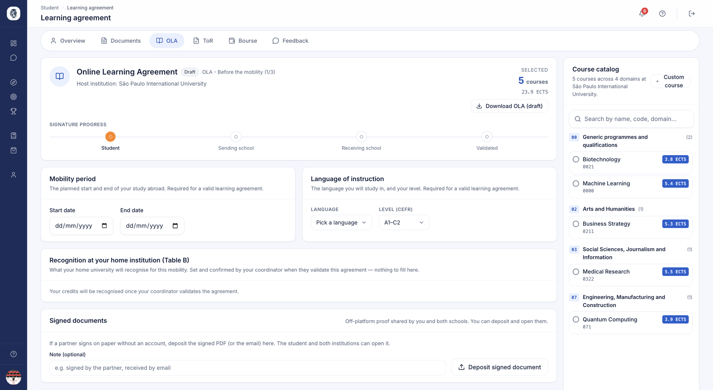

# Student portal — During & after mobility

Once the student is placed, the student portal becomes their control centre for
the mobility itself: tracking the exchange, the learning agreement (OLA), the
transcript of records, attestations, resources, services, and direct
communication with the international relations office. The goal stays the same:
student autonomy and peace of mind for the international office.

## My exchange

**What it's for.** The page of their mobility, once a destination is in sight: what is
settled, what is left to do, and whom to write to.

**Who it's for.** student

**How it works.** As long as the place is not confirmed, the page says so plainly — a
**reserved** place is not a **confirmed** one:

| Situation | What the student reads |
|---|---|
| Place reserved | "A place is held for you" — the host institution still has to confirm |
| Nomination sent | "Nomination sent — awaiting confirmation", with the date it was sent |
| Application declined | "Application declined" — no reason: it stays between the two offices |

Once the mobility is confirmed, the page uses **the same header as the file you read on your
side** — city, country, agreement framework, period, actual dates, tasks done — then their
to-do. On the right: the **partner contact** to write to, and **reviews** from students who
went before.

Documents are neither uploaded nor downloaded here: arrival and departure certificates are
uploaded in **My profile ▸ Documents**, and what you hand them arrives in **What I receive**.
The to-do tasks take them there.

*The page of their mobility: the header, the to-do by phase, the partner contact and reviews from previous students.*

**Use case.**
> A nominated student reads "Nomination sent — awaiting confirmation"; three weeks later
> the host confirms and their to-do appears, with the contact to write to about housing.

### Their task list

**How it works.** The page carries **the to-do of their mobility**: the steps of the
[path](../etablissement/parcours.md) their institution has plugged in, in order, sorted by
phase — before, during, after. Each step says what is expected of them. It is the only task
list in their space.

Steps that **reflect something done elsewhere** tick themselves without them stepping in:
a learning agreement signed by all three parties, a validated document, a grant payment.
They also untick if the act is reversed — a withdrawn signature reopens the step.

The submit button is only active **when there is something to submit**, and their
profile-completion gauge disappears once it reaches 100%.

**The destination's services** sit under the to-do: housing, insurance and support offered
where they are going.

### What they receive, and when

**How it works.** The block of documents to receive only shows **what has actually been
handed to them**: a transcript or certificate still being produced is not shown half-made,
and a document only opens once validated.

Their [agenda](../etablissement/agenda.md) is the **dated timeline** of their mobility,
from the first wish to the closing, sorted into overdue, upcoming and past.

!!! info "The type of their place, in their own words"
    The student reads the type of their place in plain language — a bilateral agreement
    reads as "Exchange" — rather than in the vocabulary of agreements.

## Learning agreement (OLA)

**What it's for.** The student builds their online learning agreement (OLA) by choosing
courses from the host institution's catalogue, submits it, then updates it during their
mobility if their courses change.

**Who it's for.** student

**How it works.**

- **Building it.** They tick courses in the partner's catalogue, grouped by field, and see
  the ECTS total. A course missing from the catalogue can be **added**, then ticked. They
  also enter their mobility dates and the language of instruction with its level.
- **Saving or submitting.** The draft can be saved at any time. Submitting requires at least
  one course, valid dates and the language of instruction — the screen says what is missing
  before sending — and counts as their signature: the agreement moves to "Selected by
  student" and can no longer be edited until their coordinator responds.
- **Changing it during the mobility.** A validated agreement reopens through an **amendment
  request**, which goes back for validation by both institutions. Changing courses resets
  the signatures already given: nobody validates an outdated version.
- **Documents signed off-platform.** A **Signed documents** block collects signed versions
  exchanged outside the [EWP](../ewp/ewp.md) network; the student and both institutions can
  deposit and open them.
- **Downloading.** The PDF can be downloaded at any time: a **draft** until all three
  signatures are in, the validated version after that.

*The learning agreement: signature progress, the mobility period, the language of instruction, recognition at home, and the partner's course catalogue with credits.*

**Use case.**
> A student picks 6 courses (30 ECTS) and submits their OLA. Once there, a course is
> cancelled: they tick another one and send an amendment request, which both institutions
> validate again.

## Transcript of Records

**What it's for.** After mobility, the student records the grades obtained for
each OLA course, chooses the grading system, optionally uploads the official
transcript and submits it for validation by their institution. This is what
closes the academic loop of the exchange.

**Who it's for.** student

**How it works.** The page requires an approved affectation and an existing OLA.
It shows the OLA courses, transcript statistics, the grading systems, an upload
form and the history. On submission, the portal checks that each course has a
valid grade for the chosen system, records the grades, uploads the official
transcript where applicable, then records the transcript with the status
"Pending institution validation".

**Use case.**
> A returning student enters the ECTS grades for their 6 courses, uploads the
> host institution's official transcript, and submits for validation.

## Resources

**What it's for.** A library where the student finds the documents and guides
their institution has published for outgoing students (handbooks, checklists,
pre-departure information).

**Who it's for.** student

**How it works.** The page lists the institution's files intended for the
"outgoing" audience. It stays empty if no home institution is available for the
student.

**Use case.**
> A student downloads their institution's Erasmus pre-departure guide.

## Services

**What it's for.** A marketplace of third-party services (housing, insurance,
banking…) offered to students, shown only when the institution has enabled the
marketplace.

**Who it's for.** student

**How it works.** Access is conditional on the institution enabling the
marketplace. Offers are shown for information, sorted by category, with a link to
the provider and, where applicable, a promo code and the benefit it unlocks.
Students can save an offer to their favourites to find it again later. No payment
happens in AroundLink: to subscribe, the student is redirected to the partner's
website.

**Use case.**
> A student saves two insurance offers to their favourites, compares them, then
> completes the subscription directly on the provider's site with the promo code
> shown.

## Messaging with the international relations office

**What it's for.** Built-in messaging lets the student have one-to-one exchanges
with their international relations office / coordinator, with an inbox, message
threads, replies and an unread-messages badge.

**Who it's for.** student / coordinator

**How it works.** The inbox lists the conversations; opening a thread marks it as
read; replying sends a message. A "New message" screen presents the reachable
recipients, and starting a conversation checks that the student may indeed
contact that recipient before creating the thread. A counter feeds the
unread-messages badge.

**Use case.**
> A student writes to their coordinator about a missing document, and sees the
> reply with an unread badge on their next login.

## Notifications

**What it's for.** A built-in notification feed keeps the student informed of the
events in their journey (offers, validations, messages), with read-on-open, a
"mark all as read" action and a live unread counter.

**Who it's for.** student

**How it works.** The page lists the most recent notifications; opening one marks
it as read and takes the student to the screen concerned; "Mark all as read" processes
the whole set. A counter feeds the badge.

**Use case.**
> A student receives a notification that their OLA has been validated and clicks
> through to see the details.

