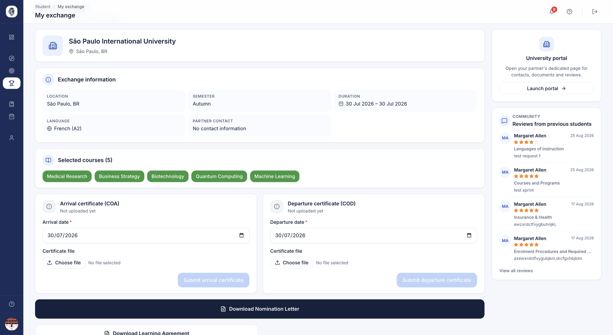
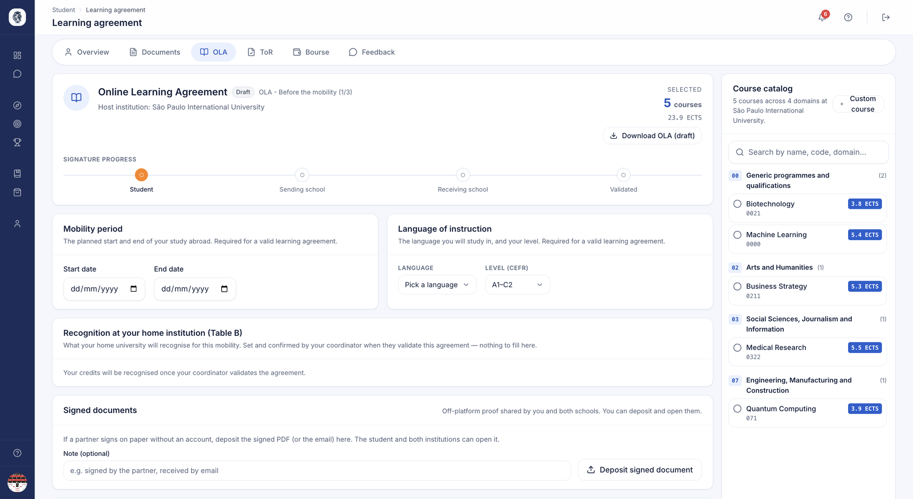

# Espace étudiant — Pendant & après la mobilité

Une fois l'étudiant placé, l'espace étudiant devient son poste de pilotage pour
la mobilité elle-même : suivi de l'exchange, contrat pédagogique (OLA), relevé
de notes, attestations, ressources, services, et communication directe avec le
bureau des relations internationales. L'objectif reste le même : autonomie de
l'étudiant et sérénité pour le gestionnaire RI.

## Mon exchange

**À quoi ça sert.** La page de sa mobilité, une fois une destination en vue : ce qui est
acquis, ce qui reste à faire, et à qui écrire.

**Pour qui.** étudiant

**Comment ça marche.** Tant que la place n'est pas confirmée, la page le dit sans détour —
une place **réservée** n'est pas une place **confirmée** :

| Situation | Ce que lit l'étudiant |
|---|---|
| Place réservée | « A place is held for you » — l'établissement d'accueil doit encore confirmer |
| Nomination envoyée | « Nomination sent — awaiting confirmation », avec la date d'envoi |
| Candidature déclinée | « Application declined » — sans motif : il reste entre les deux bureaux |

Une fois la mobilité confirmée, la page reprend **le même en-tête que la fiche que vous
lisez de votre côté** — ville, pays, cadre de l'accord, période, dates réelles, tâches
faites — puis sa to-do. À droite : le **contact du partenaire**, à qui écrire, et les
**avis** des étudiants partis avant lui.

Les documents ne se déposent ni ne se téléchargent ici : ses attestations d'arrivée et de
départ se déposent dans **My profile ▸ Documents**, et ce que vous lui remettez arrive dans
**What I receive**. Les tâches de la to-do l'y conduisent.

*La page de sa mobilité : l'en-tête, la to-do par phase, le contact du partenaire et les avis des étudiants précédents.*

**Cas d'usage.**
> Un étudiant nominé lit « Nomination sent — awaiting confirmation » ; trois semaines plus
> tard, l'accueil confirme et sa to-do apparaît, avec le contact à qui écrire pour le logement.

### Sa liste de tâches

**Comment ça marche.** La page porte **la to-do de sa mobilité** : les étapes du
[parcours](../etablissement/parcours.md) que son établissement a branché, dans l'ordre,
rangées par phase — avant, pendant, après. Chaque étape dit ce qui est attendu de lui.
C'est la seule liste de tâches de son espace.

Les étapes qui **reflètent un acte fait ailleurs** se cochent sans qu'il intervienne :
un contrat pédagogique signé par les trois parties, un document validé, un versement de
bourse. Elles se décochent aussi si l'acte revient en arrière — une signature retirée
rouvre l'étape.

Le bouton de soumission n'est actif **que s'il y a quelque chose à soumettre**, et la
jauge de complétude de son profil disparaît quand il atteint 100 %.

**Les services de la destination** figurent sous la to-do : logement, assurance et
accompagnement proposés sur le lieu où il part.

### Ce qu'il reçoit, et quand

**Comment ça marche.** Le bloc des documents à recevoir ne montre que **ce qui lui a
réellement été remis** : un relevé ou une attestation en cours de production ne lui est
pas présenté à moitié fait, et un document ne s'ouvre qu'une fois validé.

Son [agenda](../etablissement/agenda.md) est la **frise datée** de sa mobilité, du
premier vœu à la clôture, rangée en en retard, à venir et passé.

!!! info "Le type de sa place, dans ses mots"
    L'étudiant lit le type de sa place en langage courant — un accord bilatéral se lit
    « Exchange » — plutôt que dans le vocabulaire des accords.

## Contrat pédagogique (OLA)

**À quoi ça sert.** L'étudiant construit son contrat pédagogique en ligne (Learning
Agreement, OLA) en choisissant ses cours dans le catalogue de l'établissement d'accueil,
le soumet, puis le fait évoluer pendant sa mobilité si ses cours changent.

**Pour qui.** étudiant

**Comment ça marche.**

- **Composer.** Il coche ses cours dans le catalogue du partenaire, regroupés par domaine,
  et voit le total d'ECTS. Un cours absent du catalogue peut être **ajouté**, puis coché.
  Il renseigne aussi ses dates de mobilité et la langue d'enseignement avec son niveau.
- **Enregistrer ou soumettre.** Le brouillon s'enregistre à tout moment. La soumission
  demande au moins un cours, des dates valides et la langue d'enseignement — l'écran dit ce
  qui manque avant d'envoyer — et vaut sa signature : le contrat passe à « Sélectionné par
  l'étudiant » et n'est plus modifiable tant que son coordinateur n'a pas répondu.
- **Modifier pendant la mobilité.** Un contrat validé se rouvre par une **demande de
  modification**, qui repart en validation auprès des deux établissements. Modifier les
  cours remet à zéro les signatures déjà apposées : personne ne valide une version périmée.
- **Les pièces signées hors plateforme.** Un bloc **Signed documents** recueille les
  versions signées échangées en dehors du réseau [EWP](../ewp/ewp.md) ; l'étudiant et les
  deux établissements peuvent y déposer et ouvrir.
- **Télécharger.** Le PDF se télécharge à tout moment : **brouillon** tant que les trois
  signatures ne sont pas réunies, version validée ensuite.

*Le contrat pédagogique : l'avancement des signatures, la période de mobilité, la langue d'enseignement, la reconnaissance chez soi, et le catalogue de cours du partenaire avec leurs crédits.*

**Cas d'usage.**
> Un étudiant choisit 6 cours (30 ECTS) et soumet son OLA. Arrivé sur place, un cours est
> supprimé : il en coche un autre et envoie une demande de modification, que les deux
> établissements revalident.

## Relevé de notes (Transcript of Records)

**À quoi ça sert.** Après la mobilité, l'étudiant enregistre les notes obtenues
pour chaque cours de l'OLA, choisit le système de notation, téléverse
éventuellement le relevé officiel et le soumet pour validation par son
établissement. C'est ce qui referme la boucle académique de l'exchange.

**Pour qui.** étudiant

**Comment ça marche.** La page nécessite une affectation approuvée et un OLA
existant. Elle affiche les cours de l'OLA, des statistiques de relevé, les
systèmes de notation, un formulaire de téléversement et l'historique. À la
soumission, l'espace vérifie que chaque cours a une note valide pour le système
choisi, enregistre les notes, téléverse le cas échéant le relevé officiel, puis
enregistre le relevé au statut « En attente de validation par l'établissement ».

**Cas d'usage.**
> Un étudiant de retour saisit les notes ECTS de ses 6 cours, téléverse le relevé
> officiel de l'établissement d'accueil, et soumet pour validation.

## Ressources

**À quoi ça sert.** Une bibliothèque où l'étudiant trouve les documents et guides
que son établissement a publiés pour les étudiants sortants (livrets, listes de
contrôle, informations pré-départ).

**Pour qui.** étudiant

**Comment ça marche.** La page liste les fichiers de l'établissement destinés au
public « sortant ». Elle reste vide si aucun établissement de rattachement n'est
disponible pour l'étudiant.

**Cas d'usage.**
> Un étudiant télécharge le guide pré-départ Erasmus de son établissement.

## Services

**À quoi ça sert.** Une place de marché de services tiers (logement, assurance,
banque…) proposés aux étudiants, affichée uniquement lorsque l'établissement a
activé la marketplace.

**Pour qui.** étudiant

**Comment ça marche.** L'accès est conditionné à l'activation de la marketplace
par l'établissement. Les offres sont présentées à titre informatif, classées par
catégorie, avec un lien vers le prestataire et, selon les cas, un code promo et
l'avantage associé. L'étudiant peut mettre une offre en favori pour la retrouver
plus tard. Aucun paiement n'a lieu dans AroundLink : pour souscrire, l'étudiant est
redirigé vers le site du partenaire.

**Cas d'usage.**
> Un étudiant met deux offres d'assurance en favori, compare, puis finalise sa
> souscription directement sur le site du prestataire avec le code promo indiqué.

## Messagerie avec le bureau des relations internationales

**À quoi ça sert.** Une messagerie intégrée permet à l'étudiant d'échanger en
tête-à-tête avec son bureau des relations internationales / coordinateur, avec
boîte de réception, fils de discussion, réponses et badge de messages non lus.

**Pour qui.** étudiant / coordinateur

**Comment ça marche.** La boîte de réception liste les conversations ; ouvrir un
fil le marque comme lu ; répondre envoie un message. Un écran « Nouveau message »
présente les destinataires joignables, et démarrer une conversation vérifie que
l'étudiant peut bien contacter ce destinataire avant de créer le fil. Un
compteur alimente le badge de messages non lus.

**Cas d'usage.**
> Un étudiant écrit à son coordinateur pour une question sur un document manquant,
> et voit la réponse avec un badge de non-lu à sa prochaine connexion.

## Notifications

**À quoi ça sert.** Un fil de notifications intégré tient l'étudiant informé des
événements de son parcours (propositions, validations, messages), avec lecture à
l'ouverture, une action « tout marquer comme lu » et un compteur de non-lus en
direct.

**Pour qui.** étudiant

**Comment ça marche.** La page liste les notifications les plus récentes ; ouvrir
l'une d'elles la marque comme lue et conduit à l'écran concerné ; « Mark all as read »
traite l'ensemble. Un compteur alimente le badge.

**Cas d'usage.**
> Un étudiant reçoit une notification lui indiquant que son OLA a été validé et
> clique pour en voir le détail.

